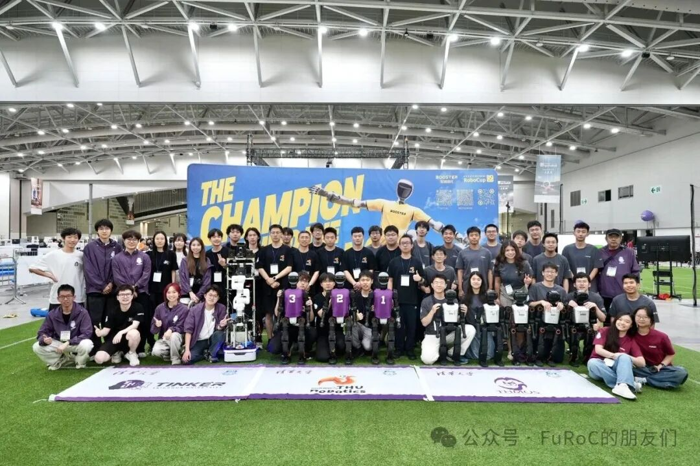
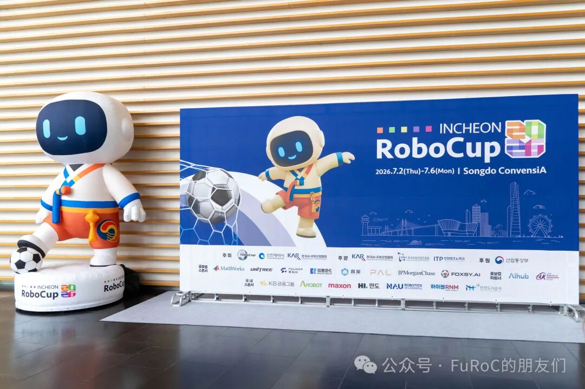
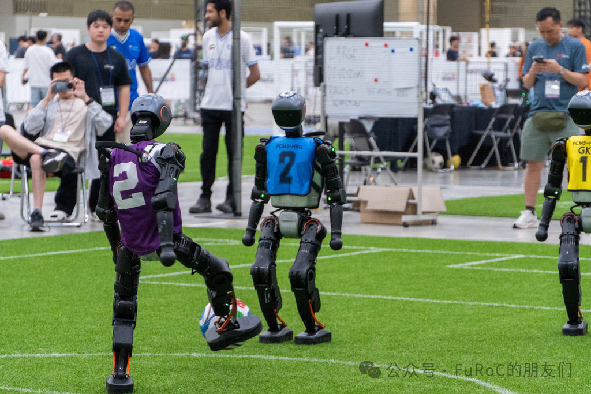
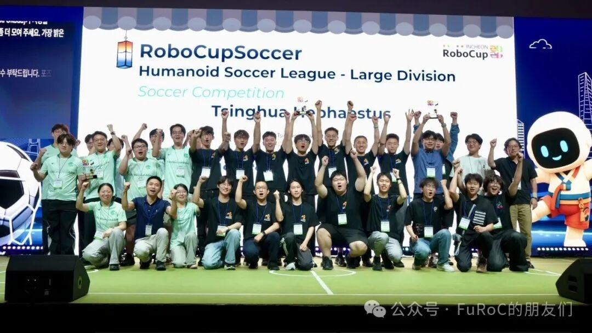
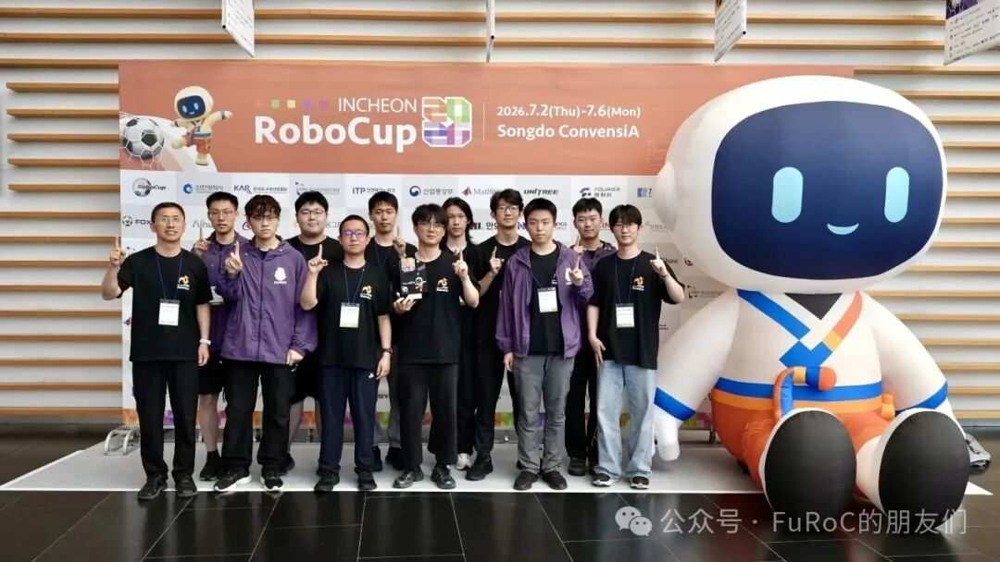
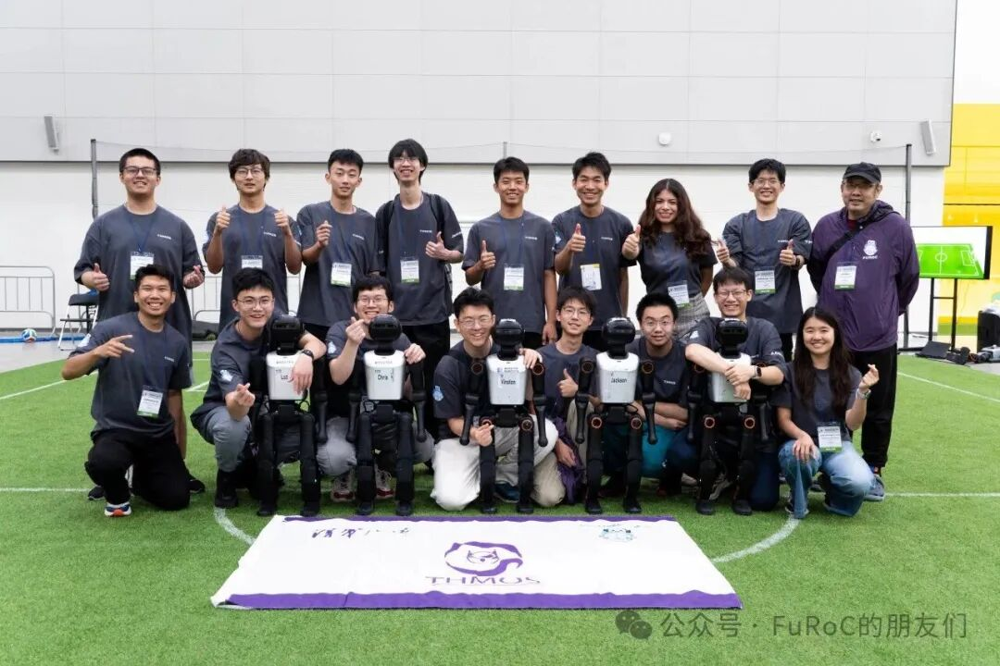
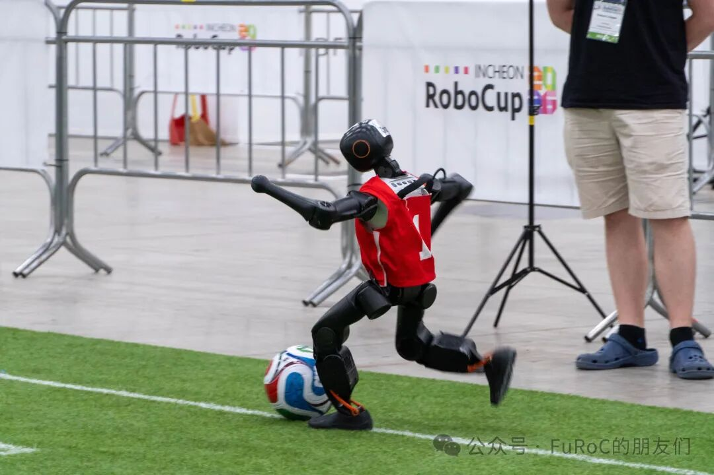
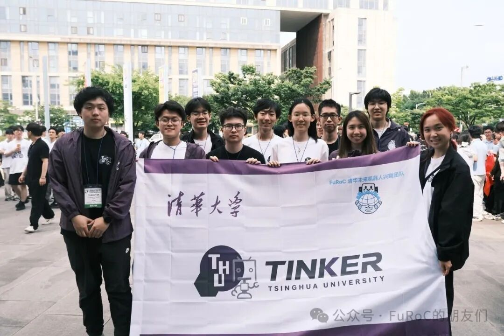
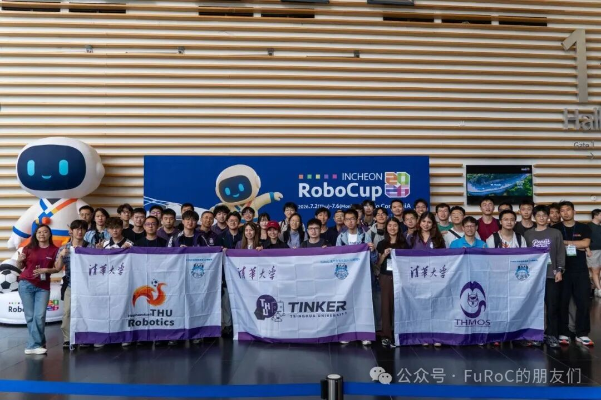

# 1冠1八强1第11 清华大学未来机器人兴趣团队征战仁川2026机器人世界杯

> 公众号: FuRoC的朋友们
> 发布时间: 2026-07-08 11:39:57
> 原文链接: https://mp.weixin.qq.com/s/XgzosAzs9Oy-qFXd_u2qHg

---

RoboCup

TSINGHUA FUROC · INCHEON RoboCup 2026

**清华力量 智竞仁川**

以工程实力，赴世界之约

7月6日，2026机器人世界杯（RoboCup）在韩国仁川松岛会展中心圆满落幕。清华大学未来机器人兴趣团队(FuRoC)派出三支代表队参赛——清华火神队强势卫冕人形机器人足球大型组世界冠军，THMOS队闯入足球中型组八强、小型组十六强，Tinker队在服务机器人赛场上最终位列第11名。

**01**

**赛事背景**

会场图片

机器人世界杯(RoboCup)诞生于1997年，其终极目标是：到2050年，建立一支完全自主的人形机器人队伍，在真实球场上击败当年的人类世界杯冠军球队。近三十年间，它已从最初的机器人足球，扩展为涵盖救援、家庭服务机器人(@Home)等多个联赛的全球机器人与人工智能科技盛会。

2026年，RoboCup首次来到韩国，于6月30日至7月6日在仁川松岛会展中心举行。本届赛事规模创下历史之最：共吸引来自 45 个国家和地区的 364 支队伍、约 2879 名选手参赛，参赛人数约为上一届的 1.9 倍。

本届赛事，中国高校军团表现活跃——其中仅人形机器人足球(Humanoid Soccer League)的三个组别，就有15支中国队伍入选。

**02**

分队战报

火神队(Large Division)

全程不败，

成功卫冕世界冠军

火神队由清华大学自动化系赵明国研究员于 2004 年创立，是国内最早投身 RoboCup 人形机器人足球的队伍之一。2025 年，球队曾接连斩获 RoboCup 人形组冠军、全球首届世界人形机器人运动会 5V5 足球赛冠军等多项国际殊荣。作为卫冕冠军，火神队在最受瞩目的人形机器人足球大型组比赛中保持全胜，成功卫冕 2026 机器人世界杯人形机器人Large组冠军。

● 积分循环赛中：清华火神队保持全胜，22支队伍排位第一；

● 八分之一决赛：以 9:1 战胜澳门 PCMS-HRG 队，顺利跻身八强；

● 四分之一决赛：以 8:0 完成零封巴西Bahia Robotics队，昂首闯入四强；

● 半决赛：与北京信息科技大学 Water 队狭路相逢，凭借稳健攻防以 5:0 胜出，提前锁定决赛资格；

决赛：再度与老对手中国农业大学 CAU 山海队会师。上半场双方一度战成1:1，场面胶着；易边再战，火神队彻底打开局面，下半场连入5球、最终以6:2力克对手夺冠。

    火神队比赛现场照片(球员/机器人对抗)

Humanoid Soccer League - Large Division 颁奖／清华火神队与大型组亚军、季军合影

本次比赛，球队的主要技术特点包括：

● 强化学习步态的全面应用：在原有基础上全面升级步态体系，提升机器人行走速度、出脚速度与定向踢球能力，其中去年的“大脚踢球”步态经进一步改进后更高效、更精准。

● 仿真驱动的快速迭代机制：通过自研仿真平台在场下复现问题、验证策略，实现高频迭代。

此次仁川卫冕，标志着火神队在世界人形机器人足球舞台上稳稳站在了领跑者的位置。

清华火神队合影(Incheon RoboCup 背景板)

THMOS队

(Small & Middle Division)

**双线作战，**

**闯入 Middle 组八强**

由机械系李曙光副教授、李啟文工程师担任指导教师的清华大学 THMOS 机器人足球队，本届同时征战 Small 组与 Middle 组，经过多轮正赛、入围赛与淘汰赛的连续考验，最终取得 Small 组十六强、Middle 组八强 的成绩。

赛前系统优化：本届比赛前，THMOS 队围绕机器人步态稳定性、视觉识别、球场定位、多机通信和攻防策略进行了系统优化——调整踢球动作、优化射门角度；扩大视觉训练数据规模、更新视觉模型、优化步态里程计以提高复杂状态下的定位精度；并进一步完善多机器人通信与动态角色分工，使机器人能根据场上局势、球权变化和自身位置进行角色切换，提升攻防衔接效率。此外，由于今年赛制与参赛组别变化，Small 组首次启用全新机器人本体，也对队伍的平台适配、算法迁移与现场调试能力提出了更高要求。

THMOS 队合影

Middle 组闯入八强：Middle 组比赛中，THMOS 重点检验视觉识别、球场定位、多机通信、动态角色分配与进攻决策等核心技术。对阵 RFC-Tsudanuma 时，队伍开赛十秒内即攻入首球，迅速掌握节奏；机器人 Oscar 与 Jackson 打出流畅配合，Oscar 更从门前侧面连进两球，最终以 6:0 强势取胜。四分之一决赛迎战法国强队 Rhoban FC，THMOS 先后打出四次远距离精准射门，每一次攻势都极具威胁；虽最终止步八强，但这场比赛充分检验了队伍在真实高强度环境下的进攻创造力、决策执行力与临场抗压能力。

射门瞬间

技术实力小结：本届比赛是 THMOS 队技术积累的一次集中检验。Small 组在全新平台上完成了从适配、调试到实战的完整闭环；Middle 组则在多场高质量对抗中不断修正问题、提升配合，最终闯入八强，展现出扎实的工程能力与快速迭代的现场作战素养。

Tinker队(@Home)

**一度冲进全球前五，**

**最终位列第 11**

在家庭服务机器人赛道，Tinker 队全程表现亮眼。@Home 赛道要求机器人在人机交互、物体抓取、通用服务指令理解、衣物整理等真实家庭场景中综合作战，对感知、导航、交互与任务执行提出了极高要求。

整届赛事，Tinker 队始终保持在 RoboCup@Home 积分榜前列，实时排名最高一度冲至全球第五。随着比赛深入，队伍不断刷新自身成绩：Human Robot Interaction Challenge 进步最为显著，成绩由早期的 300 分提升至 630 分，实现翻倍突破；Doing Laundry 同样表现突出，最终取得 391 分，按各队最高成绩计算位列单项第五。进入关键的 Restaurant 加赛前，Tinker 累计 1828.1 分，位列总榜第六。

Restaurant 是本届最具挑战的单项——比赛现场随机抽取咖啡厅场景，家具布局、光线条件与背景环境几乎全部未知。全队连夜备战、拟定完整方案，前序流程也顺利推进，唯独最后的任务执行未能完整闭环，该单项遗憾未得分；随着身后队伍拿下高分，Tinker 最终位列世界第 11。

Tinker 队合影

技术实力小结：从一度冲进全球前五、单项成绩翻倍突破，到整夜备战关键加赛，Tinker 队已经证明自己有能力在全球最高水平的服务机器人赛场上稳居前列。第 11 名不是终点，却清楚地标记出了从“完成任务”走向“稳定完成未知任务”之间仍需跨越的距离。

**03**

**总结**

仁川之行，清华未来机器人兴趣团队三线出击、各有斩获。火神队在人形机器人足球大型组保持全胜、卫冕世界冠军，稳稳站上世界人形机器人足球的领跑位置；THMOS 队双线作战，在全新平台与激烈对抗中完成从适配到实战的技术闭环，闯入 Middle 组八强、跻身 Small 组十六强；Tinker 队则在家庭服务机器人赛道一度冲进全球前五，最终位列第11名。

三支队伍的表现，既展现了清华学子在人形机器人与具身智能前沿领域的扎实功底，也印证了快速迭代、协同作战的团队实力。冠军是荣誉，遗憾是路标。以赛验技，向强而行——从绿茵场到家庭场景，清华学子正在机器人世界杯的舞台上，一步步靠近那个属于 2050 的宏大愿景。

清华三支代表队／团队成员在仁川的合影

**关于清华大学未来机器人兴趣团队**

清华大学未来机器人兴趣团队（简称“FuRoC”）是在共青团清华大学委员会、清华大学教务处及清华大学具身智能与机器人研究院指导下，由基础训练中心、自动化系与机械系共同支持建设的全校性学生机器人兴趣团队，面向机器人与具身智能方向开展跨学科实践与技术探索。

致谢

感谢共青团清华大学委员会、清华大学教务处及清华大学具身智能与机器人研究院在赛事组织与参赛工作中的支持与指导，为参赛团队提供了良好的资源保障与科研支撑。

感谢火神队赞助方加速进化、俞浩慈善基金会捐赠支持的“天空计划-清华大学专项”对团队长期发展的支持与帮助，为相关技术研发与比赛备赛提供了重要条件保障。

感谢 THMOS 队赞助方小鹏（XPENG）、高擎机电、加速进化在探索与实践过程中给予的支持与协作，助力团队在多赛道竞赛中持续优化与迭代。

感谢 Tinker 队赞助方亿航（EHang）在团队研发与赛场备战过程中给予的鼎力支持。

撰稿 | 刘思彤

摄影 | 南晓璐、许嘉杰

编辑 | 韩赟祯

