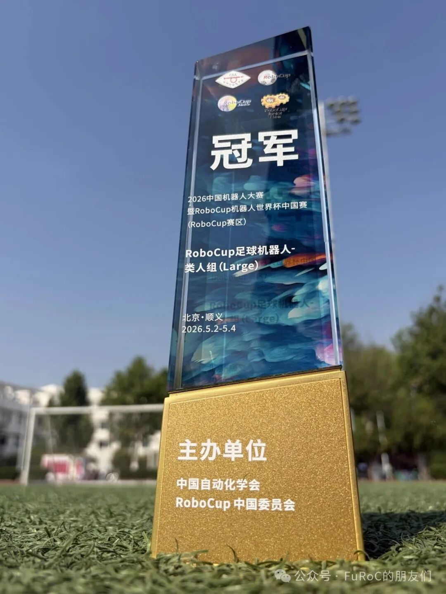
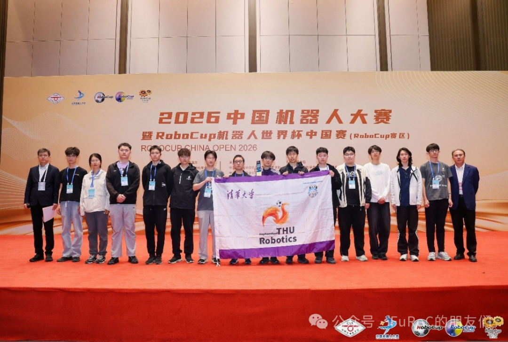
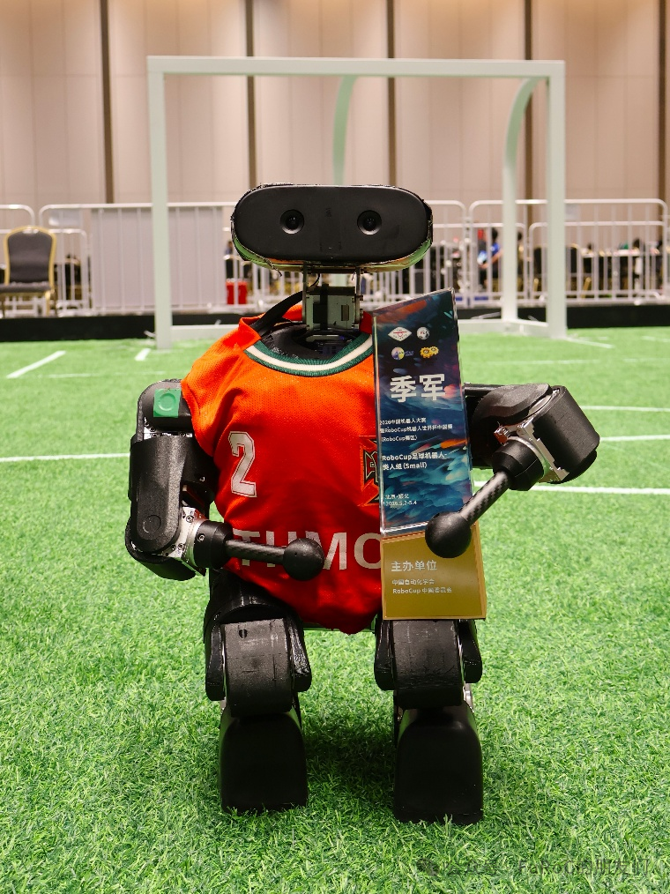
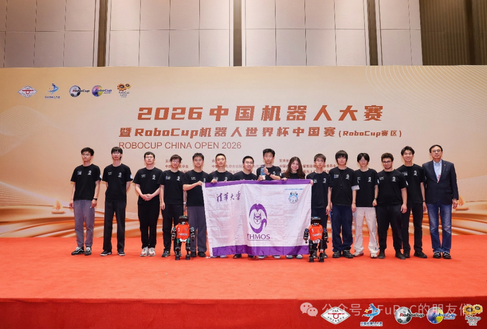
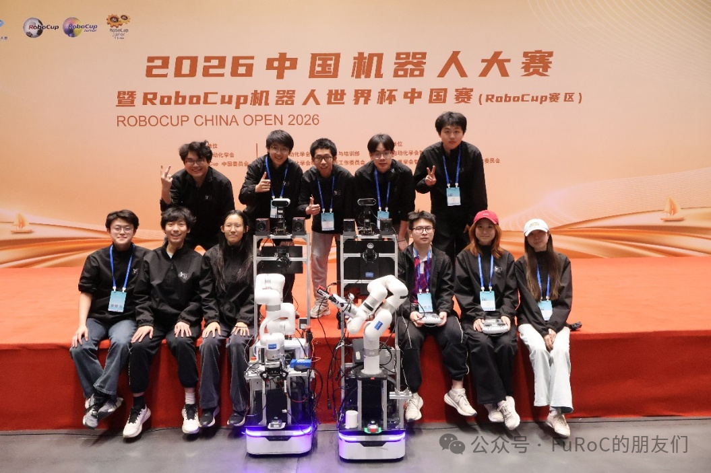

# 1冠1季1第五｜FuRoC在RoboCup中国赛的整体表现

> 公众号: FuRoC的朋友们
> 发布时间: 2026-05-07 10:05:19
> 原文链接: https://mp.weixin.qq.com/s/eZwIYxmcRWOTvteXoqOecQ

---

Part 1

**FuRoC参赛队伍在2026 RoboCup中国赛**

**斩获1冠1季1第五**

2026年5月2日至4日，2026中国机器人大赛暨RoboCup机器人世界杯中国赛在北京首都国际会议中心举行。

作为RoboCup国际体系下的重要区域赛事之一，本届比赛围绕机器人在复杂真实环境中的自主决策与执行能力展开，涵盖足球机器人与RoboCup@Home等核心赛道，是国内机器人与人工智能领域的重要技术交流与竞技平台。

清华未来机器人兴趣团队（FuRoC）派出三支队伍参赛，在多赛道中取得**1项冠军、1项季军与1项第五名**的成绩。

Part 2

**FuRoC参赛整体成绩**

本届赛事中，FuRoC三支参赛队伍成绩如下：

**• 🥇 火神队**

RoboCup足球机器人类人组 Large Size：**冠军**

**• 🥉 THMOS队**

RoboCup足球机器人类人组 Small：**季军**

RoboCup足球机器人类人组 Middle：**第七名**

**• ⭐ Tinker队**

RoboCup @Home：**第五名**

在多赛道并行参赛的体系下，团队在运动控制、系统集成与真实环境适配能力方面完成了阶段性验证，并在不同任务场景中持续优化机器人整体性能。

Part 3

**技术能力总结**

本次参赛中，FuRoC各队围绕机器人系统能力进行了多维度探索与验证，整体技术进展主要体现在以下方面：

**•        低延迟高确定性的系统架构能力**

通过对核心系统架构的重构与优化（如从解释型框架向高性能通信架构演进），显著降低通信与运行时开销，提高系统实时性与稳定性，为高强度对抗提供基础支撑。

**•        多智能体协同决策能力**

基于多机通信实现状态与策略共享，使机器人决策从单机局部优化升级为全队协同优化，在角色分工与战术执行上实现更高一致性。

**•        学习驱动的运动控制能力**

引入强化学习等方法优化步态与动作控制，提高机器人行走速度、动作响应与执行精度，增强在对抗环境中的机动性。

**•        仿真驱动的快速迭代机制**

通过仿真平台进行问题复现与策略验证，形成“仿真—实机”闭环，加速系统迭代与性能优化。

**•        系统级协同与工程化响应能力**

在复杂比赛环境中持续优化感知、决策与执行协同，并通过模块化分工与快速问题定位机制，提高系统鲁棒性与现场适应能力。

Part 4

**RoboCup赛事背景**

RoboCup机器人世界杯是全球机器人与人工智能领域具有重要影响力的国际赛事之一，聚焦机器人在动态复杂环境中的自主决策与协作能力。

中国赛作为其重要区域赛事，是国内高校与科研团队展示机器人系统能力的重要平台。

**FuRoC简介**

清华大学未来机器人兴趣团队（简称“FuRoC” ）是在共青团清华大学委员会、清华大学教务处及清华大学具身智能与机器人研究院指导下，由基础训练中心、自动化系与机械系共同支持建设的全校性学生机器人兴趣团队，面向机器人与具身智能方向开展跨学科实践与技术探索。

**致谢**

感谢共青团清华大学委员会、清华大学教务处、清华大学具身智能与机器人研究院及北奥集团对赛事组织与参赛工作的支持与指导，为团队提供了良好的资源保障与科研支撑。

感谢火神队赞助方加速进化及俞浩慈善基金会捐赠支持的“天空计划-清华大学专项”，为技术研发与备赛提供重要保障。

感谢THMOS队赞助方高擎机电、加速进化、小鹏（XPENG）在探索与实践过程中的支持与协作，助力团队在多赛道竞赛中持续迭代与优化。

**清华大学未来机器人兴趣团队（FuRoC）**

撰写：刘思彤、王鹏

编辑：刘思彤、韩赟祯

审核：李啟文、孙烨清、闫安

