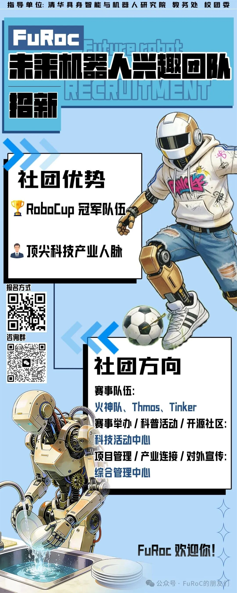
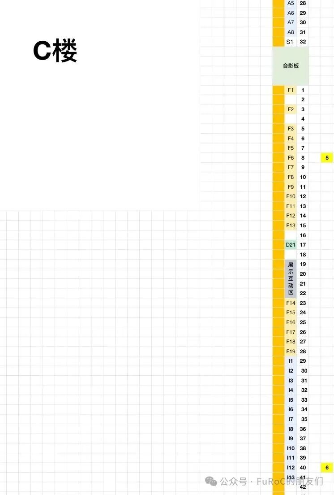

# FuRoc 招新｜加入清华未来机器人兴趣团队

> 公众号: FuRoC的朋友们
> 发布时间: 2026-03-19 15:08:45
> 原文链接: https://mp.weixin.qq.com/s/LVak5OJ_YZ60zKM-PBLRlQ

---

*[#JOIN](javascript:;) US#*

**2026**

**春季**

**FuRoc  招新**

FuRoc

**INTRODUCE**

**你是否对机器人充满兴趣**

**是否想要接触机器人技术前沿**

**是否想参与一项机器人国际赛事**

**学技术、拿大奖**

**……**

**未来机器人兴趣团队**

**招新啦！！！**

**第四周 周四周五(3.19-3.20)百团大战**

**C楼前 F1摊位 等你来看！**

**未来机器人兴趣团队**

FuRoc（Future Robotics Club）清华大学未来机器人兴趣团队聚焦**具身智能与机器人领域**，连接**技术研究、学术创新、产业资源与技术社区**。

我们希望搭建一个面向未来机器人的学生平台，让更多同学在这里接触前沿方向、参与真实项目、连接行业资源，并与一群优秀的人一起做有长期价值的事情。

如果你对**机器人、AI、科技创新、产业协作、社区建设**感兴趣，欢迎加入 FuRoc。

本轮招新，面向两个核心中心与赛事队展开，本文重点介绍两个中心：

**•        科技活动中心**

**•        综合管理中心**

你加入的不只是一个学生社团，

更是一个正在生长中的**机器人生态社区**。

**PART**

**NO.1**

关于 FuRoc

FuRoc 是一个聚焦具身智能与机器人领域的校级学生兴趣团队。

我们面向技术与产业前沿，围绕“技术实践 + 生态构建”开展工作，希望推动校内机器人社区的持续发展。

在这里，我们关注的不只是“做一次活动”，而是：

•        搭建面向未来机器人的技术社区

•        推动技术项目、赛事与科普活动落地

•        连接校内外老师、同学、企业与行业资源

•        沉淀可持续复用的组织机制与技术成果

我们希望把 FuRoc 打造成一个兼具**技术深度、组织能力、产业连接与长期生命力**的学生平台。

**PART**

**NO.2**

本次招新开放的

两个核心中心

科技活动中心

科技活动中心是 FuRoc 负责科技活动策划与执行的核心组织，面向具身智能领域，承担三类关键工作：

**•        赛事组织**

**•        科普活动**

**•        开源社区建设**

中心以**“技术实践 + 生态构建”**为核心，连接校内学生、老师与外部资源，推动社团形成长期可持续的活动体系与技术积累

这里是科技活动中心首次系统化招新、首次从 0 到 1 搭建团队机制。

你加入的不只是一个执行团队，更是一个共同搭建活动品牌、组织机制与技术生态的核心团队。

**科技活动中心下设三大部门**

**•        科创赛事部**

**•        科普活动部**

**•        开源社区部**

**① 科创赛事部｜招新约 10 人**

部门定位

负责具身智能领域相关赛事的策划、组织与落地，推动赛事标准化、品牌化与持续运行，逐步形成有清华特色的学生竞赛体系。

主要工作

•        设计赛事主题、赛制与评审流程

•        统筹报名、宣讲、培训、比赛日执行等环节

•        对接场地、评委、合作资源

•        完成赛后复盘与资料沉淀整合

我们希望你

•        有责任心和执行力，能按时间节点推进任务

•        对机器人领域有一定兴趣与了解

•        乐于沟通协作，愿意参与统筹、协调与现场执行

•        有活动组织、学生工作经验或竞赛经历优先

**② 科普活动部｜招新约 6 人**

部门定位

面向校内同学开展具身智能的产业通识与技术降维活动，帮助更多人以较低门槛进入机器人领域，提升社团认知度、参与度与影响力。

我们特别欢迎这样的人加入

•        对科技行业感兴趣，但不一定是纯研发方向

•        想了解 AI / 机器人产业与技术趋势

•        希望找到进入科技行业、产品、运营、投资等方向的切入点

•        愿意做“把复杂技术讲清楚、让更多人参与”的事

主要工作

•        策划讲座、分享会、workshop、体验活动等

•        将专业内容转化为生动、易参与、有影响力的校园活动

•        与其他部门联合组织面向新手的入门活动

•        负责活动执行与反馈收集

•        建立并完善社团知识库与活动标准化流程

我们希望你

•        有较强的跨领域学习能力

•        愿意做技术传播与活动策划工作

•        具备良好的沟通协作、统筹规划与执行能力

•        有内容创作、主持、宣发、设计等经验优先

•        有基本时间观念与契约精神

**③ 开源社区部｜招新约 5 人**

部门定位

负责社团开源社区治理与技术资产运营，以开源协作为核心，沉淀可复用的代码、文档与规范，支撑社团长期能力建设。

主要工作

•        建设和维护代码仓库、文档体系与协作规范

•        推动技术资料沉淀，如教程、README、模板、项目说明等

•        组织开源共创与协作机制，促进成果复用与传播

我们希望你

•        认可开源协作与长期建设的价值

•        愿意做技术沉淀与规范化工作

•        具备基础技术能力即可（代码、文档、工具链、项目协作任一方面）

•        有 Git/GitHub、技术项目或技术文档经验优先

•        即使经验不多，只要你对开源社区有兴趣、愿意学习，也欢迎加入

综合管理中心

综合管理中心是 FuRoc 的运营核心与资源枢纽。

我们负责推动社团项目与活动顺利落地，为 FuRoc 的赛事、科普活动和技术项目提供持续支持。

你可以把它理解为：

FuRoc 的运营引擎 + 资源枢纽

**综合管理中心连接：**

**•        项目推进**

**•        产业资源**

**•        品牌传播**

**•        组织协作**

通过整合资源与搭建机制，帮助 FuRoc 的技术社区、赛事活动和产业合作长期发展。

在这里，你不仅是在参与社团工作，更是在参与一个机器人生态社区的建设。

**综合管理中心下设四大部门**

**•        项目部**

**•        财务部**

**•        联络部**

**•        宣传部**

**① 项目部｜招新 6 人**

部门定位

项目部负责 FuRoc 整体项目的管理与支持，

是连接 科技活动中心、技术项目与外部合作 的核心中枢。

我们不直接负责某一个具体项目，

而是通过机制与协同，让 所有项目更高效、有序地运转和落地。

主要工作

•        梳理 FuRoc 各类项目（赛事 / 活动 / 技术 / 合作），建立项目台账

•        跟进项目进度与关键节点，推动项目按计划落地

•        协调科技活动中心及各部门之间的协作与资源分配

•        搭建项目流程与管理机制（立项 / 执行 / 复盘）

•        沉淀项目经验与成果（文档、模板、方法论），提升组织效率

我们希望你

•        对项目管理、组织协作或团队运作有兴趣

•        具备基本的逻辑能力与结构化思维

•        做事靠谱，有执行力和时间观念

•        善于沟通，能推动不同人一起把事情做成

•        愿意投入时间参与长期建设

**② 财务部｜招新 2 人**

部门定位

财务部负责 FuRoc 的经费管理与资源保障，为社团活动与项目提供稳定、规范的运营支持。

主要工作

•        活动预算制定与管理

•        经费报销与财务核算

•        物资采购与资产管理

•        社团财务记录与规划

我们希望你

•        做事细心、负责

•        具备良好的执行力与规范意识

•        对组织管理或财务管理感兴趣

**③ 联络部｜招新 6 人**

部门定位

联络部负责 FuRoc 的内外部连接：一方面增强团队内部凝聚力，另一方面推动社团与企业、科研机构和行业伙伴建立合作关系。

主要工作

外联方向

•        对接企业与机构合作资源

•        邀请嘉宾与合作伙伴参与活动

•        推动机器人产业合作项目

•        维护社团合作伙伴关系

内联方向

•        组织社团内部交流活动

•        促进不同部门成员之间的熟悉与合作

•        活跃社团氛围，增强团队凝聚力

我们希望你

•        善于沟通表达

•        对科技产业或创业生态感兴趣

•        乐于拓展资源与建立合作

**④ 宣传部｜招新 6 人**

部门定位

宣传部负责 FuRoc 的品牌建设与内容传播，提升社团在机器人领域的影响力。

主要工作

•        社团品牌与内容运营

•        活动宣传与科技内容制作

•        新媒体平台运营

•        社团视觉与宣传物料设计

我们希望你

•        对内容创作 / 设计 / 新媒体运营感兴趣

•        有一定创意表达能力

•        愿意参与社团品牌建设

**PART**

**NO.3**

可以获得什么

无论加入综合管理中心还是科技活动中心，你都将有机会获得：

**1）参与机器人领域最活跃的学生技术社区之一**

结识来自不同院系、不同方向的优秀同学，与技术团队、科研团队、创业团队共同协作。

**2）参与真实的科技活动与机器人项目**

包括但不限于：

•        机器人赛事

•        技术论坛

•        科普活动

•        产业交流

•        技术社区建设

•        项目共建与开源协作

**3）建立机器人领域的人脉网络**

接触：

•        创业者

•        工程师

•        科研团队

•        企业伙伴

•        行业嘉宾

•        投资与产业资源

**4）提升面向真实世界的能力**

包括：

•        项目管理

•        商务沟通

•        组织协作

•        资源整合

•        内容传播

•        社群运营

•        技术生态理解

**5）沉淀可展示、可积累的成果**

你参与的不只是一次活动，而是可以被持续沉淀的成果：

•        活动方案

•        赛事体系

•        项目经验

•        文档知识库

•        开源仓库

•        品牌内容

•        组织履历

**PART**

**NO.4**

关于 FuRoc

欢迎所有专业同学加入。

无论你来自：

**自动化｜机械｜计算机｜经管｜设计｜人文社科**

只要你：

•     对机器人 / AI / 科技创新感兴趣

•     有责任心与执行力

•     愿意参与团队协作

•     愿意学习、愿意成长、愿意一起把事情做成

•     希望在大学里做一些真正有意义、有积累的事情

FuRoc 都欢迎你。

**PART**

**NO.5**

招新流程

报名 → 宣讲 / 交流 → 面试 → 录取

本轮招新将进行筛选，优先录取：

•        愿意长期参与的同学

•        有投入意愿与行动力的同学

•        认同 FuRoc 共建理念的同学

如有兴趣，欢迎填写报名表并加入招新群，了解更多招新安排与后续通知

报名表

招新群

**THE END**

