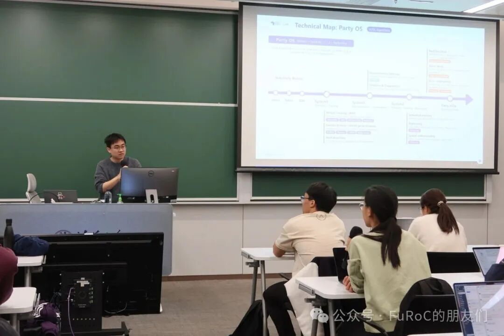
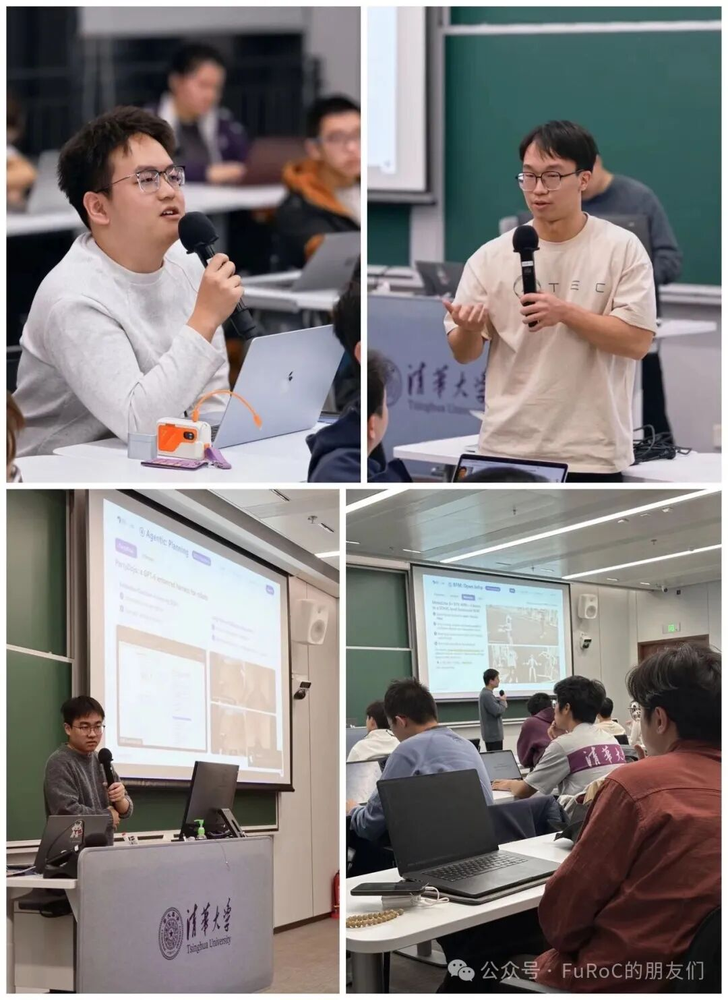
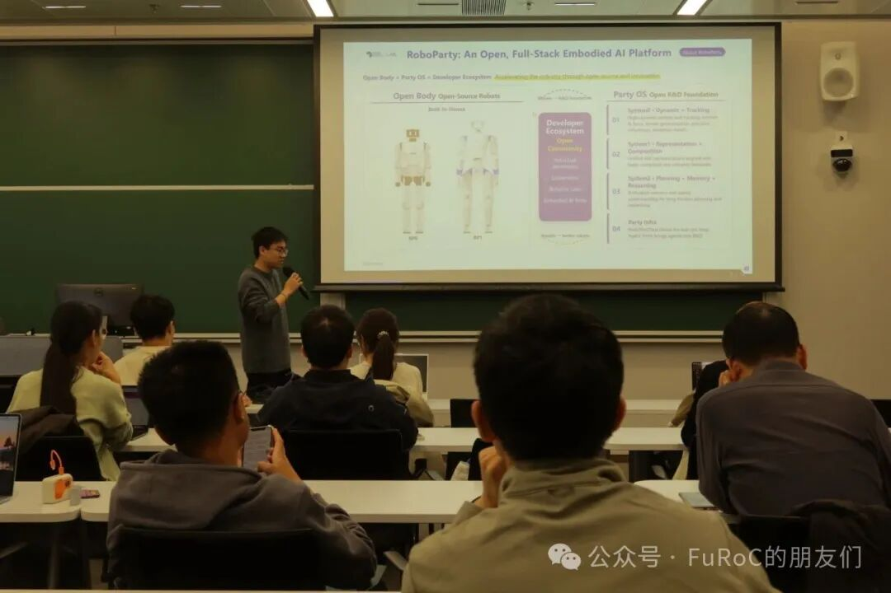
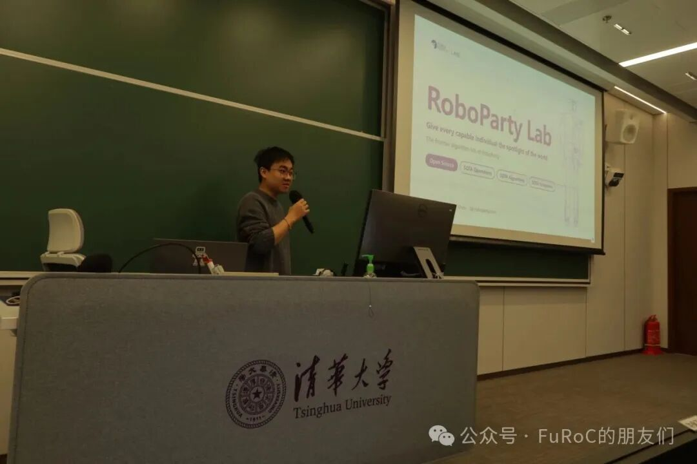
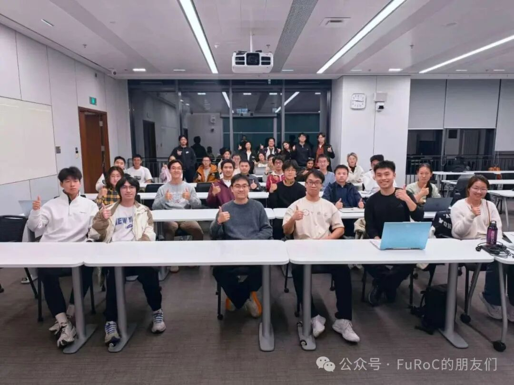

# 「40 岁的人创业，一定不会选择开源」RoboParty Lab 沈尧杰的具身判断

> 公众号: FuRoC的朋友们
> 发布时间: 2026-11-09 10:18:32
> 原文链接: https://mp.weixin.qq.com/s/lK3n8iq-7exr9bkEriClYQ

---

FuRoc科技活动中心     2026/10

**先划重点**

• 最值钱的数据，只能在真实世界里「做」出来；

• 小脑不需要泛化轨迹本身，只需要泛化到动力学；

• 人形机器人有用，下一阶段主要是小脑和上层的接口问题；

• 落地要等三个拐点：agent harness、空间理解与记忆、一个能落地的小脑；

• 「如果今天是一个40岁的人在创业，他一定不会选择开源。」

最值钱的数据，只能在真实世界里拿到

有同学问：如果 GPT-6 这类大模型把「大脑」的活都干了，夹在大模型和机器人之间做模型的公司还剩什么？Jagger 的答案是：**数据**。他现场给了一张数据价值金字塔，越往上越值钱：
1. 公开互联网数据——人人都有；
2. 公司内部文档——只有内部人能看到；
3. 原始会议纪要——比提炼过的月报更值钱，因为它留下了踩坑和讨论的过程；
4. 团队长期形成的 taste——聊天聊不出来，只有长期共事才知道；
5. 塔尖：真实物理世界交互产生的一手数据

**「有些事情，你只有在真实世界中做了之后，才能拿到（那个信息）。」**

比如触觉：只有真的碰了才知道，仿真给不了，靠推演也推不出来。他的推论是：**大模型把上层能力做成 API 之后，这些公司真正的壁垒就是场景里的真实数据和数据管线；只拼供应链成本，就会像造车一样陷入红海。**

关于数据量，他以智驾为例：覆盖 90% 的常规场景，大约 1000 小时高质量数据就够了，而且这些数据不靠用户回流，是专门雇司机、按「给老板开车」的标准采的。**质量和多样性比堆量更关键。**

**机器人被推倒了怎么办？**

 目前主流的运控（英伟达的 SONIC、Lab 自己的 MimicLite）是有监督的：上千条动作轨迹逐条模仿，「见过一条、学会一条」。一旦现场出现训练里没见过的情况，也就是 OOD（训练分布之外），它就没招了。最直观的例子：**把机器人推倒，它连站都站不起来。**

  无监督路线（如 UFO）换了个思路：这些轨迹看似不同，其实能投影回同一个特征空间，任何动作都能由这些特征组合出来。训练时学会的是「组合」，所以**不管怎么踢、怎么推，它都能自己站起来，接着跟上原来的动作。**代价是：本质是近似，精度不如逐条模仿；数学门槛高，做的人少，进展也慢。

**三个非共识判断**

**「小脑不需要泛化轨迹本身，只需要泛化到动力学。」**

「一套 policy 控制所有构型的机器人」正热，但 Jagger 认为，小脑的本职是精准、稳定地解决动力学问题，轨迹泛化是上层规划的事。为一台机器人专门训练的策略，理论上更稳、更准、更实时；跨构型模型的目的应该是预训练，而不是最终方案。

**「 SuperMimic 提供了非常好的梯度方向。」**

实测下来，它单次迭代确实快，但探索少（价值函数容易被”欺骗“，要求对状态观测可微分。正确姿态是用好它的优点、避开缺点，而不是觉得老方法已经过时。

**「先要清晰、可验证的接口，再谈端到端。」**

分层才能分清是大脑还是小脑出了问题；端到端的前提是数据都采得到，而人形机器人的力数据现在还采不到。等真机大规模部署、数据真正回流，接口才可能慢慢变成隐式。下阶段需要做好小脑的接口，以及小脑和上层的cotrain，而cotrain的本质是aware of each other。

**为什么工厂里还看不到人形机器人？**

一位外国同学用英文问了这个问题。Jagger 的回答是：**当前卡点不在硬件，在算法**。G1、RP1 这样的本体潜力还远没被激发出来，是算法还不够智能、不够稳定、不够精准。真正落地，要等三个拐点：

1. 具身方向真正长出可靠的 agent harness；

2. 空间理解发生质变，再加上记忆能力；

3. 一个能落地的小脑（System 0）。

**GPT-6之后，Lab押什么？**

Lab 在小脑（System 0）、System 1、大脑（System 2）三层都有布局。GPT-6 出来后，大脑（System 2）这边，他现在更想做的是「GPT-6 + 机器人」：先摸清它在空间理解、精细操作、延迟上还缺什么；System 1 专心研究表征，搞清具身到底需要什么知识；小脑则一定要做到能落地。**如果资源有限只能押一个方向，他押小脑。**

用他的话说，今天的运控还只是「表演级的 tracker」。下一代小脑的接口不能只接收参考轨迹，还得能接住接触、上层意图这类信息。Force一定要是一个接口，但至于是力传感器，电流估计，阻抗转换，是需要去探索的问题。

为什么敢全开源？

有同学问：市场上已经有宇树 G1 了，为什么还要买你们的？Jagger 把话题引到了开源上。好处当然有：获得信任、社区共创、售后更省、别人帮你挑错让你跑得更快。

但他坦言，**这些理由加起来，也说服不了一个不相信开源的人。**真正的答案是这群人的 taste，和年轻。

**「如果今天是一个40岁的人在创业，他一定不会选择开源，因为这个东西风险太大了。」**

敢赌，是因为年轻、输得起，也因为理想主义还在。这句话之后，现场安静了一两秒。

**关于RoboParty Lab**

RoboParty 最新一代人形机器人 RP1，从结构、驱动到软件和算法全部开源。Lab 是公司下面专门探索前沿算法的一级部门，在北京（清华科技园）和上海都有 base。

它的定位是同时补上学校和企业的短板：**学校缺资源，企业不够自由。**所以 Lab 以实习生为主，给算力，也给方向上的自由；不强制产出，不追热点做 demo，只做有意义和价值的事。实习三到六个月后去更好的平台读博、实习，都没问题。在这个时代，没有人和公司能做准确超过半年的长远规划，不变的只有变化本身。

方向上，System 0、1、2 都有布局，目前对外发布最多的是运控（小脑）方向的工作，比如 MimicLite：英伟达的 Sonic 用 128 张 L40连跑7天，约21，000小时；据 Jagger 介绍，MimicLite 用八卡训练 3–4 小时就能达到相当的效果；还有一个开源工具，能把人体动作数据集一键映射到机器人上。在SuperMimic出来的今天，我们内部即将开源的PartyMimic已经能做到单卡20分钟，精确并且同样泛化。另外据说在年末之前，会有关于system1和2的”大结果“放出。

**写给同学：去有资源的地方**

分享最后，Jagger 给同学们的建议很直接：**先找到感兴趣的方向，再去一个有资源的地方。**哪怕它今天不出名、没人手把手带你，能用上那里的算力和 token 亲手复现点东西，就很值。实习三四个月就可以去下一站，一年后你会发现很多东西都不一样了。

**现场：问题比PPT还长**

话筒几乎没停过：有人追问 MimicLite 和 SuperMimic 谁更快，有做 VLA 的同学带着自己的实测和 Jagger 对细节，有大一同学问「机器人视觉还不完善的时候，它怎么对物体做出反应」。到场的有运控工程师、VC 投资人、具身创业者，也有算力行业的从业者。

两个多小时后，在一声「给个耶」里合影定格，镜头外的交流还在继续，直到建华楼锁门赶人。有同学在收拾椅子时说：今晚最大的收获不是记住了哪个算法名，而是看到一群比我们大不了几岁的人，正在用一种完全不同的方式做研究、做公司、做选择。

FunRoc下一位邀请的嘉宾会是谁呢？欢迎在评论区点菜。

**关于FuRoc**

未来机器人兴趣团队由三支赛事队以及两个中心组成：火神队、TH-MOS队与Tinker队，持续参与机器人领域顶级赛事Robocup；科技活动中心与综合管理中心以扩大团队在机器人与具身智能领域的影响力为目标。

团队成员来自清华大学计算机系、电子系、机械系、自动化系、软件学院、经管学院等十余个院系，涵盖本科生、研究生、博士生等多个年级，得到清华大学教务处、校团委科创中心、清华具身智能与机器人研究院、自动化系、机械工程系的支持。

**关于FuRoc科技活动中心**

科技活动中心是 FuRoC 科技活动的核心引擎，聚焦具身智能，连接技术实践、赛事组织与开源协作，持续打造具身智能领域品牌赛事，并定期举办分享会、闭门会、workshop等活动。

**诚邀业内学者与企业交流合作！**

**微信：Boyce2006**

文案 | 王娜、闫安

排版 | 黄东源

摄影 | 孙凯伦、张鹤楠

审核 | 沈尧杰、潘洪浩

