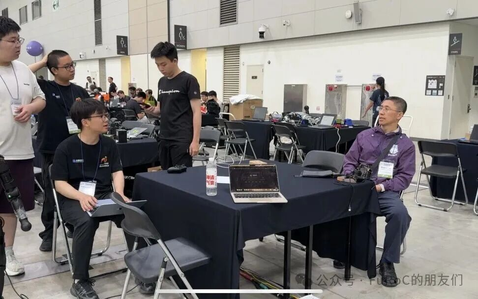
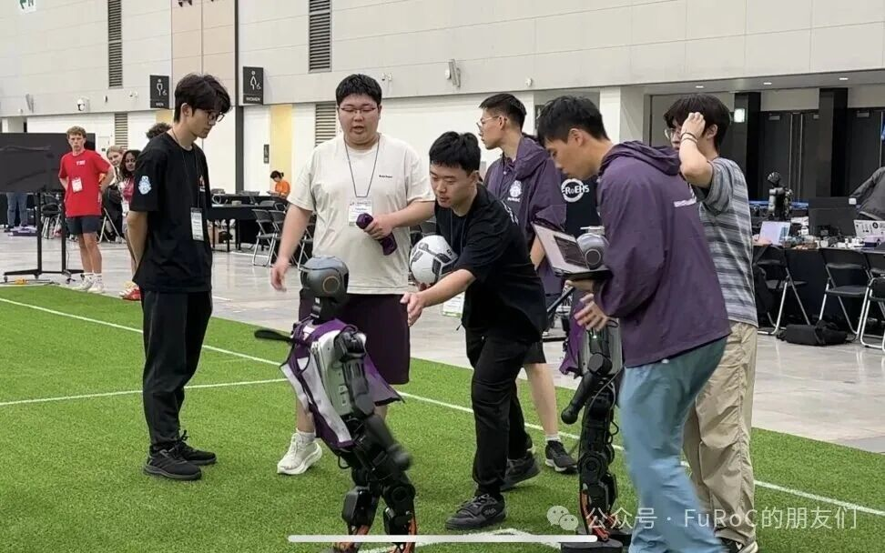
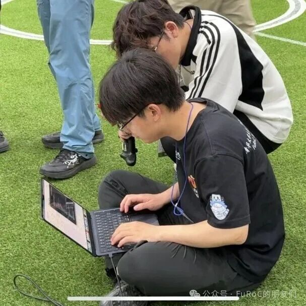
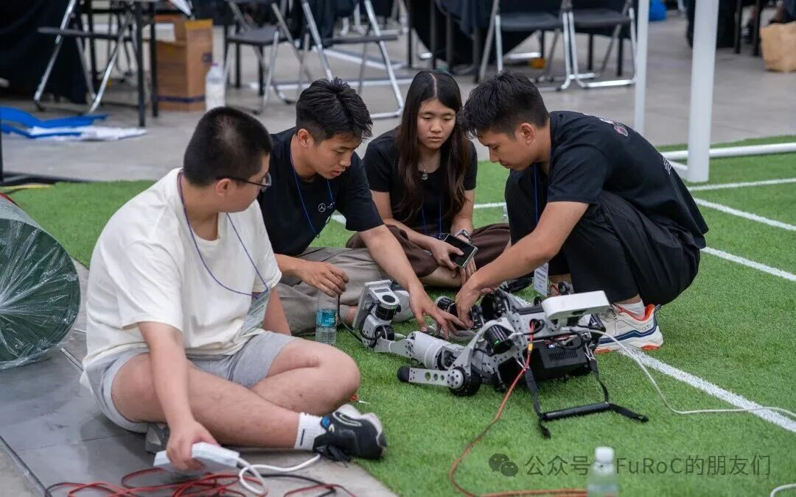
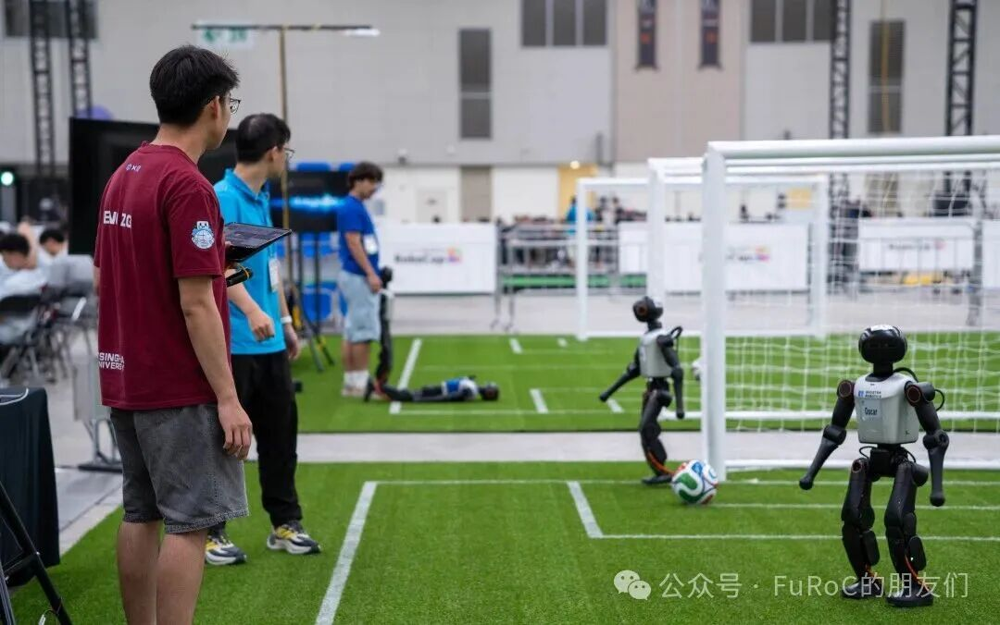
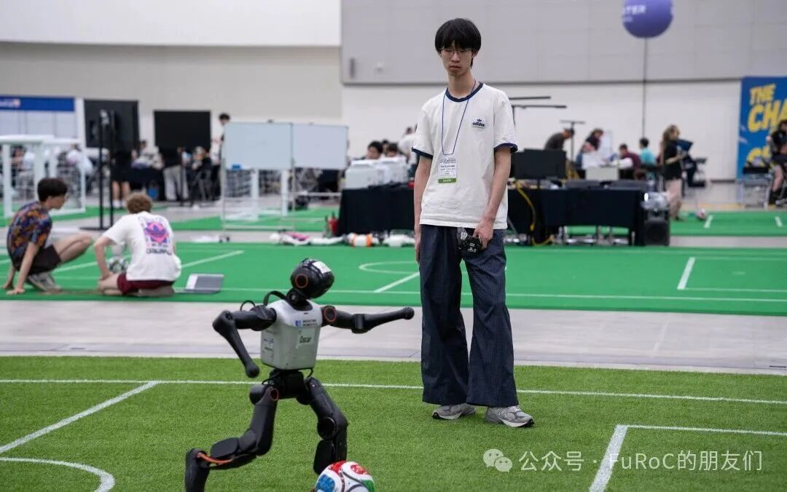
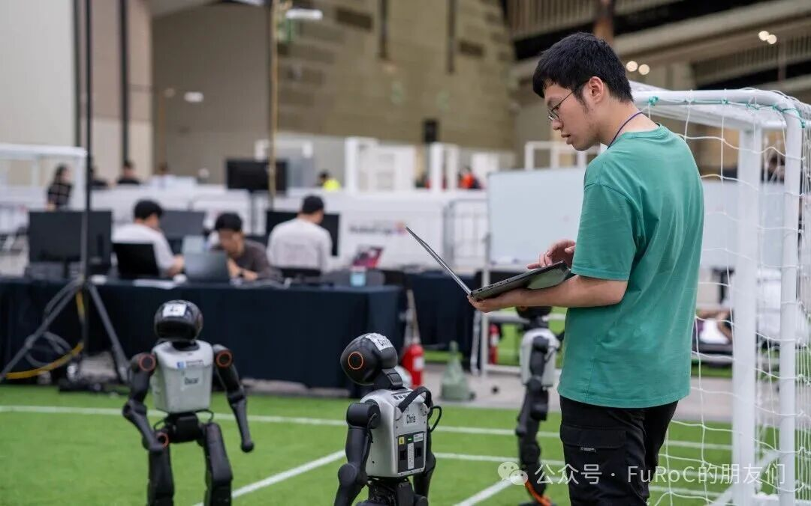
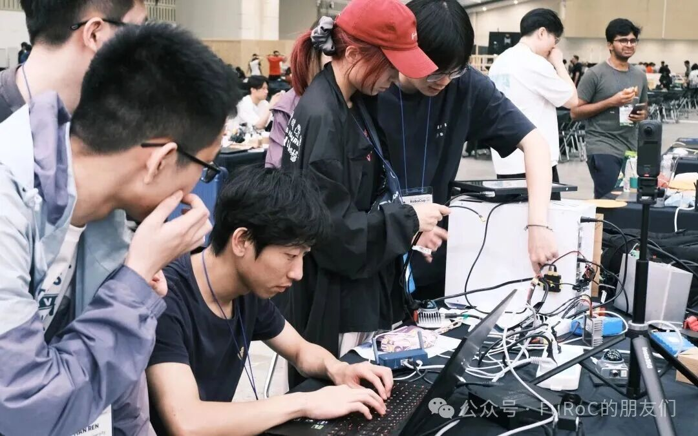
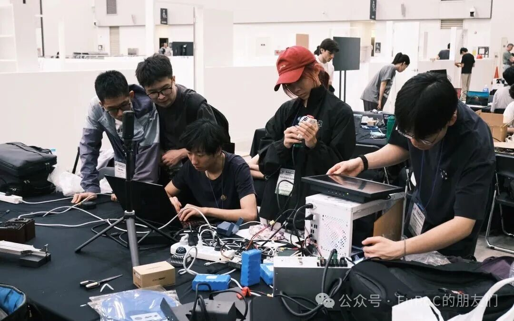
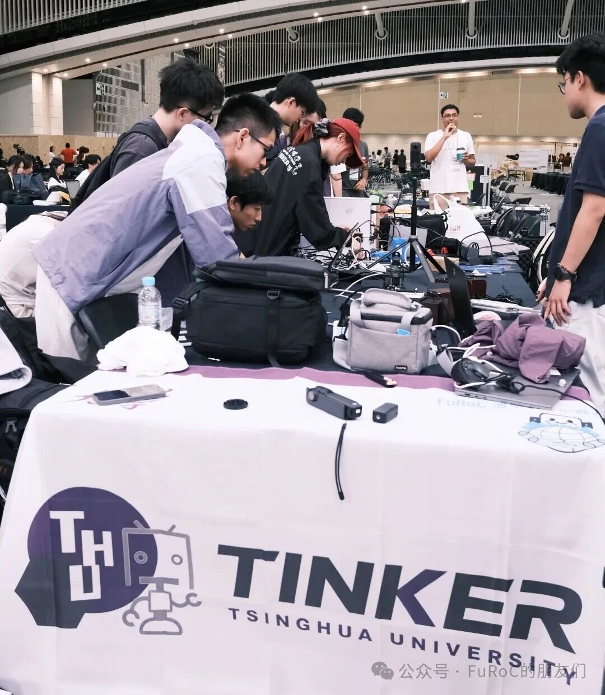

# 【2026 RoboCup · Day1】星夜赴韩，三队同征

> 公众号: FuRoC的朋友们
> 发布时间: 2026-06-30 22:55:39
> 原文链接: https://mp.weixin.qq.com/s/am36Jsr5lGQi-eEDwXTnmQ

---

RoboCup

TSINGHUA FUROC · INCHEON RoboCup 2026

**清华力量 智竞仁川**

以工程实力，赴世界之约

**01**

**星夜启程 奔赴仁川**

    2026 RoboCup韩国仁川国际赛于6月30日正式拉开帷幕。本次比赛，清华大学未来机器人兴趣团队的火神队、THMOS队、Tinker队三支代表队同台出征，向世界舞台发起冲击。

    从清华园到松岛会展中心，星夜兼程。三支队伍载着精心打包的机器人本体、调试设备与满腔期待，于深夜先后从学校出发，经过一夜舟车劳顿，于6月30日清晨陆续抵达松岛会展中心。这是出征的第一天，也是向冠军靠近的第一步。

**02**

三队并进，各显其能

火神队

昼夜攻坚，全力以赴

    报到刚结束，火神队便顾不上一夜舟车劳顿，第一时间扎进赛场，立刻投入战斗。

    由于机器人在北京便已拆卸打包，今天的首要任务是重新组装并逐台调试，摸清每台机器的"脾气"。队员们为双足机器人调步态、标定相机白平衡与颜色阈值、校准自定位，力求在会展中心的灯光下精准识别足球、球门与场地白线。真正的考验来自场地本身——赛场人工草皮比训练场地偏硬，脚感截然不同，队员们重新调整步态切换时机与出脚快慢，一点点找回熟悉的手感。面对复杂的赛场网络环境，火神队还主动向技术委员会提出反馈，力求扫清干扰。

 调试持续一整天，机器人肉眼可见地越来越稳：步态从谨慎试探到大步流星，定点球一脚脚稳稳入网。一旁是一夜未眠的队员，困了趴一会儿、醒了接着干，岗位换了一茬又一茬，那股劲儿却从未松过。

“我们的目标，是卫冕冠军！”

火神队调试现场

THMOS队

**争分夺秒，全力冲刺**

    抵韩第一天，THMOS全队全员投入紧张调试，以饱满斗志攻坚技术难题。

    Small组完成全新定位算法实地实测，整体表现亮眼，队员紧盯数据细致记录、反复微调消除定位误差；针对低摩擦赛场环境优化kick踢球动作，顺利解决以往高摩擦力造成的射门晃动难题，目前正贯通调向、走位、射门的完整连贯流程。Middle组全力适配全新9×6米3V3小型场地，推翻原先大场地决策逻辑，逐一校准射门力度、击球距离、进攻判定等核心参数。同期，自研人形机器人MOS9同步开展组装与基础行走测试，虽遭遇电路故障影响稳定性，团队预计将于明日技术挑战赛上亮相、完成成果展示。

    一整天的调试循环往复，全队在发现、修正、复测中稳步推进，抢抓赛前最后窗口期打磨程序。

Tinker队

**高效分工，即到即战**

    抵达比赛现场后，Tinker队成员们迅速展开工位、连接设备、检查系统，第一时间投入赛前调试。

    RoboCup全球赛现场环境远比实验室复杂，轮式人形机器人需在真实家庭场景中完成感知、导航、交互与操作任务，家具位置、光照、布局都会影响表现。Tinker队迅速进入工程状态，划分为硬件、视觉、操作、语音、决策、导航六组并行推进、紧密配合：视觉、操作、决策组围绕现场家具与任务流程快速调整识别范围、抓取策略与行为逻辑；硬件组逐项检查整车结构、上肢连接、供电与通信；导航组反复测试移动与定位，一点点完成现场建图。

    截至目前，Tinker队已完成基础环境infra配置，机器人系统进入现场任务联调阶段。

**03**

**序章已启，未来可期**

    从星夜启程到抵达即战，三支队伍用一整天的高效分工与持续调试，为接下来的比赛打下坚实基础。夜里的队长会上，技术委员会宣布因参赛队伍众多、场地将实行预约制度，这意味着接下来的调试要更加精打细算，也对全团的统筹组织提出了更高要求。

    挑战不少，但每个人心里都憋着一股劲。明天，火神队将进行比赛单元测试并逐一修改暴露的问题，THMOS队的MOS9将登台技术挑战赛，Tinker队也将迎来首轮现场任务。

    第一天的征程已经点燃。让我们共同期待Furoc三支战队在仁川赛场上稳步发挥，展现清华机器人团队的工程实力与战斗状态——新的征程，未来已来！

**Furoc简介**

清华大学未来机器人兴趣团队（简称“FuRoC” ）是在共青团清华大学委员会、清华大学教务处及清华大学具身智能与机器人研究院指导下，由基础训练中心、自动化系与机械系共同支持建设的全校性学生机器人兴趣团队，面向机器人与具身智能方向开展跨学科实践与技术探索。

致谢

感谢火神队赞助方加速进化及俞浩慈善基金会捐赠支持的“天空计划-清华大学专项”，为技术研发与备赛提供重要保障。

感谢THMOS队赞助方高擎机电、加速进化、小鹏（XPENG）在探索与实践过程中的支持与协作，助力团队在多赛道竞赛中持续迭代与优化。

清华大学未来机器人兴趣团队（FuRoC）

文案：刘思彤，南晓璐，许嘉杰，王艺翔

图片：刘思彤，南晓璐，许嘉杰

排版：王艺翔

