# 【2026 RoboCup · Day2】亮剑试锋 静待开战

> 公众号: FuRoC的朋友们
> 发布时间: 2026-07-02 00:45:54
> 原文链接: https://mp.weixin.qq.com/s/ag-U-g__RM0gTpmim4KCQw

---

RoboCup

TSINGHUA FUROC · INCHEON RoboCup 2026

**清华力量 智竞仁川**

以工程实力，赴世界之约

**01**

**战鼓将擂 枕戈待旦**

   7月1日，RoboCup韩国仁川国际赛进入正式开赛前的最后一天。经过首日的组装与基础调试，三支队伍今天的任务更加硬核——官方检录、场地实练、技术交流、故障应急，每一项都直接关系到明天能否顺利站上赛场。

    这是一天没有正赛、却比比赛本身更繁忙的日子。三队从早到晚扎在赛场，用争分夺秒的调试为明天的首战蓄力。

**02**

三队并进，全面冲刺

火神队

检录过关，友谊赛亮剑

    火神队迎来官方检录——裁判逐项测量机器人的身高、体重、手臂与腿部长度等各项尺寸。今天火神队派出两款加速进化人形机器人——Booster T1与Booster T2——参加检录。T1是大家熟悉的常见机型，而T2作为不少队伍从未见过的新面孔，一亮相便引来颇多好奇的目光。最终两款机型各项尺寸全部达标，顺利通过检录。

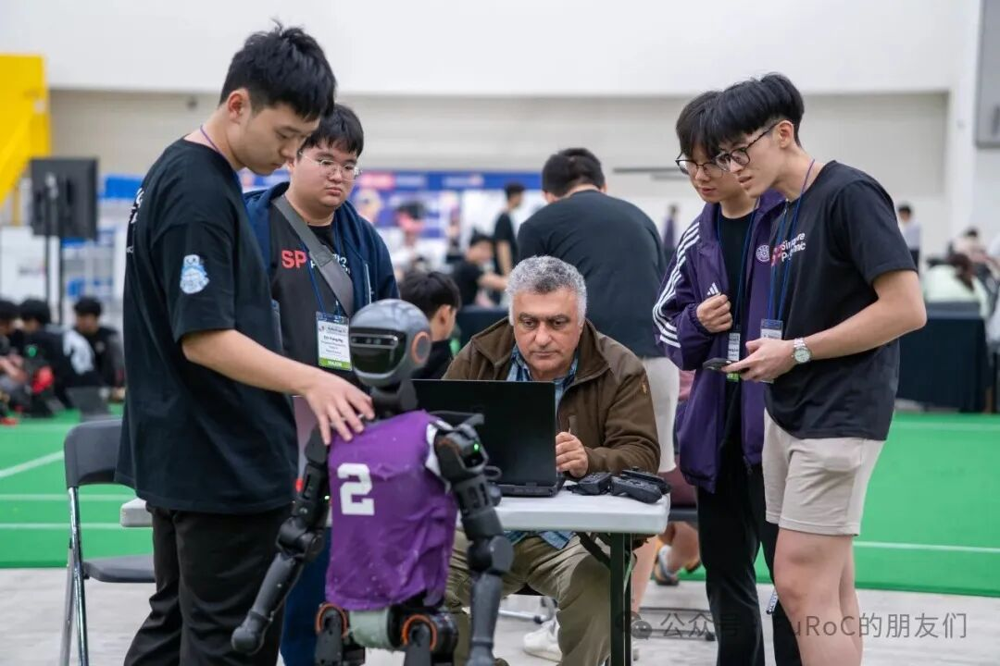

    紧接着友谊赛打响。火神队对阵美国传统强队得州大学奥斯汀分校（UT Austin），半场十分钟的较量，火神队以6:0领先，展现出强大的攻击力。实战是最好的"体检"：比赛中也暴露出关键隐患——对方开球瞬间，我方机器人偶尔会误识别皮球、提前启动上抢。问题及时暴露，正是为了在开赛前彻底解决。

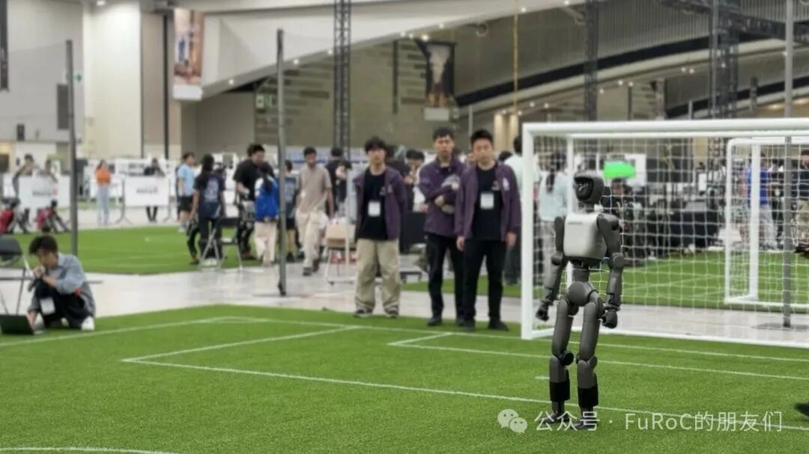

    赛场之外同样精彩。在开放研究挑战（Open Research Challenge）上，火神队队长罗长盛分享了Booster T2的"大力射门"技术。全场有一句话让人印象很深——"Test a robot without a robot（不用实体机器人，也能测试机器人）"——道出了仿真调试这一领域各国的共同探索方向。

    交流归来，调试继续。针对友谊赛暴露的开球误识别问题，队员们逐一攻克；全场网络环境逐一测试；结合己方与对手实力，避障参数调得更加保守稳妥。一整天下来，机器人的状态愈发稳定，全队的底气也愈发充足。明天，正式比赛打响——火神队只有一个念头：沉下心、做扎实每一个细节。

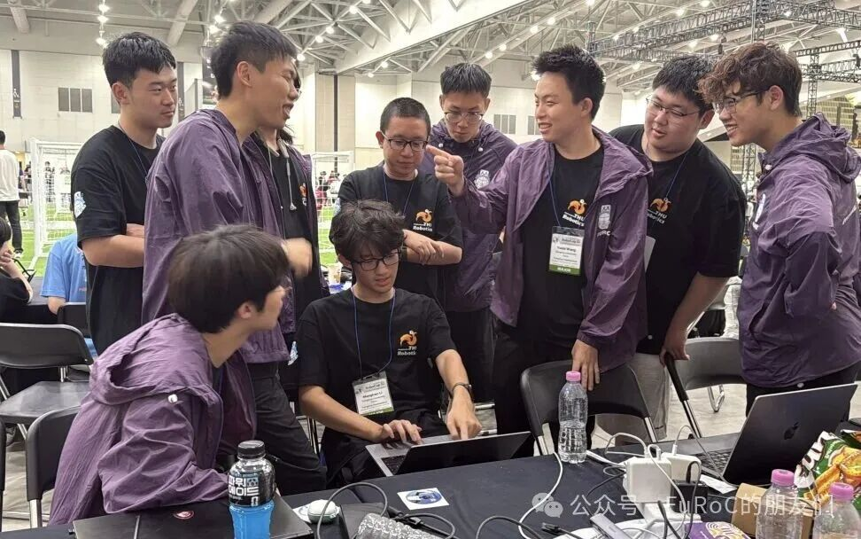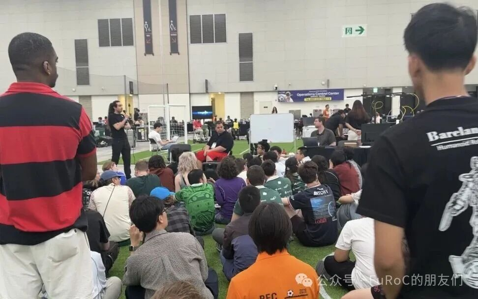

火神队友谊赛现场

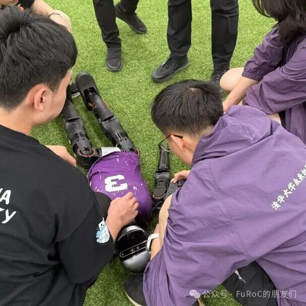

THMOS队

**双线攻坚，昼夜不停**

    今日THMOS全队奔赴赛场开启赛前攻坚。全员先参与主办方赛前规则培训会，吃透赛事标准后，Middle、Small两组同步投入场地调试，并顺利完成官方设备检测。

    Middle组完整测试射门、接发球、防守策略全流程，开展队内对抗友谊赛实战演练。调试中先后遭遇双裁判盒通讯干扰、底层代码适配故障、角球视觉识别失灵等问题，队员快速对接技术人员迭代算法版本、修复通讯干扰，逐一扫清赛场隐患。

    Small组重点攻克定位、跌倒爬起、射门精度三大难题，今日终于校准定位参数，大幅优化昨天卡滞的倒地爬起逻辑，同步迭代决策代码。为完善作战逻辑，队员计划今晚投入更多精力打磨程序。

    昼夜不停的代码修改、反复试错的场地实测，THMOS全员整装待发，以精益求精的姿态奔赴机甲绿茵。

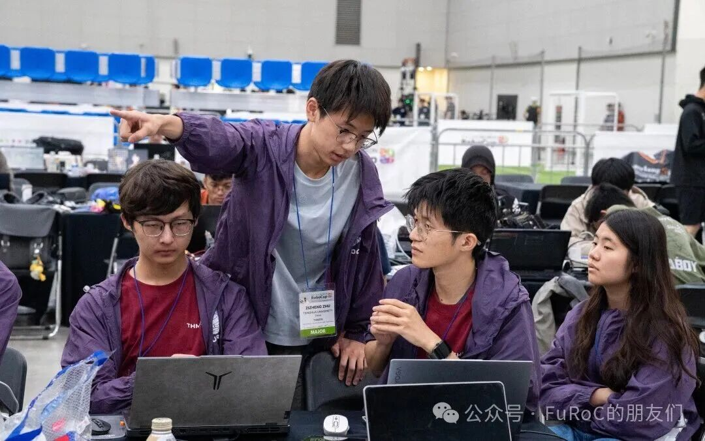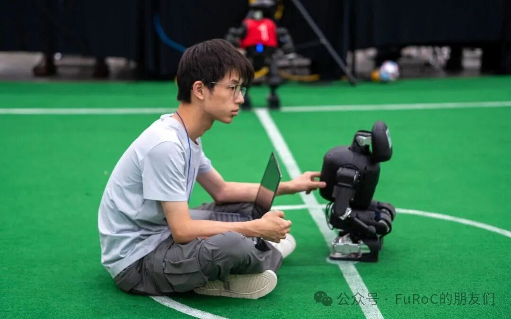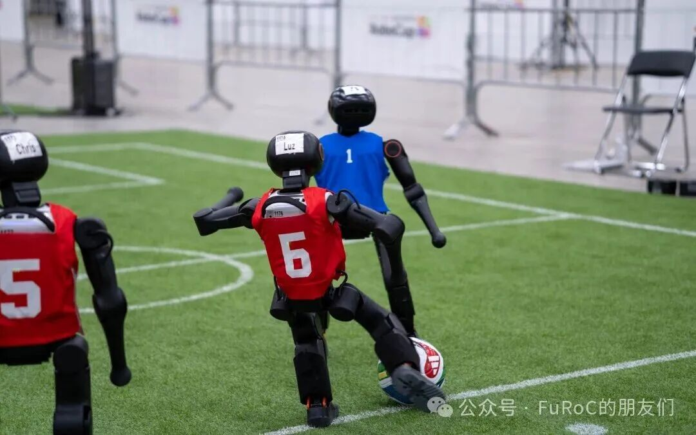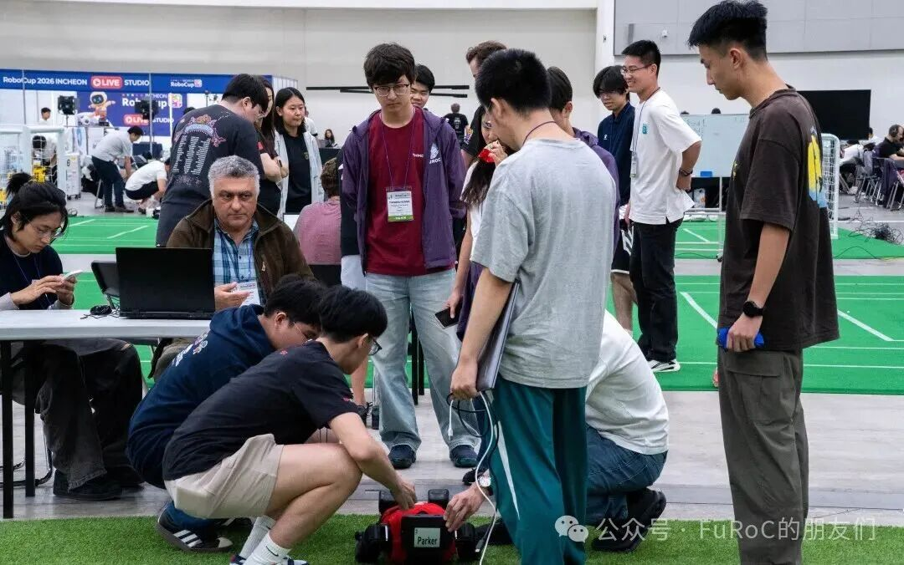

Tinker队

**从容应险，完成全场联调**

    Tinker队今天的重点转向系统级联调与真实场地适配。在软件层面，机器人雷达避障算法在现场环境中出现异常，尤其是拐角尖处建图暴露适配问题。导航组迅速定位，结合现场地图结构与机器人运行状态进行调整，最终解决了拐角尖处建图不稳定的问题，为后续全场导航和任务执行打下基础。

    硬件层面的考验更加突然——由于现场意外过流，变压器失效击穿，直接影响系统供电与整车调试节奏。但Tinker队并未被突发情况打乱阵脚：硬件组迅速排查故障、切换方案，依托提前准备的两套硬件系统和两套完整备件，快速恢复调试流程。临近清场前，Tinker队顺利完成了全场调试。

    一天的现场考验，检验的不只是机器人性能，更是团队在突发问题面前的判断力、储备量与执行力。

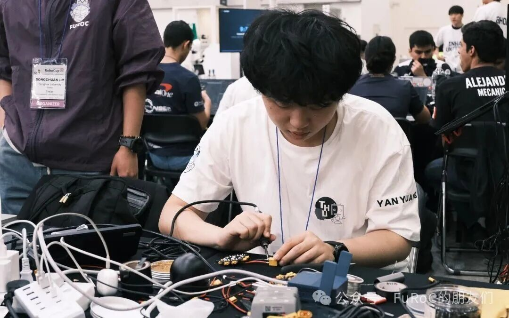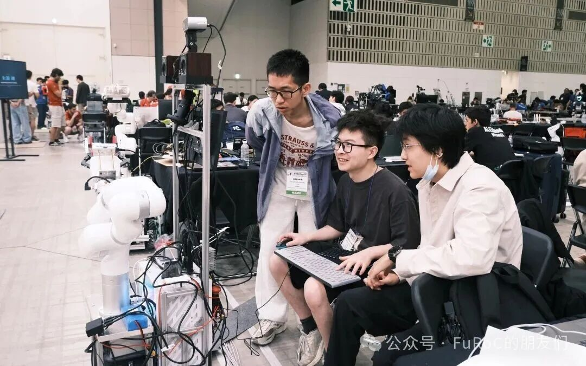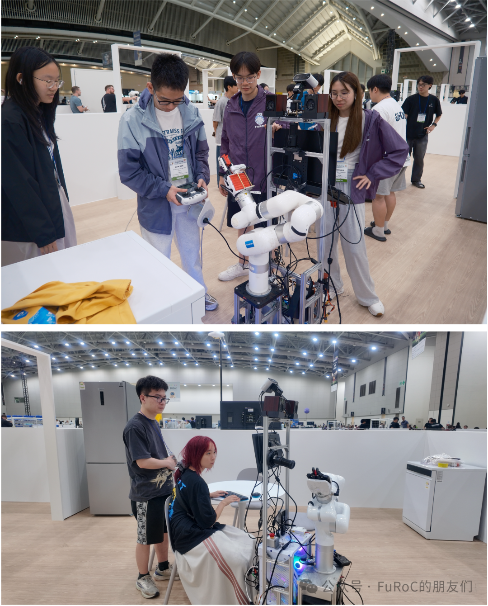

**03**

**箭在弦上，明日见真章**

    从检录到友谊赛，从技术交流到硬件应急，第二天的每一分钟都没有被浪费。三支队伍用一整天的汗水，把机器人的状态调到了开赛以来的最好水平。

    明天，RoboCup韩国仁川国际赛正式比赛将全面打响。火神队摩拳擦掌迎战正赛，THMOS队日夜攻坚后静待亮剑，Tinker队从全场联调迈入现场任务。

    备战的每一分努力，都将在赛场上接受检验。明日见真章——FuRoC三队，准备好了！

**Furoc简介**

清华大学未来机器人兴趣团队（简称“FuRoC” ）是在共青团清华大学委员会、清华大学教务处及清华大学具身智能与机器人研究院指导下，由基础训练中心、自动化系与机械系共同支持建设的全校性学生机器人兴趣团队，面向机器人与具身智能方向开展跨学科实践与技术探索。

致谢

感谢火神队赞助方加速进化及俞浩慈善基金会捐赠支持的“天空计划-清华大学专项”，为技术研发与备赛提供重要保障。

感谢THMOS队赞助方高擎机电、加速进化、小鹏（XPENG）在探索与实践过程中的支持与协作，助力团队在多赛道竞赛中持续迭代与优化。

清华大学未来机器人兴趣团队（FuRoC）

文案：刘思彤，南晓璐，许嘉杰，王艺翔

图片：刘思彤，南晓璐，许嘉杰

排版：王艺翔

