# 【2026 RoboCup · Day3】同一个七月,两个世界杯｜三队首战开门红

> 公众号: FuRoC的朋友们
> 发布时间: 2026-07-03 01:20:44
> 原文链接: https://mp.weixin.qq.com/s/BeK2wuwbGmf740dsl5_jLw

---

RoboCup

TSINGHUA FUROC · INCHEON RoboCup 2026

**清华力量 智竞仁川**

以工程实力，赴世界之约

**01**

**从实验室到赛场，挑战人类倒计时**

    此刻,大洋彼岸的美加墨,2026 国际足联世界杯正激战正酣,人类顶级球队捉对厮杀,向着大力神杯冲刺。而在地球另一端的韩国仁川,另一场“世界杯”同样鸣哨开赛——只不过,这里的球员是一群人形机器人。

    RoboCup,被誉为“机器人的世界杯”。自诞生起,它就立下了一个近乎“狂妄”的目标——到 2050 年,让一支人形机器人队伍,战胜当年的人类世界杯冠军。今天绿茵场上的每一次奔跑、每一脚射门,都是在向那个未来一步步逼近。

    7 月 2 日,2026 RoboCup 韩国仁川国际赛正式鸣哨。清华 FuRoC 三支队伍同时出击,在仁川松岛会展中心迎来各自的首次正面交锋。从赛前备战到赛场亮剑,今天,是检验一切的日子。

**02**

三队首战：火力全开，各有斩获

火神队

两连胜，4:1与8:1的火力盛宴

    正式开赛第一天，火神队一天连打两场、全部拿下——下午3点4:1力克北京信息科技大学Water队；晚上7:50再以8:1大胜德国HTWK队。两战全胜，火神队用一个漂亮的开局宣告自己的到来。两场胜利分量十足。Water是国内老牌劲旅，HTWK则来自德国莱比锡应用技术大学，是机器人足球界的传统强队。

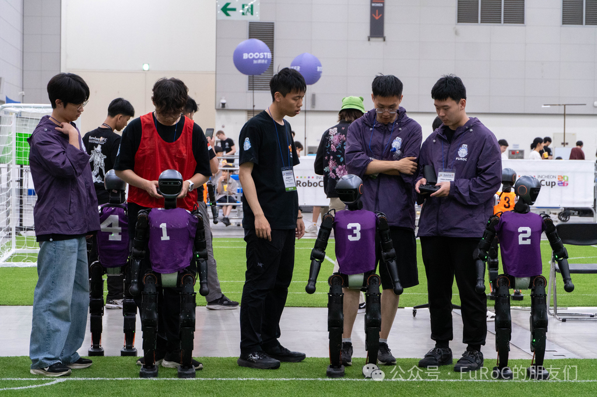

    亮点是几粒行云流水的配合进球：开边线球时，机器人并不急于自己处理，而是一脚精准传给跟进队友，队友迎球起脚、应声破门——此类配合上半场就出现了两三次。全队最稳的是2号机器人，攻防两端都撑起节奏；而赛前临时换上的3号新机表现未达预期，仍需继续打磨。

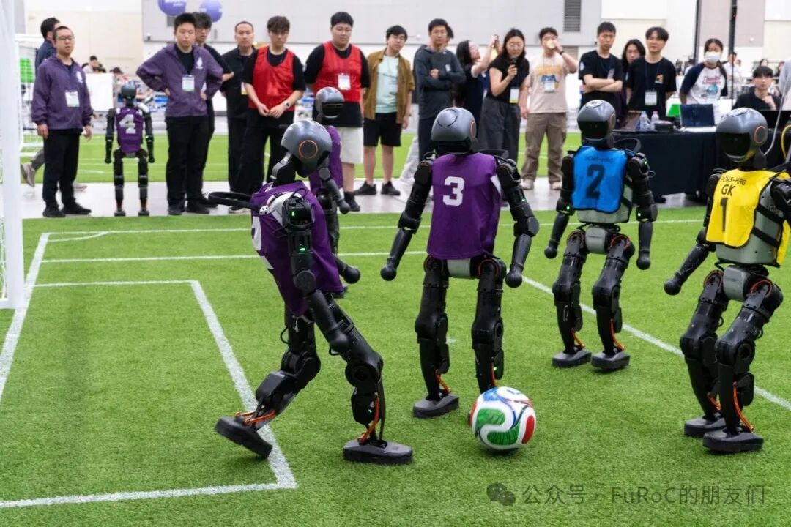

    技术层面也有好消息：昨日的开球误识别问题今日彻底解决。下一轮对手需等瑞士轮次轮结束后方能揭晓——目前两战全胜的队伍预计只剩两支。继续努力，争取卫冕！

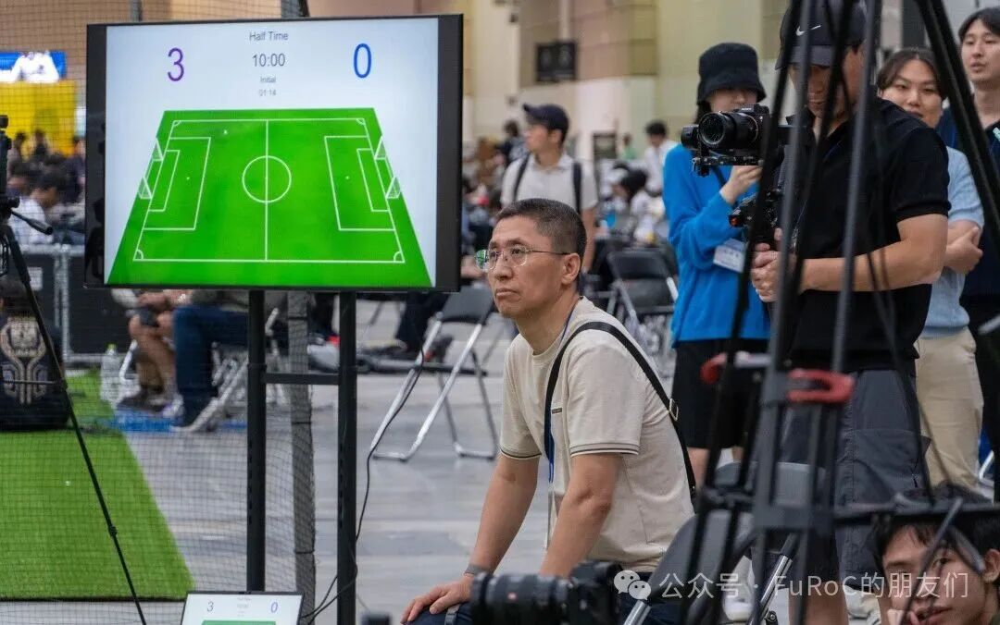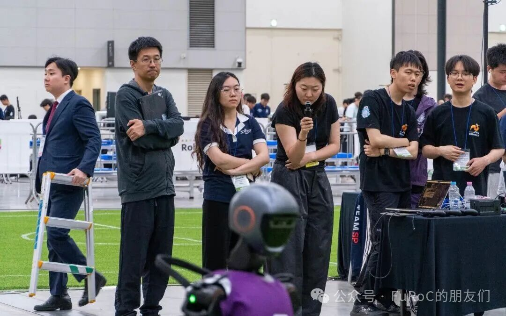

火神队比赛现场

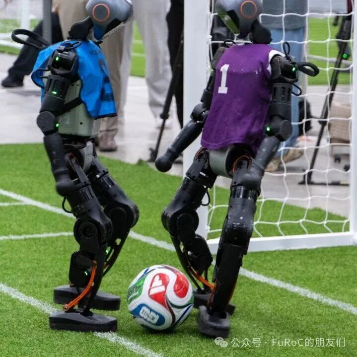

THMOS队

**双线出击，越战越勇**

    正赛第一天，THMOS在Small组与Middle组双线出战。

    Small组：上午8:30对阵GeoHBots，开场小Pi机器人意外下电、通讯卡断，场边队员迅速抢修、调整策略；上半场临近结束，Park抓住机会一脚破门，瞬间点燃全队士气。中午紧锣密鼓调试后，15:00对阵KHUBER时设备通讯问题明显减少，连续进球，4:0零封对手。

    Middle组同样战况激烈：中午12:00对阵Ruhrbot Devils，K1小兵们稳定执行，7:1强势取胜；下午17:30面对强敌Invic，双方实力胶着，尽管受到规则判罚理解、定位漂移等问题干扰，THMOS仍顽强咬住比分，最终4:3惜败。

    "胜负不仅来自技术，也来自对规则、临场节奏和抗压能力的把握。"首日战罢，THMOS展现出极强的凝聚力。队长表示：今天暴露了不少问题，但正是这些问题推动队伍继续成长。灯光之下，调试仍在继续，下一战值得期待。

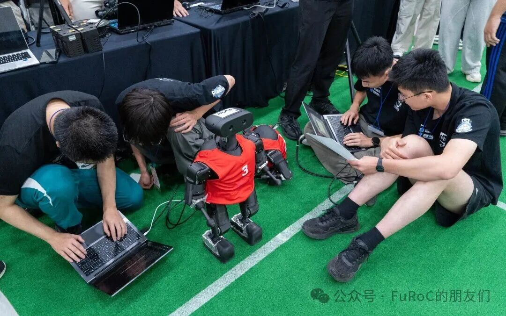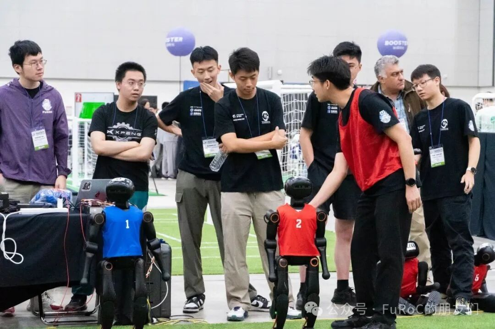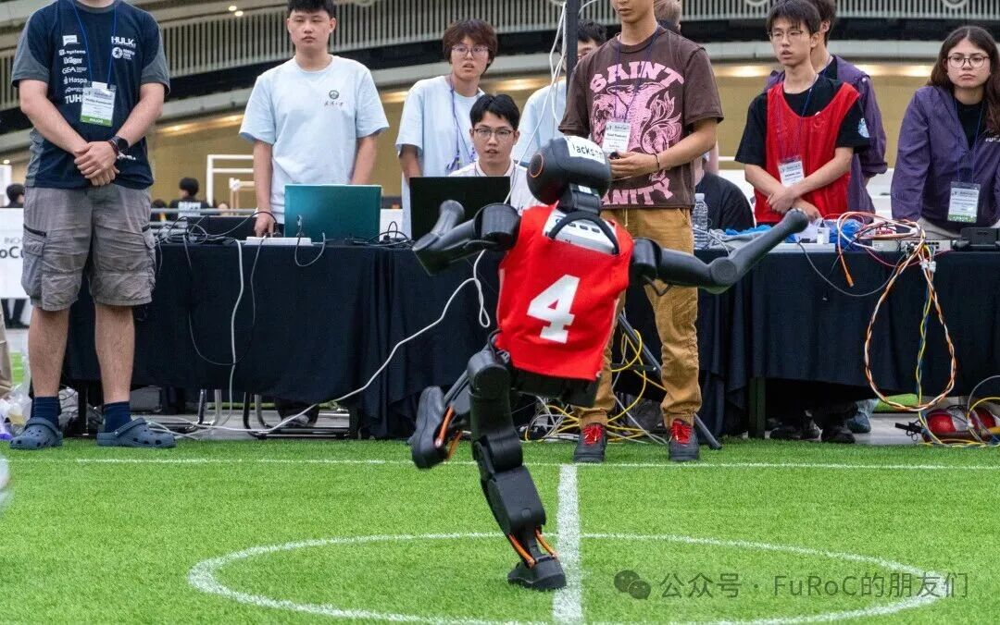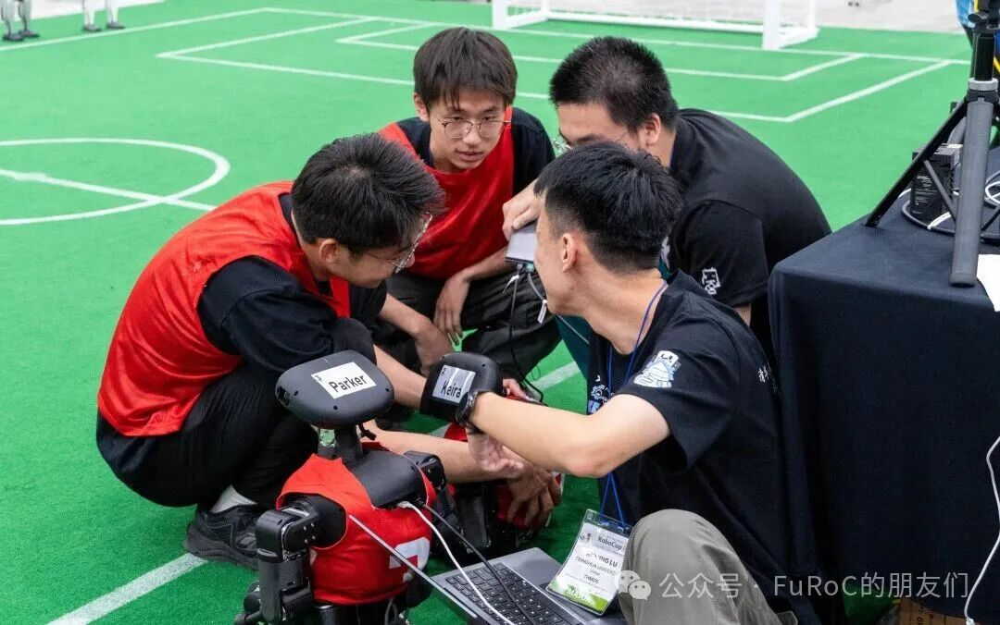

Tinker队

**挑战赛四项出击，亮点与短板并存**

    7月2日，Tinker队正式迎来多项挑战赛检验。当天比赛共四项：HRI人机交互、Pick and Place物体抓取、GPSR通用服务指令理解以及Doing Laundry整理衣物。队伍整体表现稳定，目前总分位居榜单前列。

    其中HRI和Doing Laundry两项取得超出预期的优秀表现——尤其在整理衣物这一关，面对形态复杂、状态多变的柔性物体，机器人依靠前期积累的感知、操作与决策能力，完成了更接近真实家庭服务场景的任务，体现出系统在非标准环境下的适应潜力。

    短板同样明显。GPSR和Pick and Place中，机器人受到现场光照、空间布局影响，出现撞墙、任务链路完成度不足等情况。每一个赛场偏差，都对应着真实部署中的一个关键问题，这是Tinker队后续优化的明确方向。

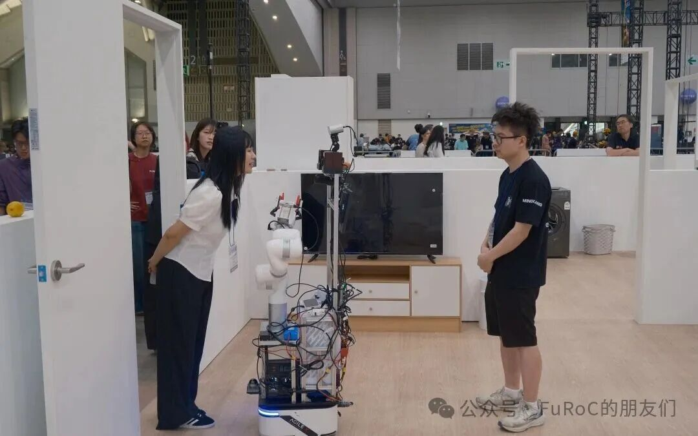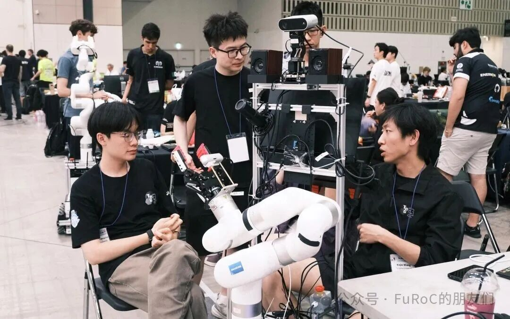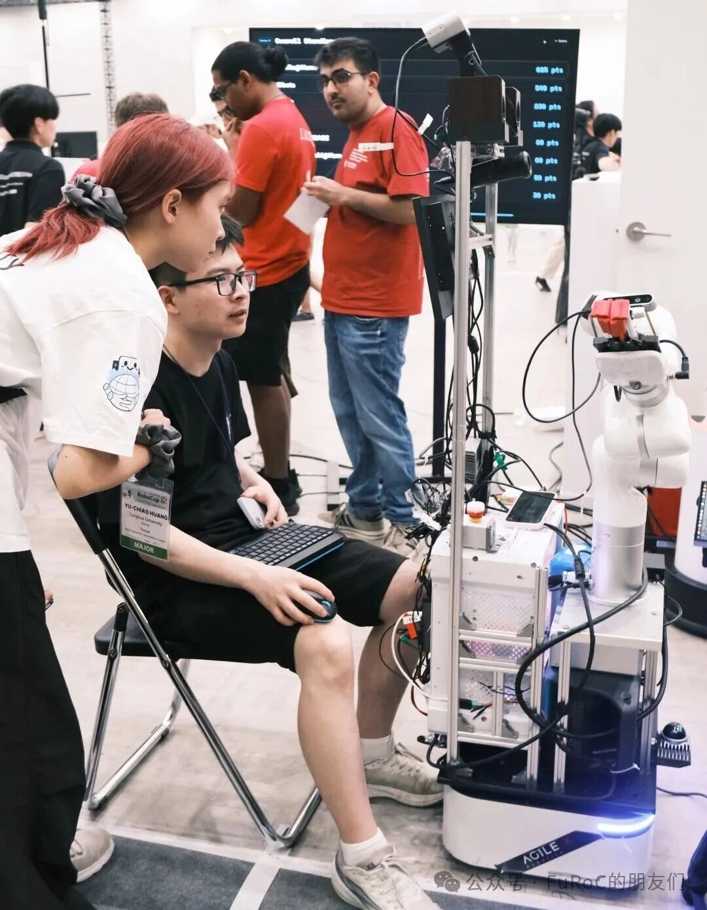

**03**

**鸣哨已响，向前一步**

   首日战罢,三支队伍用不同的方式给出了一个相同的答案:今天,FuRoC 已经站上了世界舞台。

    火神队两连胜宣告王者归来,THMOS 双线出击、在磨合中越战越勇,Tinker 队在挑战赛中展现扎实的工程实力。从赛前备战到赛场亮剑,每一支队伍都在向那个“狂妄”的愿景又迈进一步。

    当大洋彼岸的人类世界杯正在决出属于自己的英雄,仁川赛场上的这群机器人,也在一场场比赛里,书写着属于机器人的世界杯故事。也许 2050 还很远,但通往那个未来的路,正是由今天这样的每一场胜负铺就。

    明天,RoboCup 的号角将继续吹响,FuRoC 三队仍将全力向前——属于机器人的世界杯,才刚刚开始。让我们共同期待!

**Furoc简介**

清华大学未来机器人兴趣团队（简称“FuRoC” ）是在共青团清华大学委员会、清华大学教务处及清华大学具身智能与机器人研究院指导下，由基础训练中心、自动化系与机械系共同支持建设的全校性学生机器人兴趣团队，面向机器人与具身智能方向开展跨学科实践与技术探索。

致谢

感谢火神队赞助方加速进化及俞浩慈善基金会捐赠支持的“天空计划-清华大学专项”，为技术研发与备赛提供重要保障。

感谢THMOS队赞助方小鹏（XPENG）、高擎机电、加速进化在探索与实践过程中的支持与协作，助力团队在多赛道竞赛中持续迭代与优化。

清华大学未来机器人兴趣团队（FuRoC）

文案：刘思彤，南晓璐，许嘉杰，王艺翔

图片：刘思彤，南晓璐，许嘉杰

排版：王艺翔

