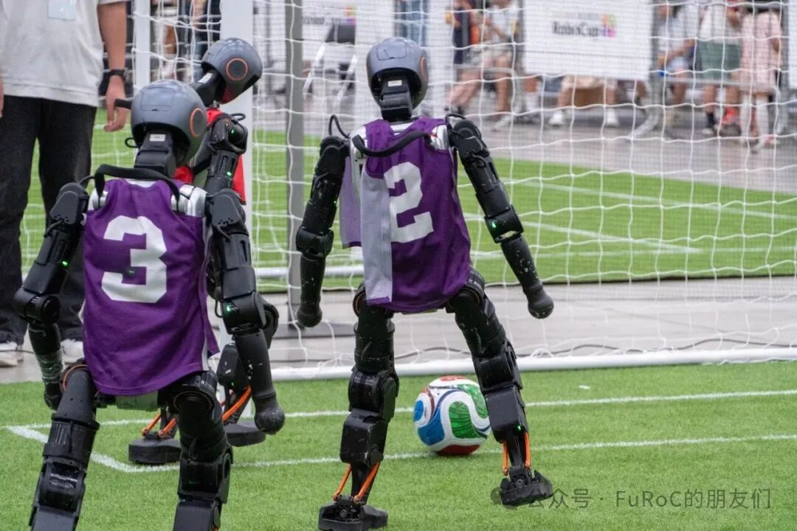
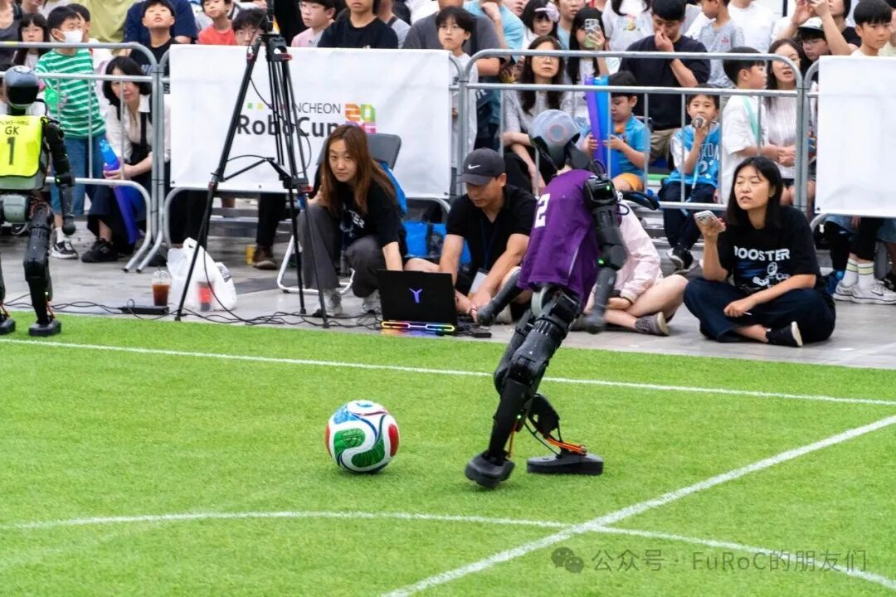
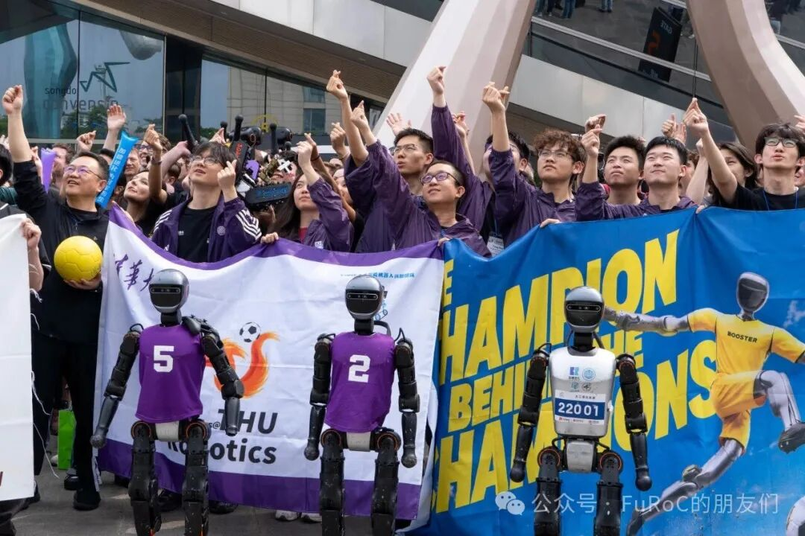
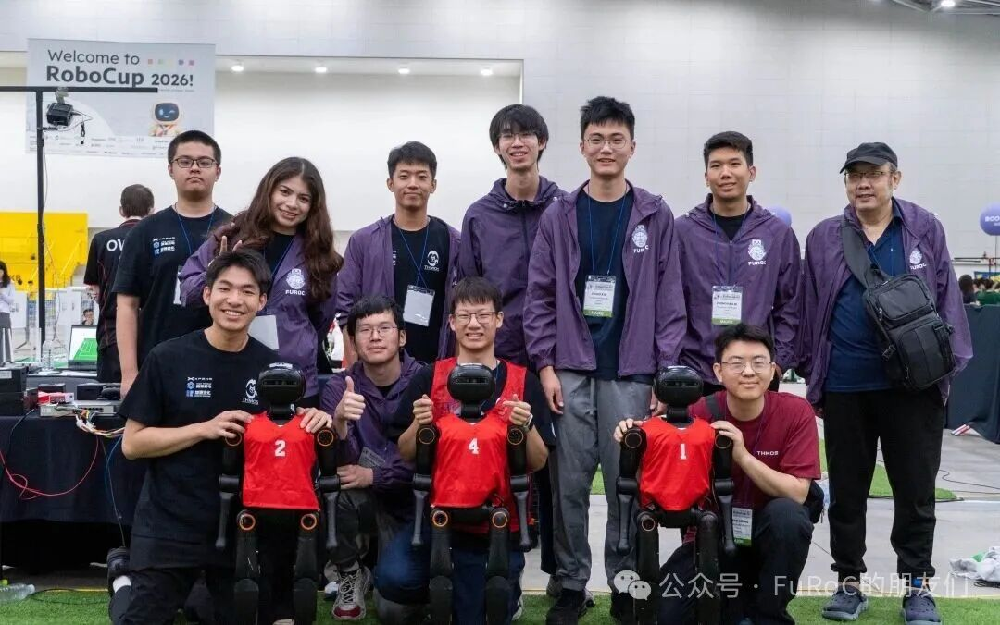
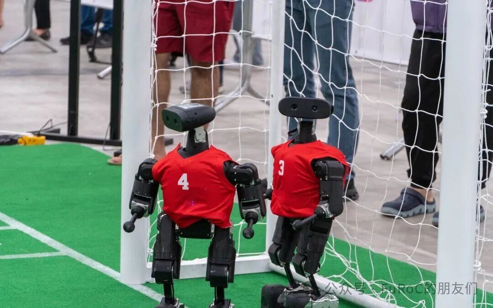
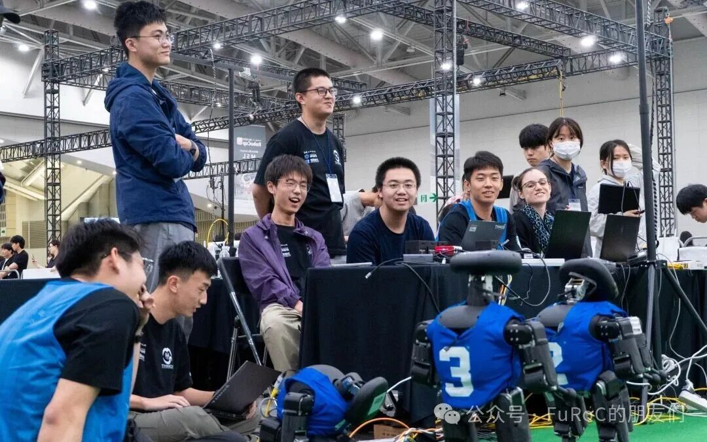
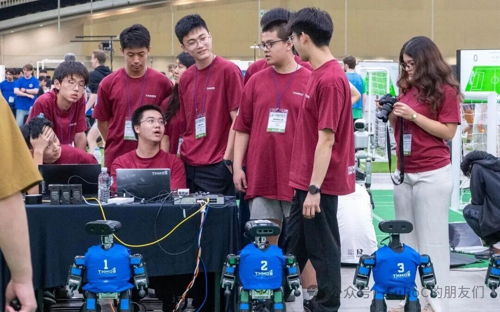
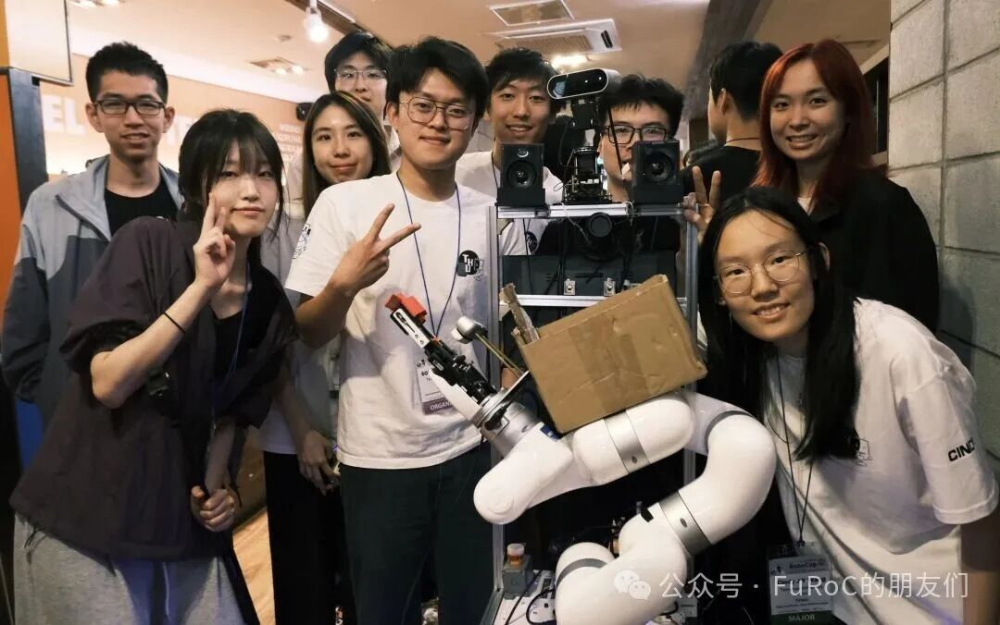
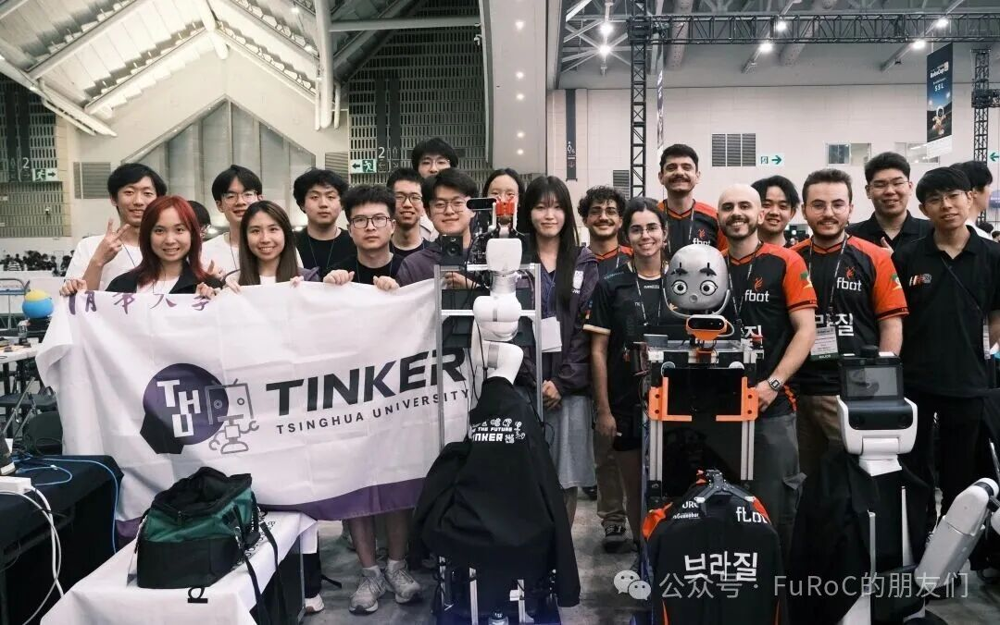
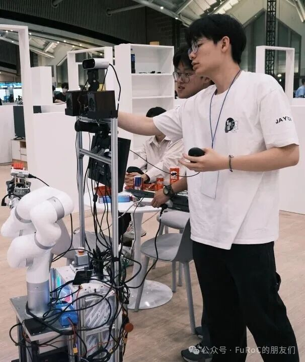

# 【2026 RoboCup · Day4-5】淘汰赛鏖战，Furoc三队各显锋芒

> 公众号: FuRoC的朋友们
> 发布时间: 2026-07-05 04:50:33
> 原文链接: https://mp.weixin.qq.com/s/9_-v7HugzauB2pWgqIkw3g

---

RoboCup

TSINGHUA FUROC · INCHEON RoboCup 2026

**清华力量 智竞仁川**

以工程实力，赴世界之约

**01**

**鏖战两日，三队全力以赴**

    7月3日至4日，RoboCup韩国仁川国际赛进入最激烈的晋级阶段。小组赛收官、淘汰赛捉对厮杀、加赛一锤定音——两天里，FuRoC三支队伍在世界舞台上各展锋芒，从小组头名到八强鏖战，从多项刷新纪录到闯入关键加赛。赛程各异，但每一场都拼尽了全力。

**02**

三队战报

火神队

三战全胜，狂轰23球挺进四强

    近两日，火神队打出了卫冕之师的底色。7月3日小组赛收官战6:2力克老对手CAU山海队，以12分、27:5净胜球锁定小组第一出线。

    进入淘汰赛，火神队火力全开——八分之一决赛9:1大胜PCMS-HRG，四分之一决赛8:0零封Bahia Robotics Team，干净利落叩开四强之门。两天三战全胜、狂轰23球，高居积分榜首位。

    大比分背后，全队依旧清醒：机器人步态稳定性较前几日再度提升，队员们没有因连胜松懈，仍在一点点抠细节。半决赛将于今日上午打响，决赛紧随其后。距离卫冕，只差最后两步——火神队，全力冲刺！

THMOS队

**双组鏖战，止步八强完成正赛收官**

     7月3日，THMOS迎来正赛第二日连续作战。Middle组上午对阵RFC-Tsudanuma，开赛十秒内闪电破门，Oscar与Jackson配合默契，最终6:0强势胜出；下午苦战Inha-United，僵持中觅得侧翼突破口，2:1压点取胜。Small组下午再战RO:BIT，状态回升3:0取胜。

    7月4日晋级战更为焦灼。Small组3:0战胜Berlin United，入围赛惜败Mountain。Middle组上午以5:4险胜RoboRoos拿下1/4决赛资格；傍晚正面交锋法国强队Rhoban FC，四次远距离精准射门极具威胁，无奈对方防守强劲，最终惜败止步八强。

    两天赛程，有大比分胜利，也有压点险胜；有故障后的迅速修正，也有面对强队的正面交锋。比分记录结果，而每一次复盘、调试、再上场，记录的是队伍真正的成长。

Tinker队

**冲进全球前五，最终定格第11名**

    7月3日至4日，Tinker队始终保持在RoboCup@Home赛道排行榜前列，最好成绩一度冲入全球前五。在HRI、GPSR、Doing Laundry等任务中延续良好状态，多项成绩刷新首日纪录，顺利进入前12名队伍的Restaurant加赛。

    Restaurant是本届极具挑战的一项——现场随机抽取咖啡厅场景，家具、光线、环境几乎全部未知。为这场关键加赛，团队备战整整一夜，各组反复复盘、重新设计未知环境的处理方案。遗憾的是，进入赛场后机器人在任务终端环节暴露出执行感知缺陷，最后一环未能完整闭环，而Restaurant仅有一次机会，整体积分因此受到较大影响。

    最终，Tinker队定格第11名，与决赛擦肩而过。第11名不是期待的终点，却清楚标记出了下一次出发的位置——问题留下来了，答案将在下一次调试、迭代与赛场上继续寻找。

**03**

**征程未尽，全力向前**

       两天的淘汰赛，是对整支团队实力与心态的双重检验。Tinker队与THMOS完成正赛收官，而火神队仍在向着卫冕的目标全力奔跑。

    今天上午，火神队的半决赛即将打响，决赛紧随其后。距离最后的荣耀，只剩两步——让我们共同期待，FuRoC在仁川赛场的最后冲刺！

**Furoc简介**

清华大学未来机器人兴趣团队（简称“FuRoC” ）是在共青团清华大学委员会、清华大学教务处及清华大学具身智能与机器人研究院指导下，由基础训练中心、自动化系与机械系共同支持建设的全校性学生机器人兴趣团队，面向机器人与具身智能方向开展跨学科实践与技术探索。

致谢

感谢火神队赞助方加速进化及俞浩慈善基金会捐赠支持的“天空计划-清华大学专项”，为技术研发与备赛提供重要保障。

感谢THMOS队赞助方小鹏（XPENG）、高擎机电、加速进化在探索与实践过程中的支持与协作，助力团队在多赛道竞赛中持续迭代与优化。

清华大学未来机器人兴趣团队（FuRoC）

文案：刘思彤，南晓璐，许嘉杰，王艺翔

图片：刘思彤，南晓璐，许嘉杰

排版：王艺翔

