# 开门红活动 | 嘉宾风采 | 场地揭秘 | 春晚机器人爆火后：具身智能与产业链新走向

> 公众号: FuRoC的朋友们
> 发布时间: 2026-03-27 10:10:46
> 原文链接: https://mp.weixin.qq.com/s/DjS8glUflUmUCcS903zsSg

---

3月29日活动嘉宾阵容                  2026/03

**春晚机器人爆火后**

**具身智能与产业链新走向**

今年春晚，人形机器人惊艳亮相，具身智能一夜出圈。

从实验室到春晚舞台，从概念验证到量产交付——具身智能正在经历从"技术突破"到"产业落地"的关键跃迁。整机厂商加速迭代，芯片企业深度布局，供应链体系日趋成熟，资本市场热度攀升。

在这个产业拐点的关键时刻，清华MBA具身智能俱乐部邀请你一起追问：春晚爆火之后，具身智能将走向何方？

3月29日（周日）下午13:30，清华大学东阶梯教室（高德可查），敬请期待这场不容错过的行业对话，更有“神秘嘉宾”现场惊艳互动！

温馨提示：校外同学请自行解决入校报备哦~

大咖云集

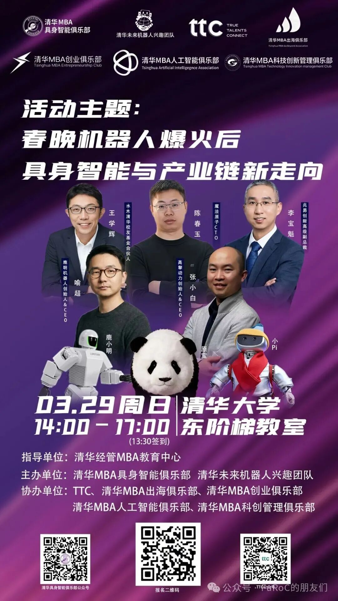

重磅嘉宾

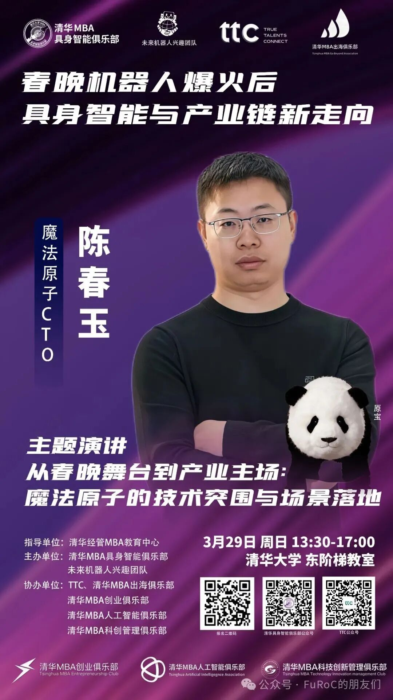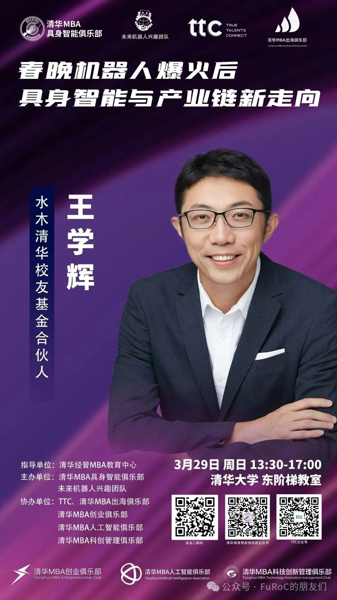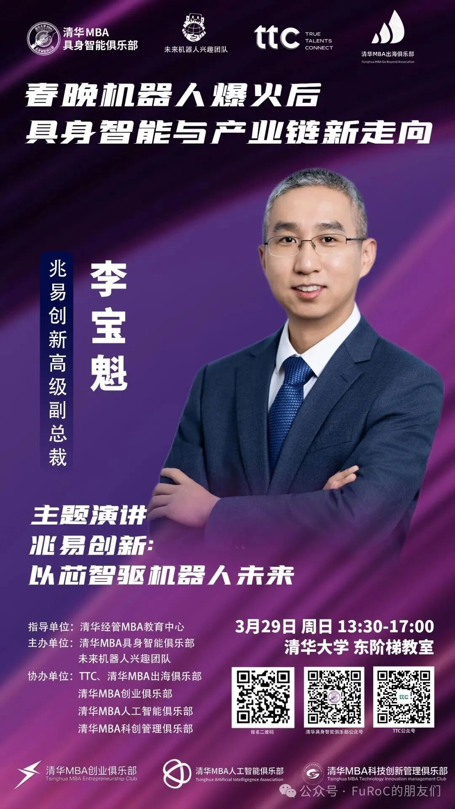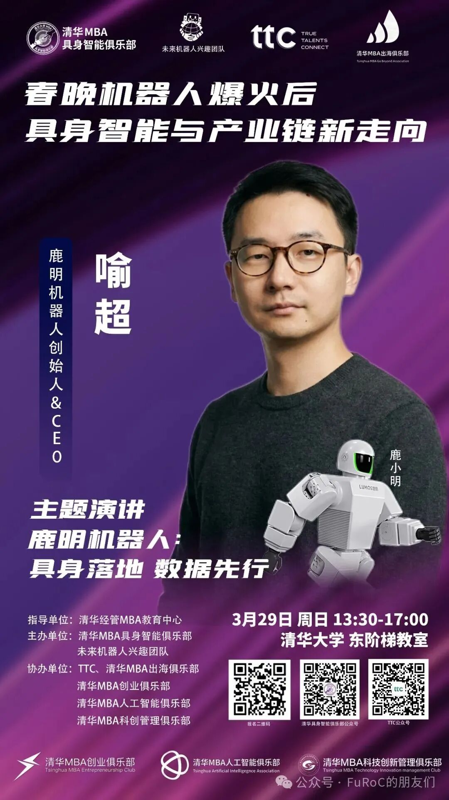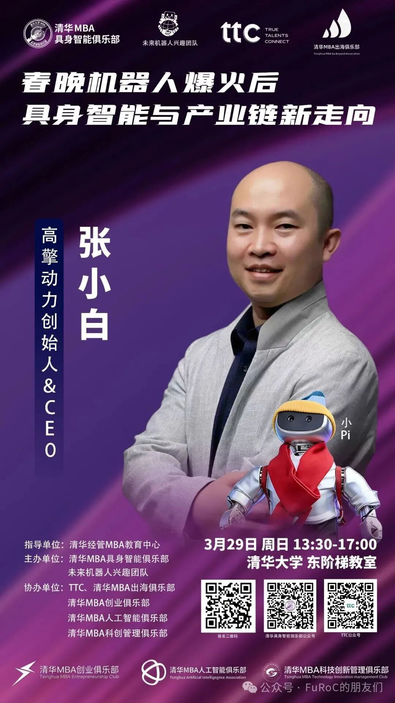

产业观察员

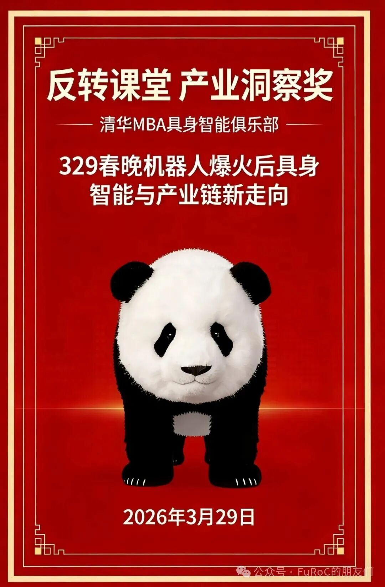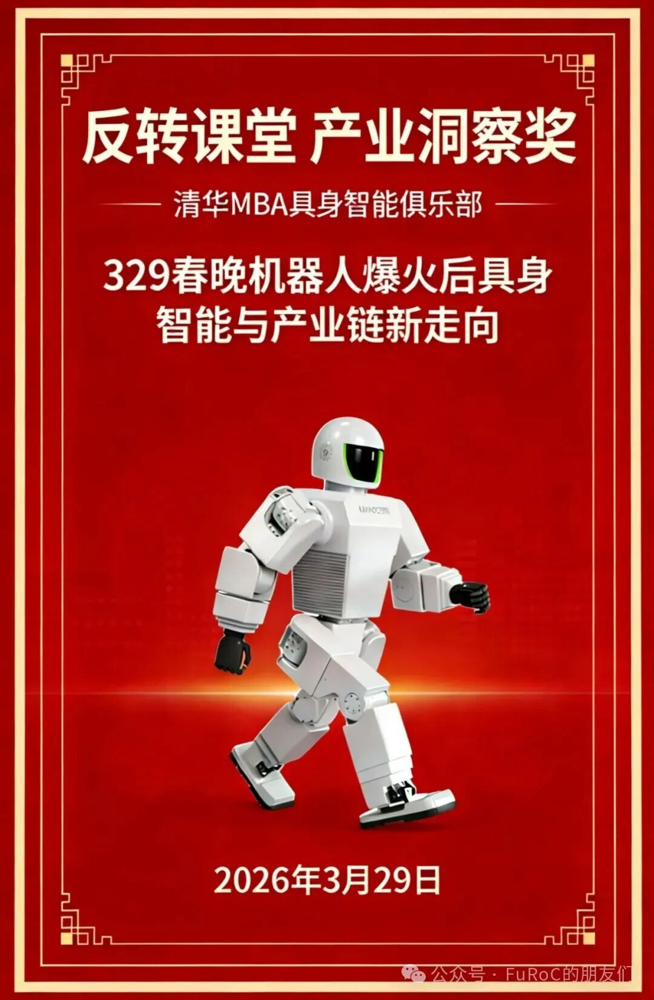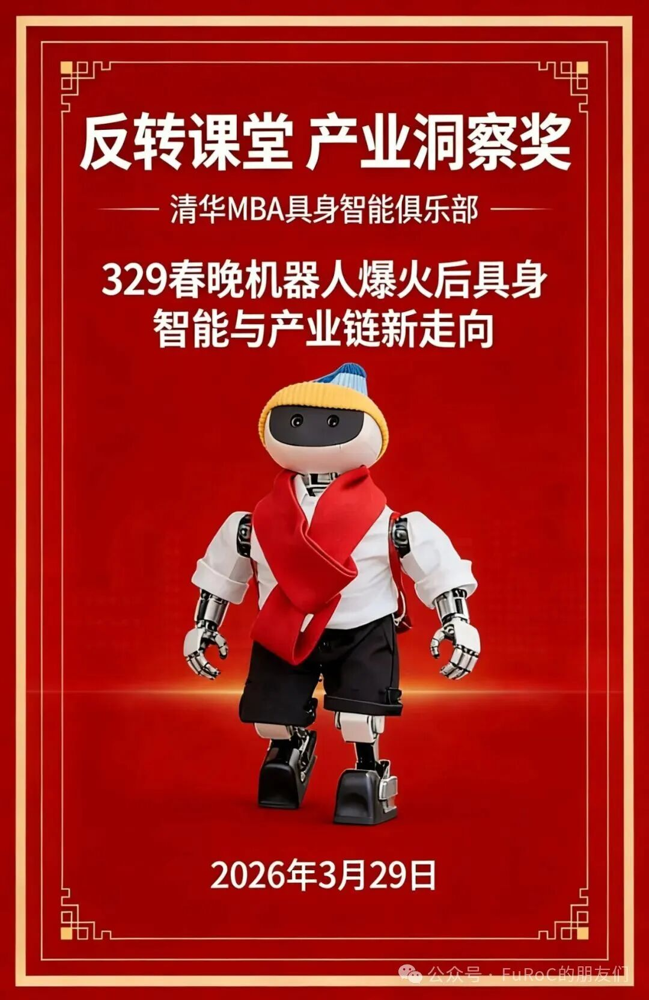

主办单位

**指导单位：**

清华经管MBA教育中心

**主办单位：**

清华MBA具身智能俱乐部

清华未来机器人兴趣团队

**协办单位：**

TTC

清华MBA出海俱乐部

清华MBA创业俱乐部

清华MBA人工智能俱乐部

清华MBA科创管理俱乐部

**报名方式**

请同学们扫码报名，实名制填写报名信息，活动当天凭借报名信息签到入场。校外同学请自行解决入校报备，感谢配合！

**工作人员**

****活动发起****| 王明玥

****活动统筹**** | 王阔

**活动策划** | 蒲冰、高敏、刘思彤

****工作人员****| 丁冠翔、徐柠杉、闫安、许嘉昭、吴建敏、郑文哲、宋佳荣、刘逸阳、朱瑞依

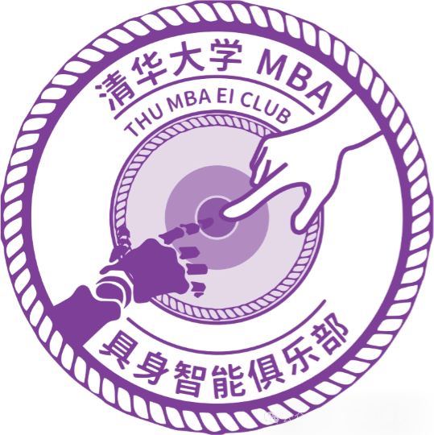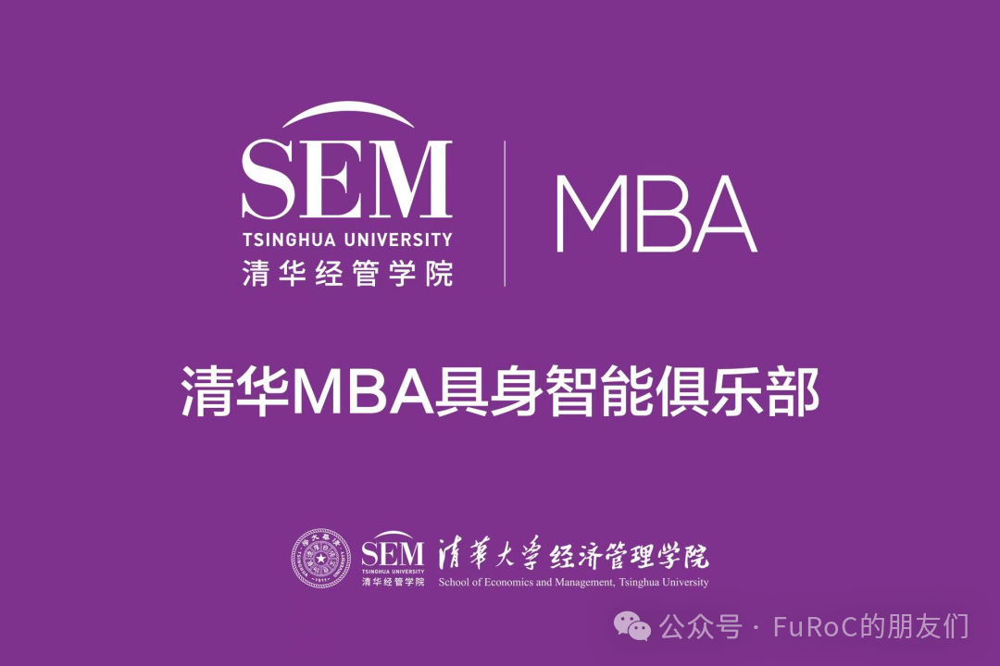

清华MBA具身智能俱乐部致力于加速资源整合，推动跨领域合作，为具身智能行业的发展提供创新支持和启发，旨在成为清华具身智能商业化的精英网络和知识的商业化桥梁。通过行业专家分享、专题项目研究会和创新小组实践等活动，俱乐部为会员提供知识提升、资源整合和创新实践的机会，助力职业成长，推动技术和市场的深度融合。

**排版**：徐柠杉、吴建敏

