# 清华THMOS队｜2026 RoboCup机器人世界杯中国赛小型组季军

> 公众号: FuRoC的朋友们
> 发布时间: 2026-05-11 11:56:13
> 原文链接: https://mp.weixin.qq.com/s/Dogjiwofl8j2jwe-fUHcEQ

---

2026年5月，2026中国机器人大赛暨RoboCup机器人世界杯中国赛在北京圆满落幕。清华THMOS队携类人组Small Size（小型组）与Middle Size（中型组）两支队伍出战，在多轮比拼中稳扎稳打、迎难而上，最终斩获Small Size组别季军，并获得Middle Size组别第7名。

本次比赛中，清华THMOS队在核心系统架构上进行了重要升级。团队将原有核心系统从 Python + ROS2 重构为 C++ + IPC 架构，显著降低了通信与运行时开销。在决策层面，团队基于多机通讯机制实现状态与意图共享，使机器人决策从过去的“单机局部最优”进一步升级为“全队协同最优”。这一变化使场上角色分工更加稳定，战术执行更加一致，也让多机器人之间的配合更具整体性和连续性。

此次参赛，不仅是一次技术实力的集中检验，也是一次团队协作、临场应变与工程实践能力的全面锤炼。赛场之上，队员们在高强度调试与连续对抗中不断磨合，在问题中寻找突破，在实战中积累经验，为后续赛事和技术迭代奠定了坚实基础。

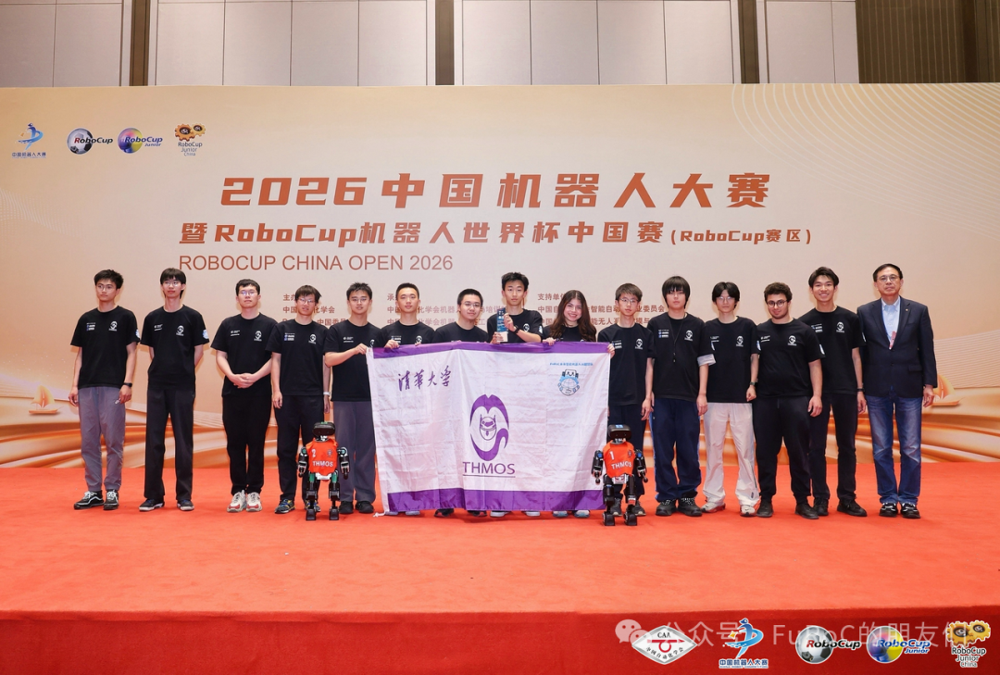

Part 1

**以赛砺技，载誉而归**

本届赛事中，类人组Small Size组别共有20支队伍参赛，Middle Size组别共有8支队伍同台竞技。赛程分为线上小组赛与现场淘汰赛两个阶段。在线上阶段，各参赛队伍需在空场环境下完成进球能力测试。清华THMOS队两支队伍分别取得小组第三、第四的成绩，顺利晋级现场赛。
进入现场赛后，比赛强度与不确定性进一步提升。现场仅设置一块比赛场地，多支队伍需在有限时间内完成调试、适配与对抗。现场赛阶段直接进入淘汰赛，对机器人系统稳定性、规则适配能力、临场调试效率以及队员协作水平都提出了更高要求。
面对紧张赛程与复杂现场环境，清华THMOS队凭借前期技术积累和队员间的默契配合稳步推进。最终，Small Size组别获得季军，Middle Size组别获得第7名，用实战成绩检验了团队长期训练与持续投入的成效。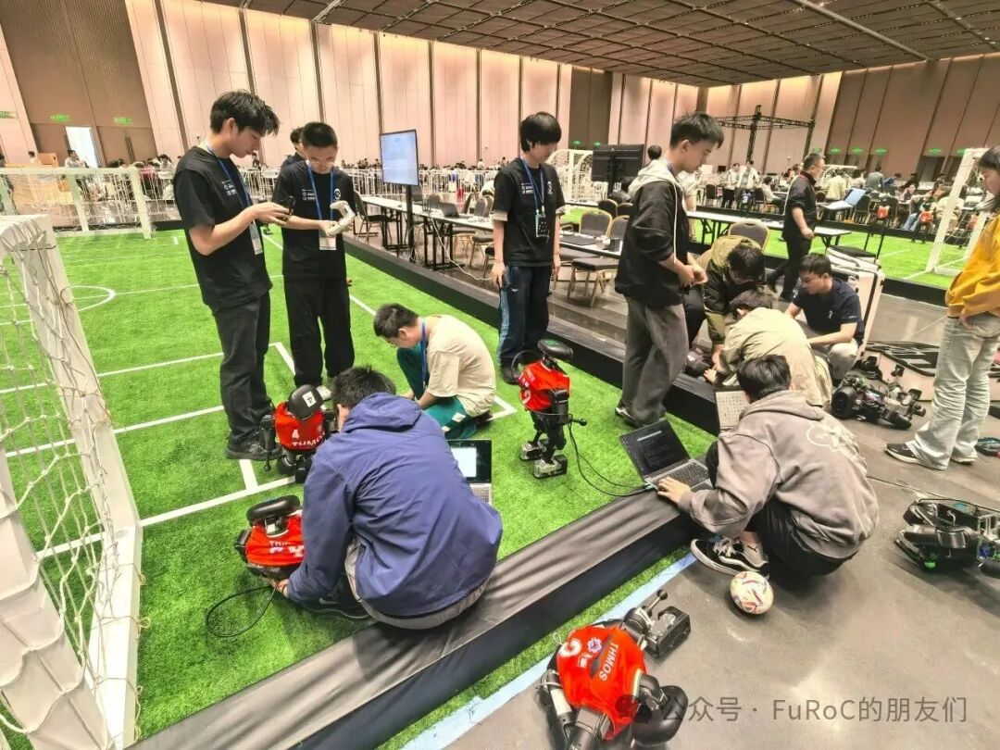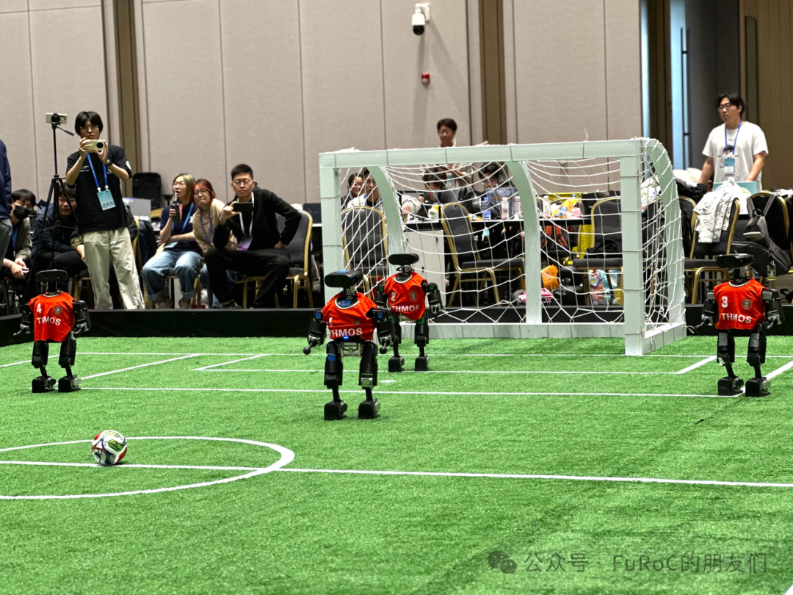

Part 2

稳步突围：Small Size队伍斩获季军

Small Size队伍Pi+在本次比赛中表现稳健。队伍顺利从线上小组赛突围，并在现场赛中保持较好的竞技状态，最终获得Small Size组别季军。

比赛过程中，Pi+一度遭遇感知系统调试难题，相关问题占用了决策组较多调试时间。面对突发情况，队员们迅速分工、协同排查、连续迭代，最终保障了机器人在赛场上的稳定发挥。比赛中，Pi+多次完成精准进球，展现出良好的运动控制能力、系统响应速度和多机协同水平。

与此同时，比赛也暴露出一些值得进一步改进的问题。例如，感知组部分新队员对机器人调试流程仍不够熟悉，在高强度赛程下上手难度较大，一定程度上影响了整体调试效率。正因如此，本次比赛也成为新队员快速成长的重要实践场景。通过实战，大家对赛制规则、硬件维修、系统调试和临场协作有了更直接、更深入的认识。

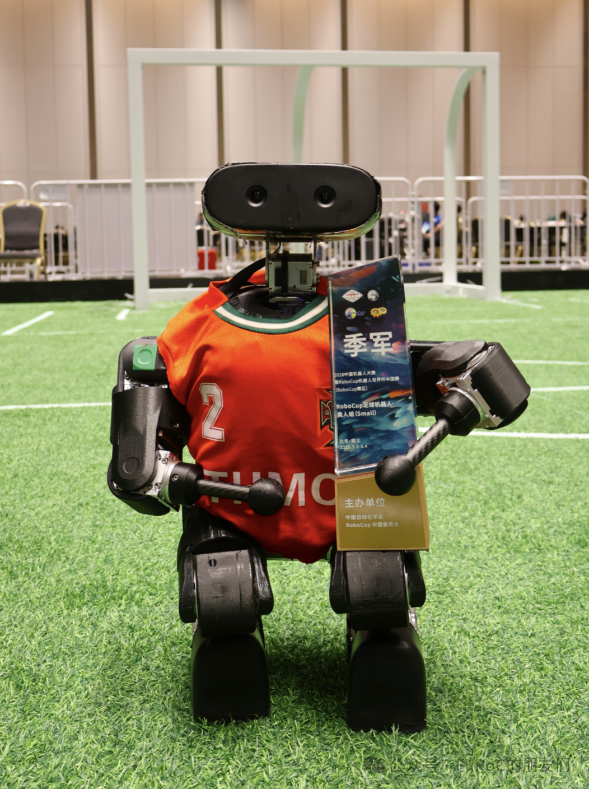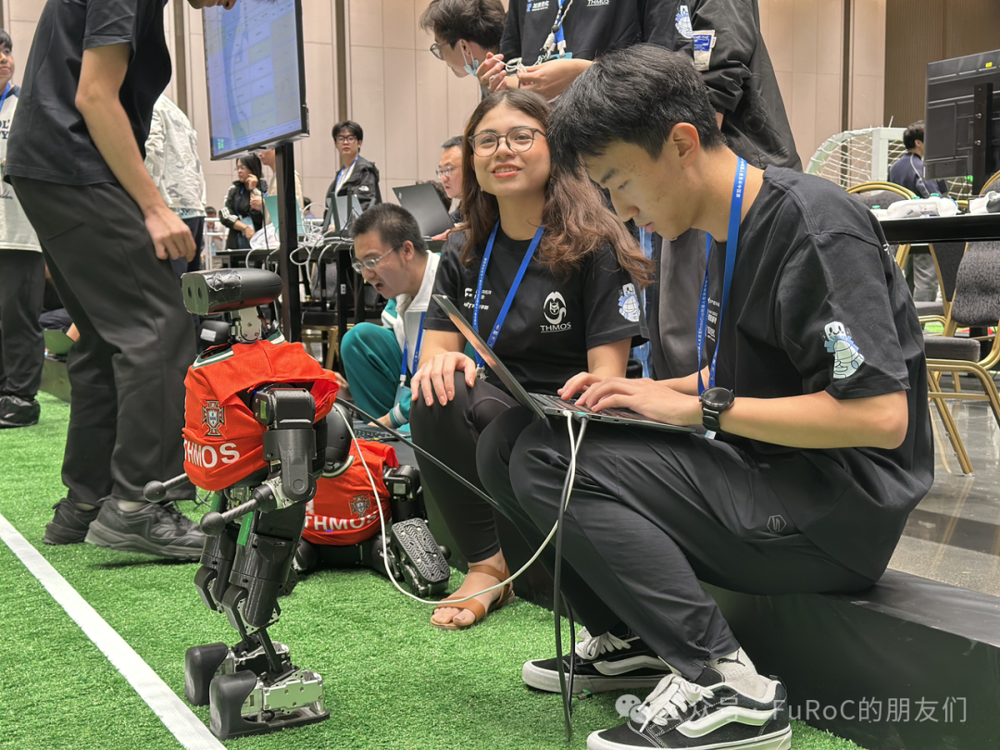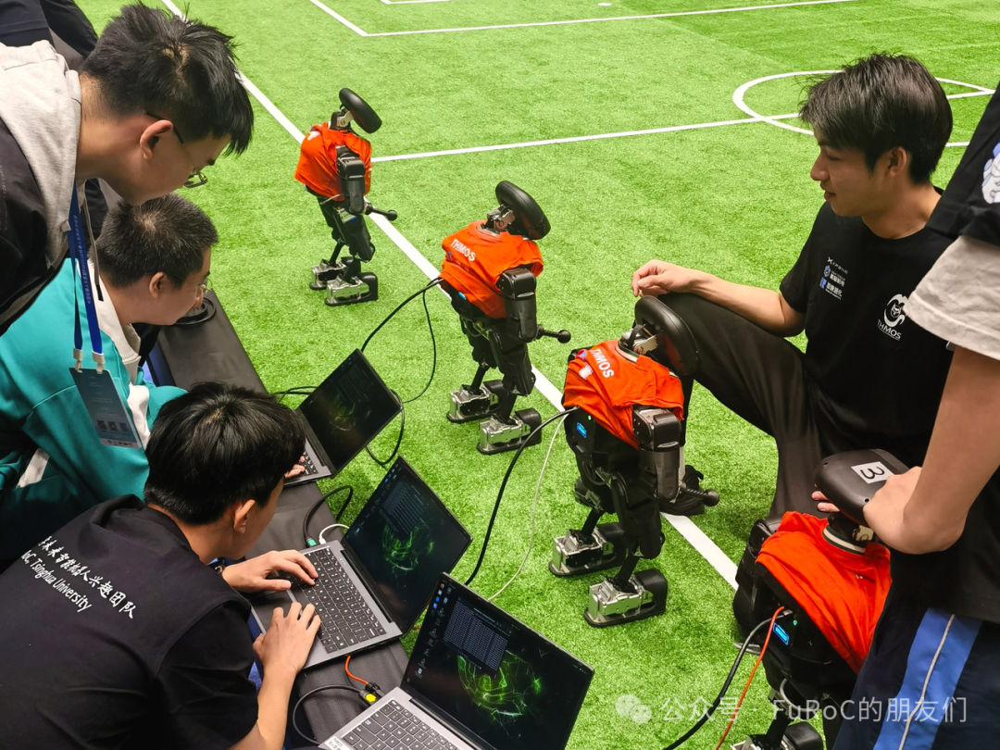

Part 3

**逆风调整：Middle Size队伍积累宝贵经验**

Middle Size队伍K1的参赛过程则更具挑战。由于赛前固件升级未能充分测试并备份，比赛期间机器人一度出现无法正常踢球、行走等问题，影响了关键场次的发挥。同时，定位问题也在现场调试中持续暴露，相机与步态里程计等环节尚未形成足够稳定的协同，感知组、步态组部分调试工作最终由决策组队员协助完成，也在一定程度上分散了团队精力。

尽管开局不利，K1队伍并未放弃。后期比赛中，队员们快速复盘、紧急调整，在不断排查问题的过程中逐步恢复比赛状态。尤其是在最后一场比赛中，双方上半场、下半场战至7:7平，加时赛阶段清华THMOS队以3:2取胜，并最终以10:9的总比分战胜山东大学，成功锁定Middle Size组别第7名。

这场比赛充分展现了队员们的韧性与执行力。更重要的是，大家在处理突发问题的过程中进一步理解了机器人底层调用逻辑、运动控制机制与现场调试方法，为后续系统升级和队伍建设积累了宝贵的一线经验。

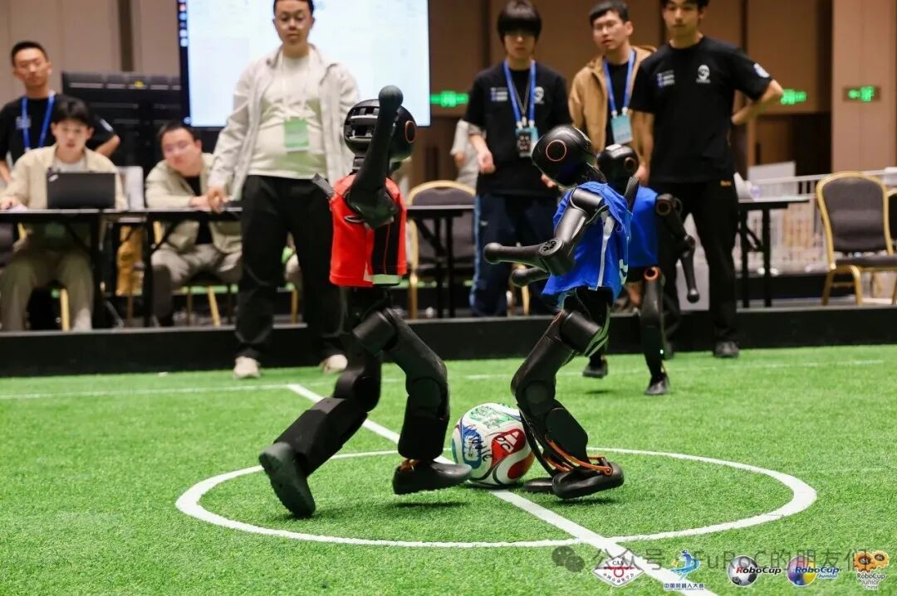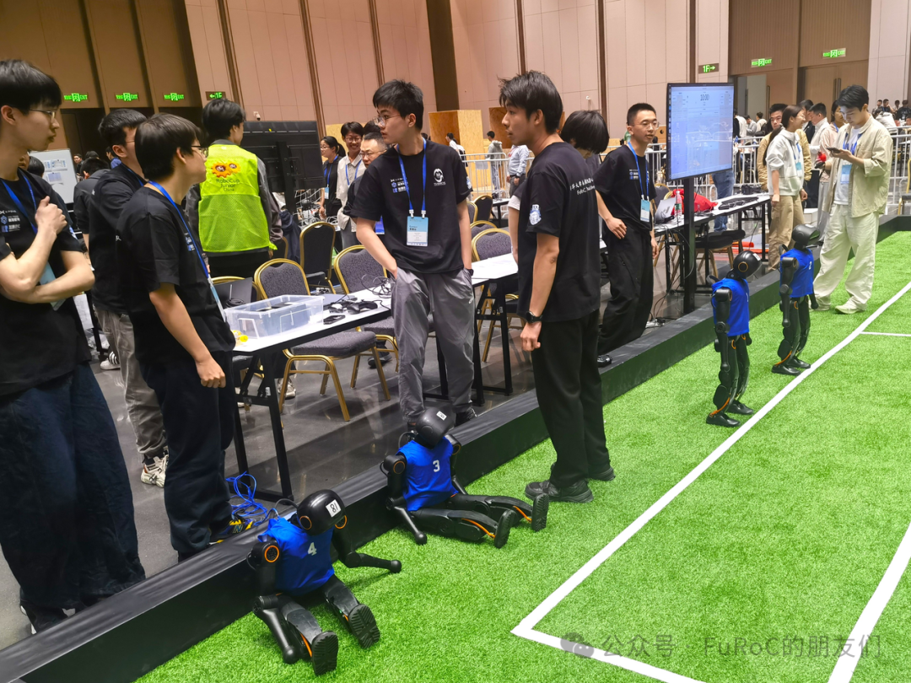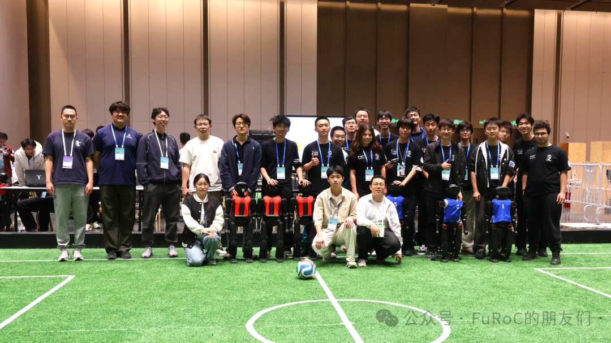

Part 4

**同心致远，共赴成长**

本次中国赛不仅检验了清华THMOS队的技术水平，也进一步锤炼了团队的凝聚力和战斗力。对每一位队员而言，这都是一次真实而深刻的成长。

新队员在比赛中快速熟悉了机器人调试流程、Git协作、硬件维护和规则适配等基础技能；老队员则在高压环境下进一步提升了沟通协调、任务分配和临场判断能力。比赛让大家更加清晰地认识到，机器人竞赛不仅是技术比拼，更是工程实践、团队协作与心理韧性的综合考验。

赛场内外，队员们各司其职、彼此补位。主要技术负责人全程坚守现场，持续处理各类技术问题；有队员在不同场地之间奔波，兼顾裁判、对接与协调工作；也有队员认真研读规则，帮助团队减少误判风险；后勤同学默默保障餐食与物资，让大家能够专注比赛。备赛时间紧、突发状况多，但队员们始终共同面对、一起解决，这正是THMOS队最宝贵的团队底色。

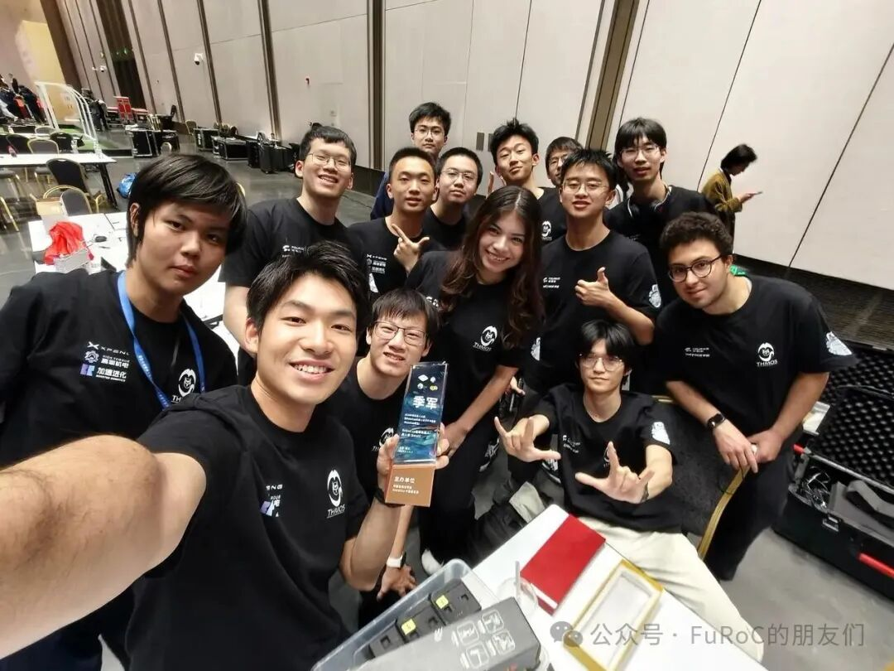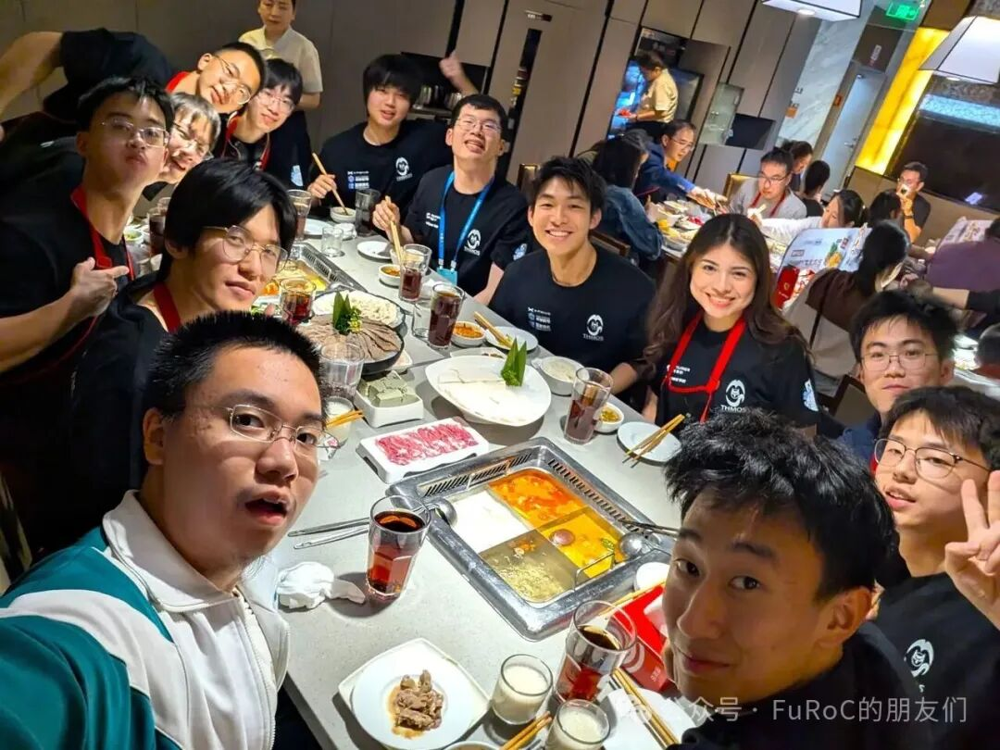

Part 5

**正视不足，蓄力前行**

复盘本次比赛，清华THMOS队既收获了成绩，也看到了不足。无论是赛前测试与备份机制、现场调试流程，还是组间协作、规则理解、硬件维护和新人培养，都还有进一步提升空间。

与此同时，本次比赛也验证了团队在系统架构和协同决策方向上的阶段性成果。面向后续赛事，THMOS队将继续围绕低延迟通信、多机协同决策、稳定感知融合、运动控制优化和临场调试流程等方向持续迭代，不断提升机器人在复杂对抗场景下的稳定性、适应性与整体战术执行能力。

每一场比赛，都是一次沉淀；每一次复盘，都是一次进步。中国赛的结束不是终点，而是清华THMOS队继续向更高目标迈进的新起点。面向后续国际赛及更多赛事任务，团队将进一步完善技术体系，优化调试流程，加强队伍建设，在实战中持续打磨机器人系统的综合能力。

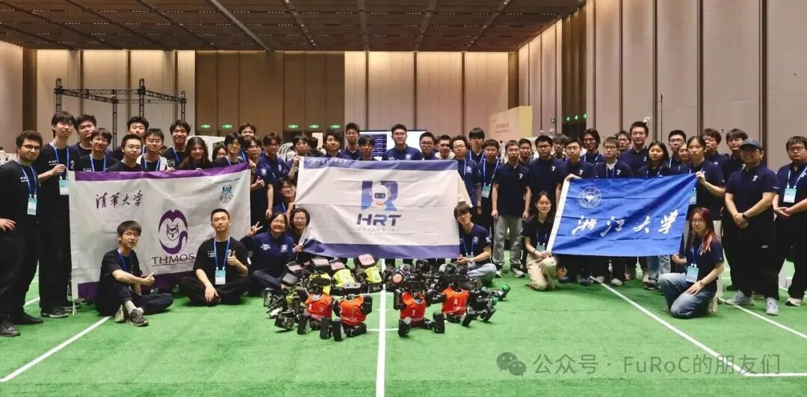已关注Follow  Replay    Share     Like   Close**观看更多**更多

退出全屏切换到竖屏全屏退出全屏FuRoC的朋友们已关注Share Video，时长00:49

0/0

00:00/00:49 切换到横屏模式 继续播放进度条，百分之0Play00:00/00:4900:49倍速全屏 倍速播放中0.5倍0.75倍1.0倍1.5倍2.0倍超清流畅 Your browser does not support video tags

继续观看

清华THMOS队｜2026 RoboCup机器人世界杯中国赛小型组季军

观看更多转载,清华THMOS队｜2026 RoboCup机器人世界杯中国赛小型组季军FuRoC的朋友们已关注Share点赞BoostWowAdded to Top StoriesEnter comment Video Details

**致谢**

**Thank You**

感谢THMOS队赞助方高擎机电、加速进化、小鹏（XPENG）在探索与实践过程中的支持与协作，助力团队在多赛道竞赛中持续迭代与优化。

感谢每一位全力以赴的THMOS队员，感谢所有在备赛、调试、后勤、规则研究和现场支持中默默付出的同学。也感谢长期关心和支持清华THMOS队发展的老师、同学与朋友们。

以赛为起点，向更高目标进发。

THMOS，将继续在机器人与具身智能的道路上探索前行。

文案：全体THMOS参赛队员

图片视频：余志强，露思，德珍

审核：李啟文

文字：吴建敏

