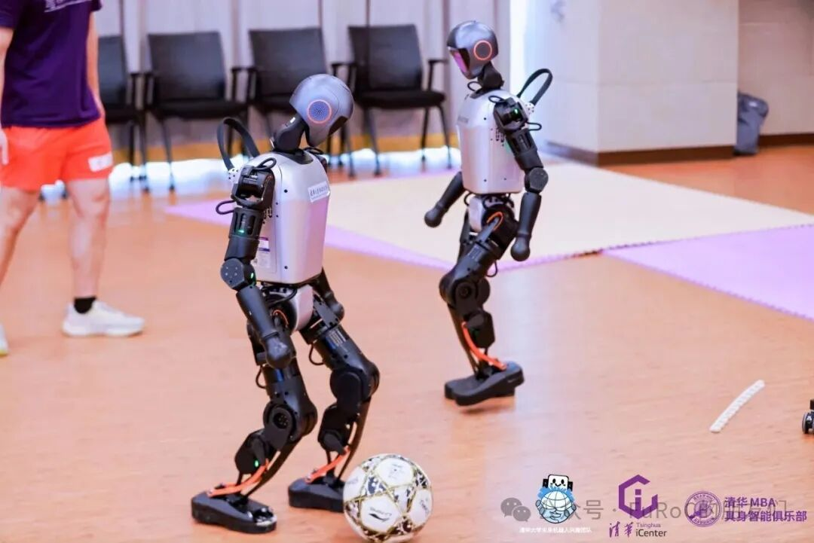
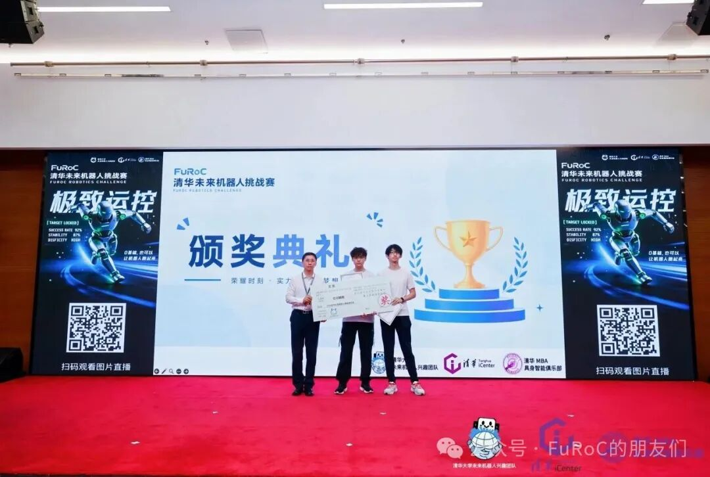
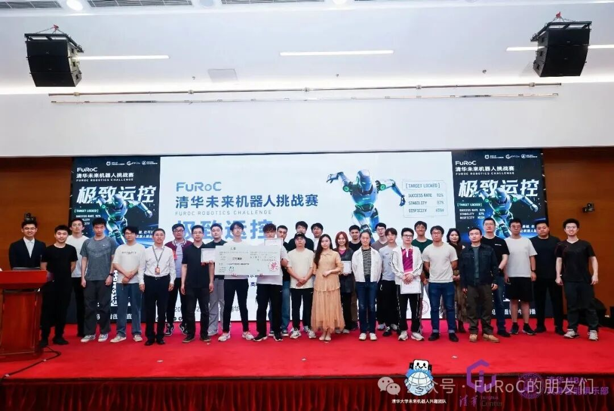
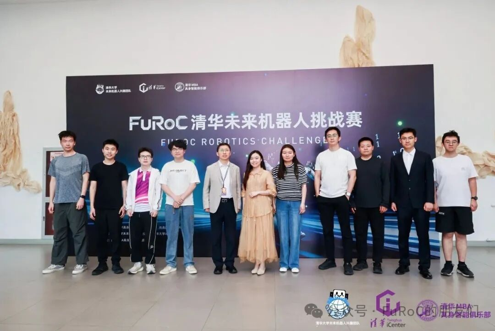

# 清华未来机器人挑战赛 佳绩速报

> 公众号: FuRoC的朋友们
> 发布时间: 2026-05-01 10:38:56
> 原文链接: https://mp.weixin.qq.com/s/9WZV8T5WPQ5bShy0HOaLaQ

---

赛况综述

2026年FuRoC清华未来机器人挑战赛圆满落幕。本届赛事以“极致运控”为主题，旨在激发清华学子对机器人、具身智能及高动态控制方向的探索热情。

比赛吸引了校内外多支队伍同台竞技，涵盖动态踢球、障碍物自主导航、带球竞速及自选课题等多个高难度方向。在不到两周的“极限开发”周期内，同学们在运控领域实操精进，全部队伍均顺利完赛。经过激烈比拼与严格评审，最终 6 支队伍脱颖而出，产生一等奖 1 项、二等奖 2 项、三等奖 3 项。

本次挑战赛由共青团清华大学委员会指导，清华大学未来机器人兴趣团队、清华大学iCenter主办，清华MBA具身智能俱乐部协办。特别鸣谢魔法原子、加速进化、高擎动力、NVIDIA的支持。

获奖详情

本次最高荣誉由程允康带队的第4组摘得，队员包括李孟涵、吴宇同与周诗贺。其自选题目为轮滑机器人，以出色的技术发挥夺得一等奖，赵明国老师亲自为其颁奖。

二等奖由两支队伍共同收获。潘洪浩带领的第1组参加带球竞速赛道，队员为马振煊、叶展维与符敦靖，于下午第四场出赛，凭借流畅的控球与竞速策略获此殊荣。刘建翔率领的第2组选择障碍物导航赛道，携手赵金柯共同参赛，于下午第二场出赛，同样摘得二等奖。

三等奖方面，共有三支队伍上榜。王科锦带队的第3组（障碍物导航，队员汪佳宇）于下午第二场出赛；黄翊愷率领的第5组（障碍物导航，队员鞠坤达、符敦靖、颜月明）于下午第五场出赛；黄予乔带领的第10组（队员王子煦、丁葳）于下午第六场压轴出赛。三组均发挥稳定，各获三等奖。

**结语**

本次赛事各队伍均顺利完成全部赛程，整体竞技水准突出，充分展现了参赛团队扎实的技术积淀与昂扬的科创风采。

未来，FuRoC 将持续深耕机器人赛事领域，不断打磨赛事品质，搭建更优质的交流竞技平台，期待未来再创更多精彩。

