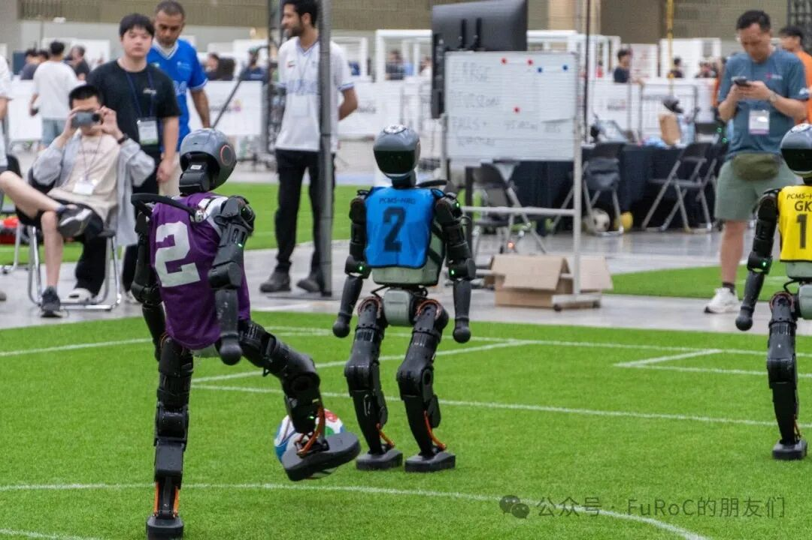
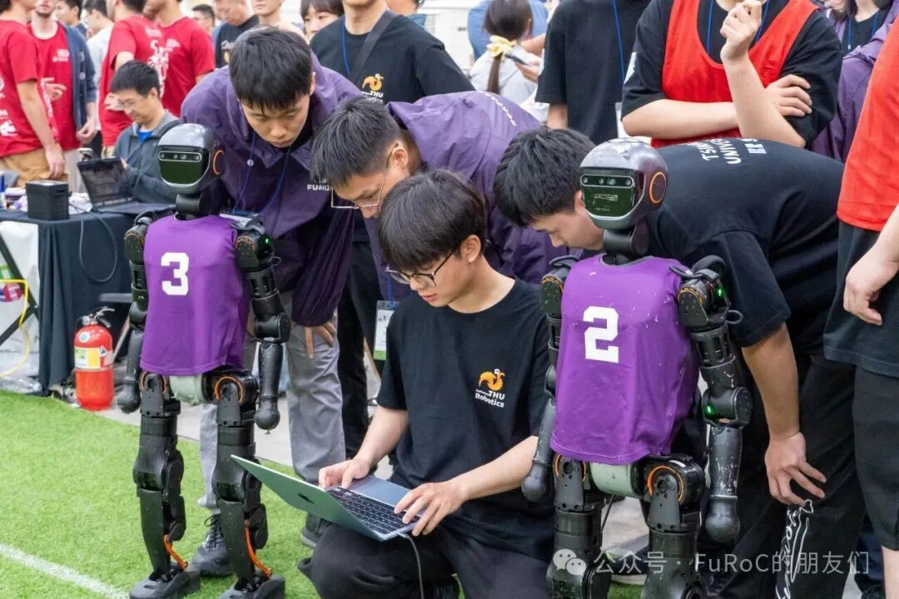
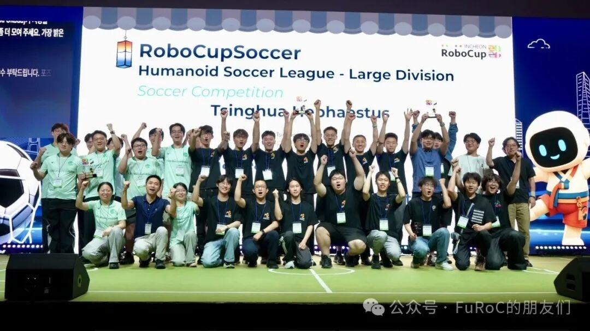
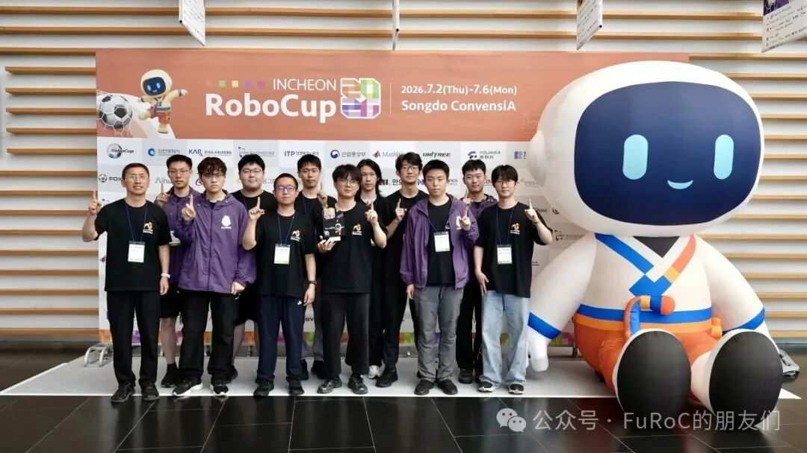

# 清华火神队卫冕2026机器人世界杯（RoboCup）人形机器人足球大型组冠军

> 公众号: FuRoC的朋友们
> 发布时间: 2026-07-07 11:27:09
> 原文链接: https://mp.weixin.qq.com/s/kvz2R6H5BmmFci8WJlk3Hg

---

RoboCup

TSINGHUA FUROC · INCHEON RoboCup 2026

**清华力量 智竞仁川**

以工程实力，赴世界之约

7月5日,2026机器人世界杯（RoboCup）在韩国仁川松岛会展中心圆满收官。作为全球规模最大的机器人综合赛事,本届比赛汇聚了来自45个国家和地区的364支队伍。在最受瞩目的人形机器人足球Large Size组项目中,自动化系清华火神队以保持战绩、卫冕世界冠军。

清华火神队比赛现场照片

22支大型组参赛队伍的积分循环赛中，火神队保持全胜，排位第一。淘汰赛八分之一决赛,火神队以9:1大胜澳门PCMS-HRG队,顺利跻身八强；四分之一决赛面对巴西Bahia RoboticsTeam队,又以8:0完成零封，昂首闯入四强；半决赛与北京信息科技大学Water队狭路相逢，火神队凭借稳健的攻防以5:0胜出，锁定决赛资格。

决赛中,火神队再度与老对手——中国农业大学山海队会师。上半场,双方一度战成1:1,场面胶着；易边再战，火神队彻底打开局面，下半场连入5球，最终以6:2力克对手，成功卫冕2026机器人世界杯人形机器人足球大型组冠军，尽显冠军之师的深厚底蕴与强劲后劲。

清华火神队与大型组亚军及季军合影

清华火神队由清华大学自动化系赵明国研究员于2004年创立，是国内最早投身RoboCup人形机器人足球的队伍之一。2025年，火神队接连斩获RoboCup机器人世界杯人形组冠军、全球首届世界人形机器人运动会5V5足球赛冠军等多项国际殊荣，实现了中国团队的历史性突破。此次仁川夺冠，不仅是对上届荣誉的成功卫冕，更标志着球队在世界人形机器人足球舞台上稳稳站在了领跑者的位置。

清华火神队合影

以下视频来源于清华大学自动化系已关注Follow  Replay    Share     Like   Close**观看更多**更多

退出全屏切换到竖屏全屏退出全屏FuRoC的朋友们已关注Share Video，时长00:26

0/0

00:00/00:26 切换到横屏模式 继续播放进度条，百分之0Play00:00/00:2600:26倍速全屏 倍速播放中0.5倍0.75倍1.0倍1.5倍2.0倍超清流畅 Your browser does not support video tags

继续观看

清华火神队卫冕2026机器人世界杯（RoboCup）人形机器人足球大型组冠军

观看更多转载,清华火神队卫冕2026机器人世界杯（RoboCup）人形机器人足球大型组冠军FuRoC的朋友们已关注Share点赞BoostWowAdded to Top StoriesEnter comment Video Details

决赛精彩瞬间视频

**Furoc简介**

清华大学未来机器人兴趣团队（简称“FuRoC” ）是在共青团清华大学委员会、清华大学教务处及清华大学具身智能与机器人研究院指导下，由基础训练中心、自动化系与机械系共同支持建设的全校性学生机器人兴趣团队，面向机器人与具身智能方向开展跨学科实践与技术探索。

撰稿 | 刘思彤

摄影 | 南晓璐    视频 | 刘思彤

编辑 | 韩赟祯

审核 | 赵明国

