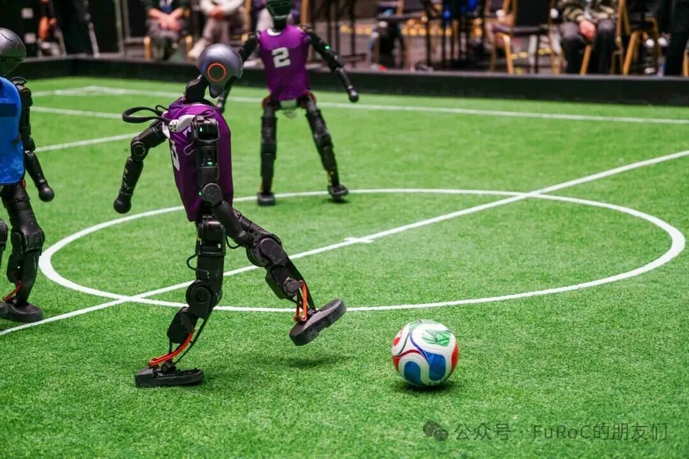
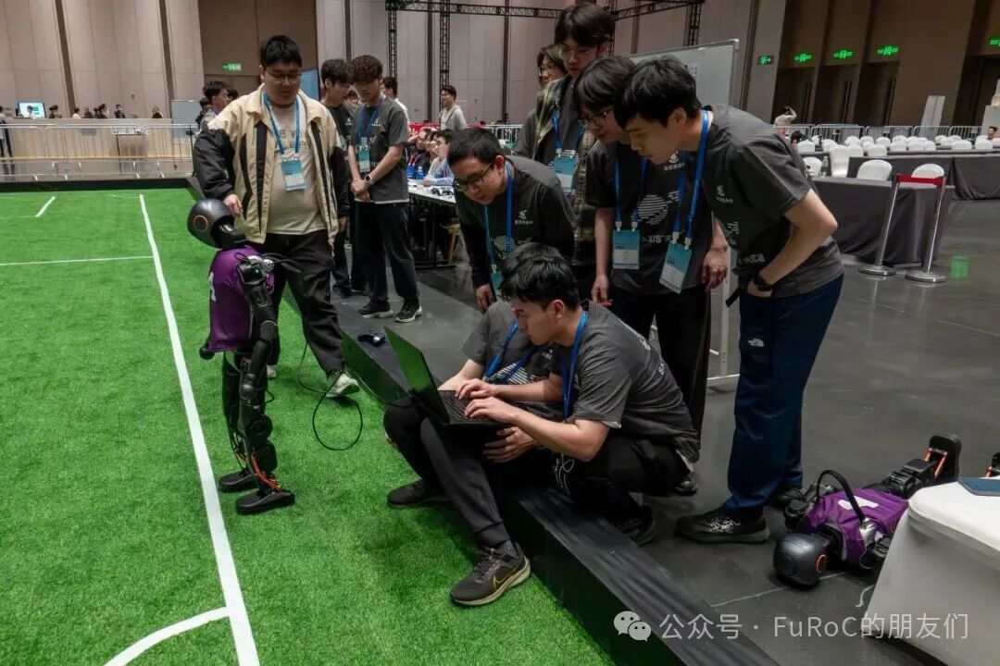
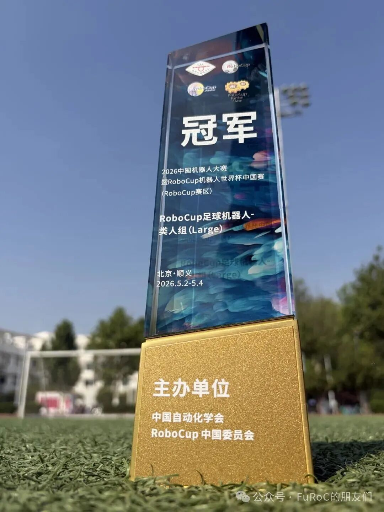
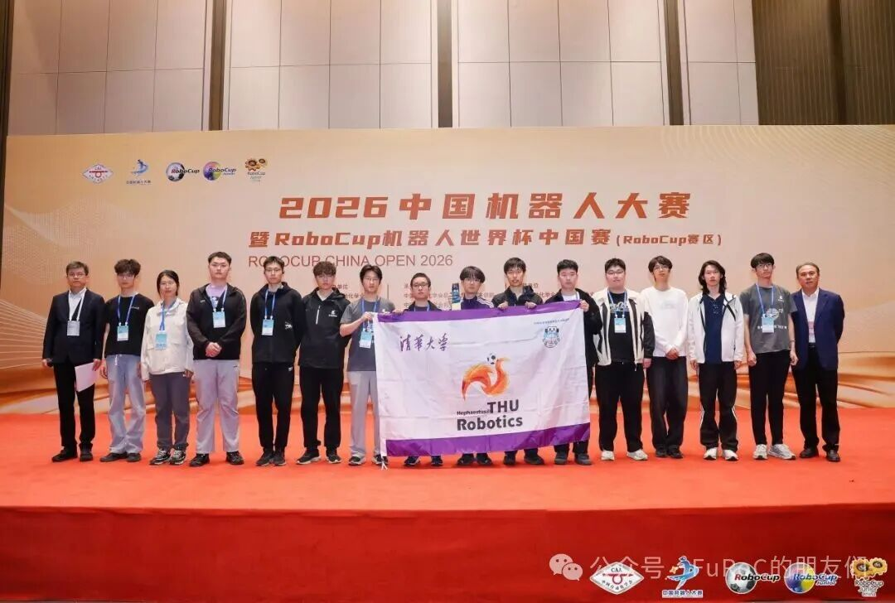
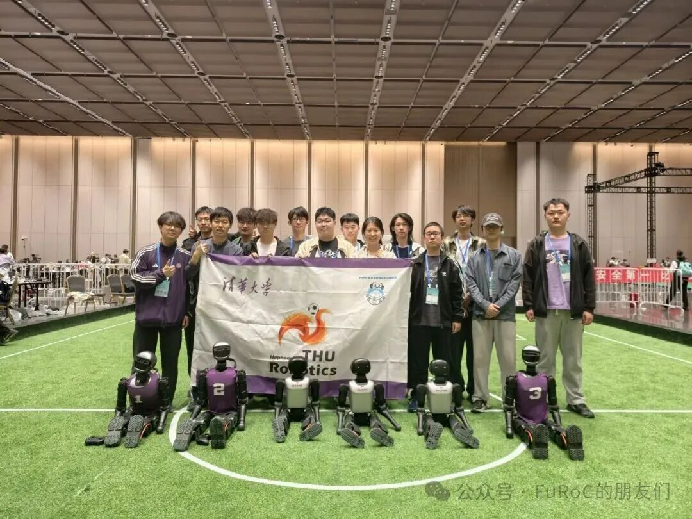

# 清华火神队｜2026 RoboCup中国赛类人组Large Size冠军

> 公众号: FuRoC的朋友们
> 发布时间: 2026-05-06 09:17:32
> 原文链接: https://mp.weixin.qq.com/s/cxL9bnQ6E24ZAkHf7Wv9bg

---

2026年5月4日，2026中国机器人大赛暨RoboCup机器人世界杯中国赛在北京圆满落幕。清华未来机器人兴趣团队——火神队作为出战队伍之一，在类人组Large Size项目中表现强势，一路过关斩将，最终摘得桂冠。

清华火神队比赛现场

比赛过程中，火神队展现出极佳的统治力：淘汰赛首轮以4:1击败农大青禾队，晋级四强；半决赛对阵上海交通大学数字山海队，再以7:2取胜，锁定决赛席位；决赛中与北京信息科技大学I-Kid队展开较量，最终以8:2的大比分获胜，成功捧起2026 RoboCup机器人世界杯中国赛类人组Large Size冠军奖杯。此外，火神队还获得了类人组Large Size技术挑战赛冠军，进一步体现了队伍在运动控制上的综合能力。

颁奖嘉宾与清华火神队合影

清华火神队由清华大学自动化系赵明国研究员于2004年创立。2025年，“清华火神队”接连斩获RoboCup机器人世界杯人形组冠军、全球首届世界人形机器人运动会5V5足球赛冠军等多项国际殊荣，实现了中国团队的历史性突破。

清华火神队合影

已关注Follow  Replay    Share     Like   Close**观看更多**更多

退出全屏切换到竖屏全屏退出全屏FuRoC的朋友们已关注Share Video，时长01:24

0/0

00:00/01:24 切换到横屏模式 继续播放进度条，百分之0Play00:00/01:2401:24倍速全屏 倍速播放中0.5倍0.75倍1.0倍1.5倍2.0倍超清流畅 Your browser does not support video tags

继续观看

清华火神队｜2026 RoboCup中国赛类人组Large Size冠军

观看更多转载,清华火神队｜2026 RoboCup中国赛类人组Large Size冠军FuRoC的朋友们已关注Share点赞BoostWowAdded to Top StoriesEnter comment Video Details

点击查看首赛精彩瞬间

（红色队服为清华火神队）

已关注Follow  Replay    Share     Like   Close**观看更多**更多

退出全屏切换到竖屏全屏退出全屏FuRoC的朋友们已关注Share Video，时长01:30

0/0

00:00/01:30 切换到横屏模式 继续播放进度条，百分之0Play00:00/01:3001:30倍速全屏 倍速播放中0.5倍0.75倍1.0倍1.5倍2.0倍超清流畅 Your browser does not support video tags

继续观看

清华火神队｜2026 RoboCup中国赛类人组Large Size冠军

观看更多转载,清华火神队｜2026 RoboCup中国赛类人组Large Size冠军FuRoC的朋友们已关注Share点赞BoostWowAdded to Top StoriesEnter comment Video Details

点击查看决赛精彩瞬间

（紫色队服为清华火神队）

致谢Thank You
感谢火神队赞助方加速进化及俞浩慈善基金会“天空计划-清华大学专项”对火神队的长期支持，为团队技术研发与备赛提供重要保障。感谢北奥集团对赛事组织与参赛工作的支持与指导。
以赛为起点，向真实世界进发。FuRoC，将持续探索具身智能的边界。
关于 FuRoCAbout Us

清华大学未来机器人兴趣团队（简称“FuRoC” ）是在共青团清华大学委员会、清华大学教务处及清华大学具身智能与机器人研究院指导下，由基础训练中心、自动化系与机械系共同支持建设的全校性学生机器人兴趣团队，面向机器人与具身智能方向开展跨学科实践与技术探索。

编辑 | 陈博敏

审核 | 刘思彤

