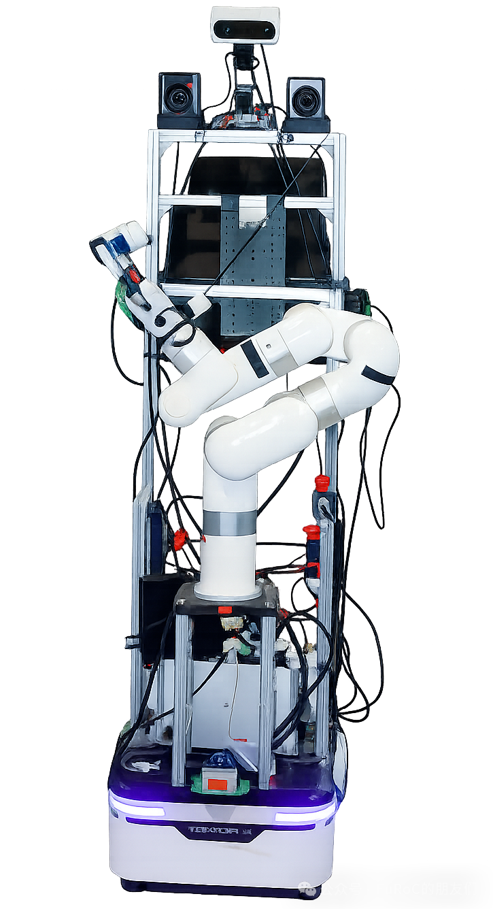
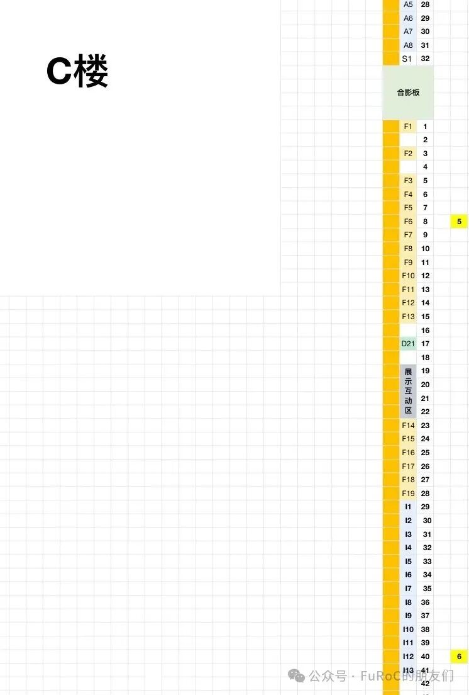
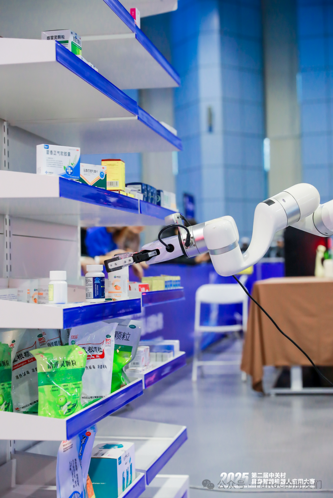
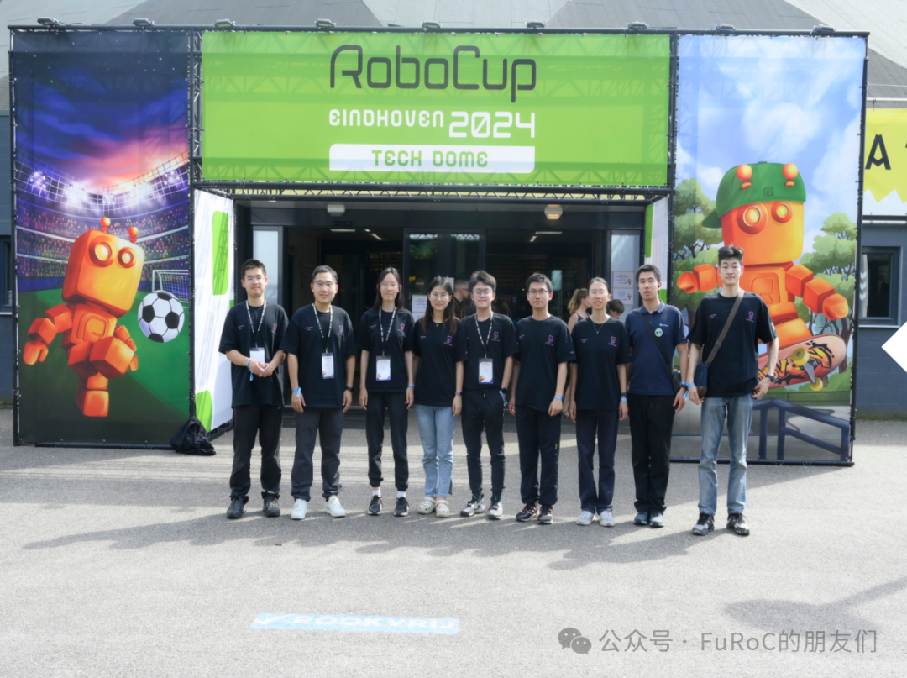
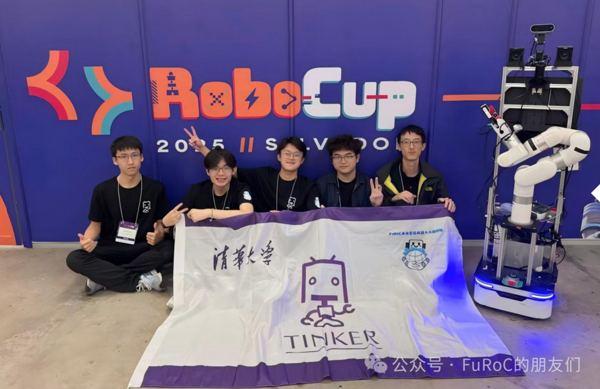

# 社团招新 | 清华大学Tinker家用服务机器人队

> 公众号: FuRoC的朋友们
> 发布时间: 2026-03-17 14:20:29
> 原文链接: https://mp.weixin.qq.com/s/fYiExmdyJB_7xOHIoHpfZg

---

*[#JOIN](javascript:;) US#*

**2026**

**春季**

**Tinker 招新**

FuRoc

**INTRODUCE**

**你是否对机器人充满兴趣**

**是否想要接触机器人技术前沿**

**是否想参与一项机器人国际赛事**

**学技术、拿大奖**

**……**

**未来机器人兴趣团队**

**招新啦！！！**

**第四周 周四周五(3.19-3.20)百团大战**

**C楼前 F1摊位 等你来看！**

**未来机器人兴趣团队**

 未来机器人兴趣团队（Future Robotics Club），简称FuRoC，是由清华大学本科生、研究生组成的学生兴趣团队，专注于机器人、人工智能技术和相关领域的研究和技术探索。

       Tinker队是由积极为FuRoC做出贡献的骨干成员组成的**一支家用服务机器人比赛队**,旨在通过参加RoboCup国际赛这样的世界范围比赛，在不断迭代中掌握世界顶尖的高水平的机器人技术，并为未来留下技术积累，为热爱机器人的同学们发挥兴趣特长提供良好的技术平台。

**PART**

**NO.1**

组织结构

人员组织

未来机器人兴趣团队目前拥有150多名成员，  其中Tinker队目前的骨干大致15人，涵盖了自动化、电子、计算机、软件、精密仪器、机械等十余个院系。

    Tinker队伍的**组织管理模式是“老带新”**，高年级的老队员往往承担着管理与开发骨干的工作，负责**每周**开展技术交流，分享机器人相关理论知识和技术开发经验，同时负责带领新队员开发学习；低年级的新队员则可以参与队伍的技术交流，并跟随老队员**共同参与开发**。

队伍现状

 Tinker 家用服务机器人为集合机械臂运动规划与抓取、激光雷达 + VSLAM、深度相机识别、语音系统的大型机器人平台，主要面向**家庭环境下**物品传递、食物制作、垃圾分类等实际应用场景，是由各届队伍成员自主搭建的机器人平台，拥有自主设计的底盘方案；同时经过了多次迭代，已经基本具备完成基本家庭服务任务的各项能力。

    我们建立了**以兴趣为导向、以开发为基础**的团队氛围。通过项目开发、技术分享、定期会议、参加国际比赛以及其他活动，关注国内外机器人相关领域的研究动态和产业发展，不断尝试先进技术。

        FuRoc 团队参加Robocup国际、国内比赛有着悠久历史，往届取得了优异成绩：

- 第二届中关村具身智能机器人应用大赛 具身智能商用服务场景应用赛 一等奖 2025
- 机器人世界杯家庭服务赛道组 国际第八名 2025
- 中国机器人大赛暨Robocup机器人世界杯中国赛 国家三等奖  2025
- 具身智能机器人运动会 拟人化设计奖 2025
- 中国机器人大赛暨Robocup机器人世界杯中国赛 国家三等奖  2024
- 亚太机器人世界杯天津国际邀请赛家庭服务赛道 季军 2024

**PART**

**NO.2**

**我们的队伍**

**Tinker队 招新宣讲**

- 时间：3.22 第4周周日 19:00-21:00
- 地点:  建华楼六楼嘉信汇金路演厅

**视觉组**

**我们在做什么？**

- 在开放场景中识别任务目标
- 记录并重识别人体特征
- 识别手势等人体动作

**当前技术栈**

- 开放场景目标识别：SAM3 + Qwen VL
- 人体特征识别：Qwen VL + 微调ResNet
- 人体动作识别：MediaPipe + YOLO-seg

**加入视觉组，你将收获...**

- 前沿硬件支持：Orbbec、Realsense 等 RGBD 双目相机+显卡支持，真实体验具身视觉系统的搭建
- 完整技术闭环：参与开发、维护、调试一套完整的视觉识别 pipeline
- 前沿探索机会：接触并实践最新的视觉模型与算法

**我们期待你...**

- 对机器人和视觉感兴趣，会觉得深度相机眉清目秀（不是）

- 有一定的编程基础（Python或C++等）

- 有投入时间和精力的准备，愿意在项目中成长

- 有ROS1/2或CV方面经验的优先（没有的也不要怕，我们会教的0w0）

上下滑动，查看详情

**语音组**

**我们在做什么？**

- 听懂复杂指令：让机器人不仅能听懂“去拿瓶可乐”，还能理解上下文和隐含意图，比如“我刚喝过的那个饮料，再帮我拿一瓶”
- 多轮对话交互：当指令模糊时，主动向用户提问澄清，“桌面有可乐和雪碧，您想要哪一个？”

**当前技术栈**

- 语音识别：OpenAI Whisper（本地部署/API），支持中英文混合识别
- 语义理解：接入大语言模型（智谱ChatGLM、Moonshot Kimi），解析任务意图
- 语音合成：Coqui TTS，支持多音色、情感化语音生成
- 对话管理：构建基于LLM的多轮对话系统，维护对话状态

**加入语音组，你将收获...**

- 前沿硬件支持：Tinker 家务机器人实体、体验麦克风阵列、高性能计算设备，搭建真实的机器人语音交互系统
- 前沿探索机会：实践最新的语音大模型、端侧语音技术、多模态交互方案
- 跨组协作体验：与决策组深度合作，实现“语音+决策”的人机交互实现

**我们期待你...**

- 对机器人和人机交互感兴趣，
- 有一定的编程基础（Python）
- 对音频信号处理、语音识别或大模型应用有好奇心和学习热情
- 有投入时间和精力的准备，愿意在项目中快速成长

上下滑动，查看详情

**操作组**

**我们在做什么？**

- 机械臂的运动、抓取与规划
- 操作机械臂从场景中拿取物品
- 将目标物品放置在指定位置

**当前技术栈**

- 目标位姿：AnyGrasp 选择一个合适的位姿来抓取目标
- 运动规划：CuMotion 根据目标位姿生成运动轨迹并避免碰撞
- 执行运动：MoveIt 执行运动轨迹并操作夹爪开闭
- 可视化显示：RViz2 实时显示机械臂当前状态
- 数据采集：通过遥控机械臂采集数据

**加入操作组，你将收获...**

- 对机器人运动学基础的了解
- 软硬件结合调试的经验
- 对前沿操作技术（如VLA）的理解

**我们期待你...**

- 喜欢玩机械臂，享受多关节联动的丝滑

上下滑动，查看详情

**决策组**

**我们在做什么？**

- 拆解任务，规划序列：当收到“tinker，去卧室把里面的人引导到客厅”的指令时，能将模糊指令转化为机器人可执行的、有序的行动步骤。
- 复杂状态下的动态决策：在执行任务（如抓取牛奶）途中，若遇到意外（如桌子被移动、目标被遮挡），能实时调整策略，规划新路径或子任务。
- 长链任务的自主执行：探索让机器人具备“常识”，能够自主完成多步骤、长时序的复杂任务，比如“收拾餐桌”这类需要判断、规划和纠错的工作。
- 行为与感知的桥梁：理解视觉等感知模块的输出（如“看到可乐”、“认出张三”），并基于这些信息决定机器人“下一步该做什么”。

**当前技术栈**

- 核心框架：基于行为树的决策方案，使用 pytree 库搭建清晰、模块化的机器人任务逻辑。
- 底层通信：ROS2 架构，实现决策模块与感知、控制模块间的高效、稳定通信。
- 前沿探索：让机器人具备更强的任务理解与长链任务执行能力，向自决策、自纠错的智能系统迈进。

**加入决策组，你将收获...**

- 真实的机器人平台：你的代码将直接运行在实体机器人上，感受决策逻辑驱动身体行动的乐趣。
- 核心智能的构建：参与设计与维护机器人的“大脑”，直面并解决开放环境下任务规划、执行与容错的真实挑战。
- 前沿技术探索：有机会深入实践大语言模型（如openclaw）与机器人决策的融合，探索如何让机器人更聪明地理解世界、规划任务。

**我们期待你...**

- 对“如何让机器人自己思考”充满好奇，热衷于解决逻辑与规划问题。
- 有一定的编程基础（Python或C++等），具备基本的逻辑思维能力。
- 有投入时间和精力的准备，享受在调试和优化中不断成长的成就感。
- 有ROS1/2、行为树或状态机方面经验的优先（当然，零基础但热情十足，我们也非常欢迎，会有系统的培训 0w0）。

上下滑动，查看详情

**硬件组**

**我们在做什么？**

- 机器人本体搭建：围绕 Tinker 平台，近期计划复制并重新搭建一台 trace-mini + xArm7 机械臂 的机器人平台，形成稳定可复现的硬件底座
- 机械结构设计与实现：通过 SolidWorks 进行 3D 建模，完成零件设计、结构适配、3D 打印与装配，让机器人从方案真正落到实体
- 数据采集平台搭建：搭建面向机器人感知的采集平台，例如 视觉 / YOLO 数据采集平台，为后续感知算法、操作任务和系统训练提供高质量数据支持
- 机器人机构升级改造：围绕实际任务不断优化机器人的机械结构，包括机械臂安装方案、传感器支架设计、底盘改造、模块集成与整体稳定性提升

**当前技术栈**

- 机械设计：SolidWorks 3D 建模，用于机器人结构设计、支架设计、连接件适配与整机方案迭代
- 平台搭建：基于现有机器人底盘与机械臂平台，进行整机装配、结构调试与模块集成
- 数据系统支持：面向视觉感知任务，搭建数据采集与标注前端平台，支持后续 YOLO 等感知模型训练与评测

**加入硬件组，你将收获...**

- 真实机器人硬件经验：从建模、打印、装配到调试，完整参与一台机器人从 0 到 1 的搭建过程
- 前沿平台实践机会：参与从单臂移动操作平台到升降柱双臂平台的持续演进，接触具身智能硬件落地的真实问题
- 跨组协作体验：与视觉、决策、语音等方向深度协作，真正支撑“感知 + 决策 + 执行”的机器人系统实现

**我们期待你...**

- 对机器人硬件、机械设计或具身智能感兴趣
- 愿意学习并使用 SolidWorks 进行建模，有 3D 建模、3D 打印、机械设计经验更好
- 对动手搭建和工程实现有热情，愿意反复调试、解决真实问题
- 对数据采集平台、机器人机构优化等方向有兴趣，愿意在项目中持续投入时间与精力

上下滑动，查看详情

招新宣讲

- 时间：3.22 第4周周日 19:00-21:00
- 地点:  建华楼六楼嘉信汇金路演厅

联系方式

**THE END**

