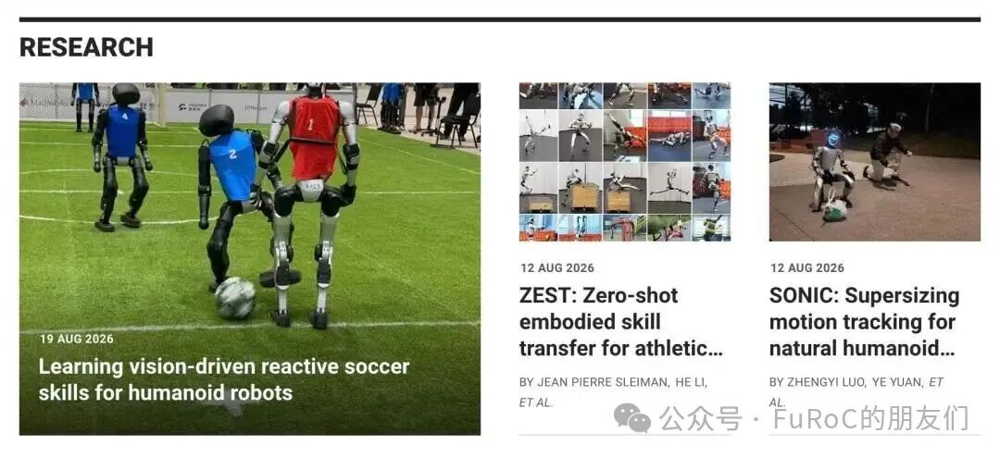
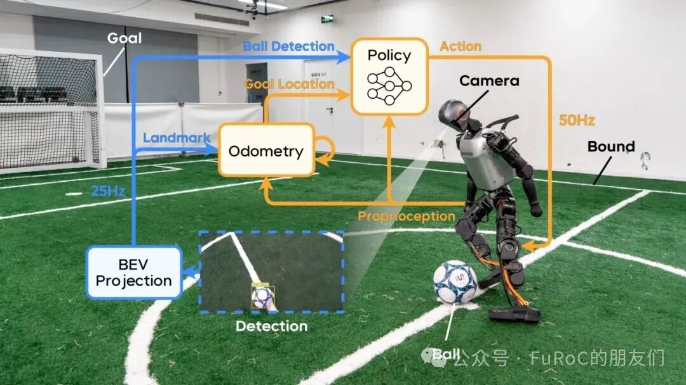
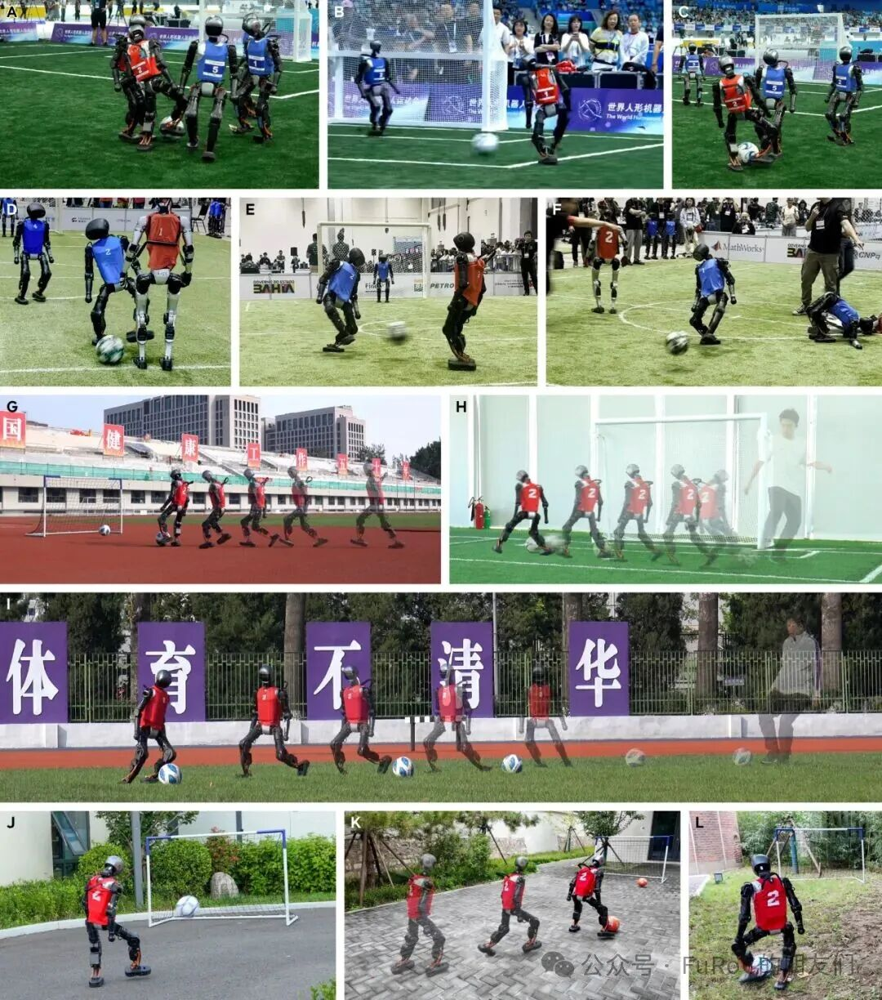
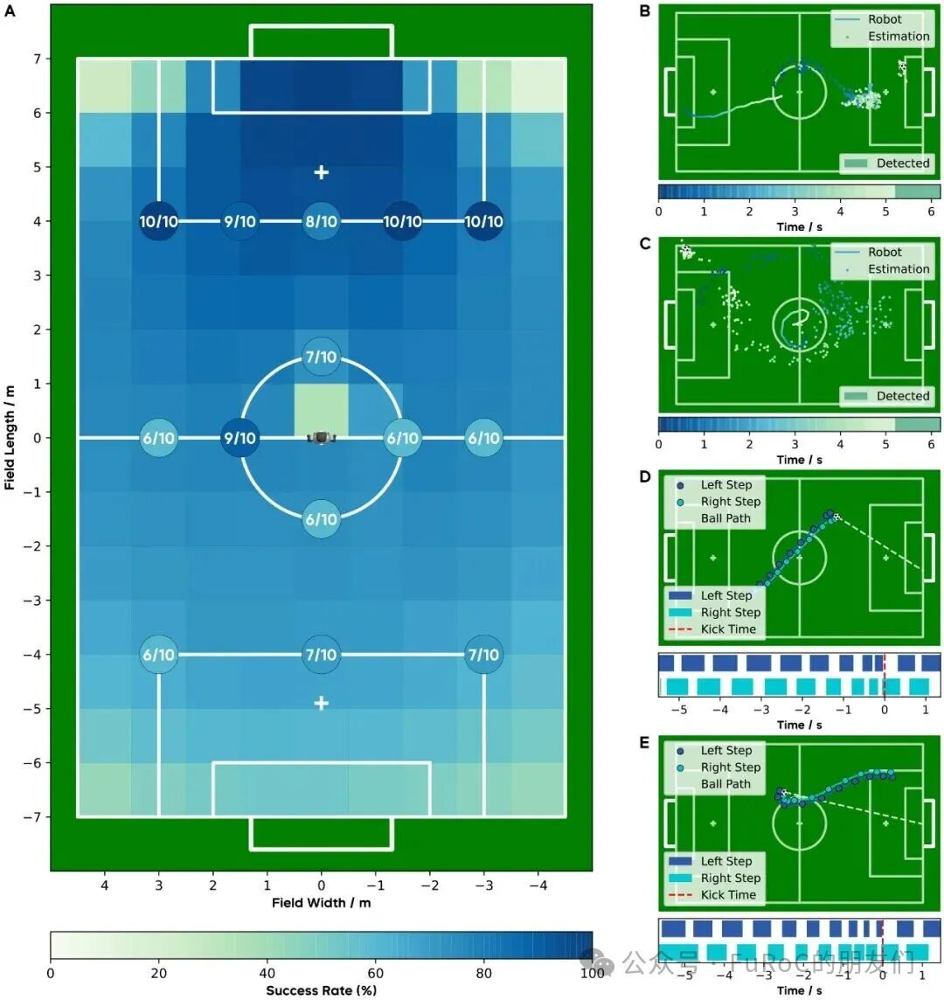

# 自动化系赵明国团队在Science Robotics发文，实现人形机器人视觉驱动反应式踢球

> 公众号: FuRoC的朋友们
> 发布时间: 2026-08-20 19:14:27
> 原文链接: https://mp.weixin.qq.com/s/iw8MY3P_uPNchuhG3iDtnw

---

2026年8月19日，清华大学**自动化系赵明国团队**在**Science Robotics**在线发表题为“**Learning vision-driven reactive soccer skills for humanoid robots**”的研究论文，提出一套将真机视觉不确定性直接纳入强化学习训练回路的学习框架，并在Booster T1人形机器人上实现了反应式踢球能力。

**01**

**论文摘要**

人形机器人足球是具身智能的代表性挑战，要求机器人在动态环境中将敏捷运动控制与不可靠视觉感知紧密耦合。已有系统多依赖模块化流水线，将感知与控制解耦或预设理想传感，致使机器人在受限的真实感知下难以产生连贯、敏捷的行为。

本文提出的机器人运动技能学习框架，将视觉感知与运动控制端到端耦合：在仿真中以对抗运动先验（AMP）引导策略习得类人自然动作；以虚拟感知系统建模本体视觉，让策略在不完美观测下进行训练；并采用编解码器结构对带噪历史观测做时序压缩与特权状态重建，隐式完成球位置的估计，令策略在无动捕设备的条件下实现抗噪的“感知–动作”闭环。

真机仅凭本体视觉即可连贯执行搜球、追球与多方向踢球；与基线方法相比，球位置估计误差降低了46%，触球时间最多缩短了64%，前场射门成功率约达90%。

视觉驱动的机器人控制系统概览

**02**

研究方法和结果

采用该方法，机器人在多种环境、动态场景及RoboCup真实赛事中均展现了鲁棒的踢球技能，具体表现为：

**\*****踢球敏捷性与射门精度全面提升****：**按照RoboCup场地规格，前场射门成功率约达90%，后场保持60%–70%的成功率，真机表现与仿真高度一致且全程零摔倒。与主流规则式策略相比，不同朝向的踢球时间均压缩至约1.5秒，踢球过程机器人最大转动角速度达3–4 rad/s，敏捷性提升约一倍。

**\*****实现感知-动作反应式闭环控制****：**机器人可在视觉驱动下调整头部与躯干朝向，将球稳定维持在相机视野中心，提升动态场景下的追踪鲁棒性。得益于隐式状态估计能力，踢球前1秒内球位置估计均方根误差从0.344米降至0.186米，为精准射门提供核心支撑。

**\* 真实赛事与复杂场景验证实战价值：**该控制器作为核心技术模块，支撑清华大学火神队连续斩获近两年RoboCup人形组比赛冠军与2025世界人形机器人运动会5V5比赛冠军。此外，策略完全在仿真环境中训练，零样本部署即可适配草地、石板、土壤、沥青等多种地形与光照条件。

机器人在真实比赛等多种环境下的表现

射门成功率及找球和步态行为分析

**03**

团队介绍和资助

清华大学自动化系硕士研究生王与时为论文第一作者；清华大学自动化系赵明国研究员为论文通讯作者。研究工作由清华大学自动化系、字节跳动 Seed 团队、中国农业大学工学院、清华大学具身智能与机器人研究院联合完成。该研究得到了科技创新2030重大项目、北京市自然科学基金、清华大学追光计划的资助。研究同时得到了加速进化的机器人平台与实验设施支持，以及北奥集团的测试场地支持。

原文链接：

https://www.science.org/doi/10.1126/scirobotics.aed1152

论文工作表明，将感知不确定性直接纳入策略学习，是人形机器人在真实条件下获得可靠的视觉驱动行为的有效路径。

已关注Follow  Replay    Share     Like   Close**观看更多**更多

退出全屏切换到竖屏全屏退出全屏FuRoC的朋友们已关注Share Video，时长05:10

0/0

00:00/05:10 切换到横屏模式 继续播放进度条，百分之0Play00:00/05:1005:10倍速全屏 倍速播放中0.5倍0.75倍1.0倍1.5倍2.0倍超清流畅 Your browser does not support video tags

继续观看

自动化系赵明国团队在Science Robotics发文，实现人形机器人视觉驱动反应式踢球

观看更多转载,自动化系赵明国团队在Science Robotics发文，实现人形机器人视觉驱动反应式踢球FuRoC的朋友们已关注Share点赞BoostWowAdded to Top StoriesEnter comment Video Details

Science Robotics文章视频-反应式足球技能学习

点击下方“**阅读原文**”

编辑 | 田佳辉

审核 | 周亚

终审 | 裴欣

