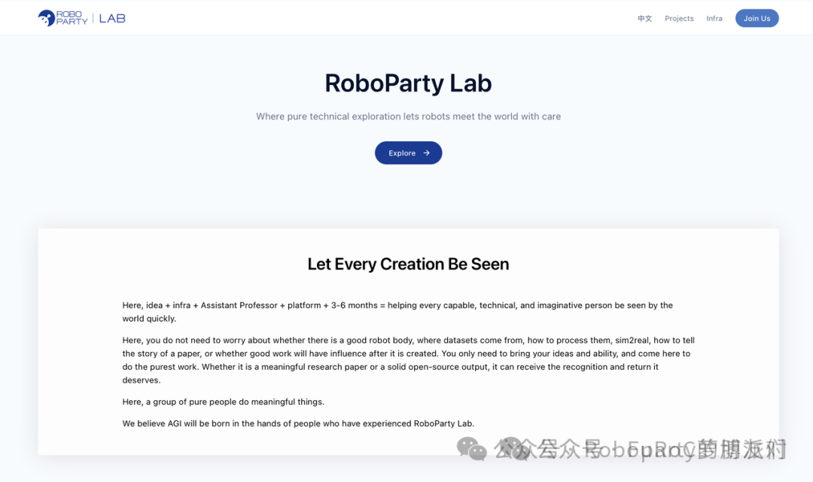
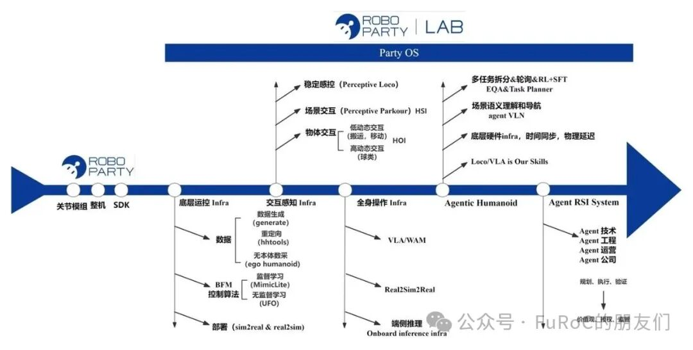

# 萝博派对沈尧杰：聊聊具身产业、开源与创业

> 公众号: FuRoC的朋友们
> 发布时间: 2026-10-26 14:57:41
> 原文链接: https://mp.weixin.qq.com/s/nrK1OUtdR602VCxyw2yyFw

---

FuRoc科技活动中心     2026/10

**这次，**

**我们请来了一位新朋友**

先说明一下：这不是一场正襟危坐的学术报告，更像一次围坐聊天。

我们会聊聊 RoboParty Lab 在做什么、为什么选择开源；也会聊聊具身智能产业眼下走到了哪一步：技术离真正落地还差什么，哪些场景会最先跑通；还有在这个赛道创业是什么体验：从一个想法到一支团队，踩过哪些坑，又有哪些意料之外的收获。

无论你是已经在做具身智能、运动控制、强化学习，还是刚刚对机器人产生兴趣，又或者正在考虑要不要投身这个行业、甚至自己创业，都欢迎来坐坐。

  本次嘉宾

沈尧杰

RoboParty Lab 前沿算法实验室负责人

**什么是RoboParty Lab？**

RoboParty Lab 是 RoboParty 成立的人形机器人开放实验室，聚焦前沿学术与工程突破，愿景是“让每一个有能力、有技术、有想法的人，被这个世界看到”。

在人形机器人研发中，好 idea 往往被底层问题拖住：本体是否可靠、数据从哪里来、训练框架是否稳定、策略如何上真机、结果如何复现。研究者常常要反复从零搭建基础设施。RoboParty Lab 的做法是**把这些最耗时、最分散、最难复现的能力提前沉淀成可复用的研发底座**，也就是 Party OS。它连接本体、数据、训练、动作工具链、Sim2Real、真机验证与开源发布，让开发者把时间花在真正关键的问题上。借助这套底座，一个好想法有望在 3～6 个月内变成可验证、可开源、可发表的成果。

**Party OS Github地址：**

https://github.com/Roboparty/Party\_OS

**RoboParty Lab 官网：**https://lab.roboparty.com

**RoboParty Lab 小红书：**

https://www.xiaohongshu.com/user/profile/68b33e2500000000190187a6?xsec\_token=YBP9nI-sks1Ea1SZ0RfPm7Ykn0o1LelL0-arela8mC-WA=&xsec\_source=app\_share&xhsshare=&shareRedId=OD5EMzZKNj42NzUyOTgwNjc8OTg8PEc\_&apptime=1792949238&share\_id=99c8d1cfed154612a9135e803021aed9&share\_channel=wechat&wechatWid=84838933d35627c05529e767f1cf1db6&wechatOrigin=menu

活动信息

**时间：**10.29（周四）晚19:30开始

**地点：**清华校内，报名后群内通知

**报名方式：**扫码填写下列问卷

**非清北同学请自行预约入校**

**关于FuRoc**

未来机器人兴趣团队由三支赛事队以及两个中心组成：火神队、TH-MOS队与Tinker队，持续参与机器人领域顶级赛事Robocup；科技活动中心与综合管理中心以扩大团队在机器人与具身智能领域的影响力为目标。

团队成员来自清华大学计算机系、电子系、机械系、自动化系、软件学院、经管学院等十余个院系，涵盖本科生、研究生、博士生等多个年级，得到清华大学教务处、校团委科创中心、清华具身智能与机器人研究院、自动化系、机械工程系的支持。

**关于FuRoc科技活动中心**

科技活动中心是 FuRoC 科技活动的核心引擎，聚焦具身智能，连接技术实践、赛事组织与开源协作，持续打造具身智能领域品牌赛事，并定期举办分享会、闭门会、workshop等活动。

**诚邀业内学者与企业交流合作！**

**微信：Boyce2006**

**- END-**

**作者：**闫安、丁嘉仪、王晨鉴

