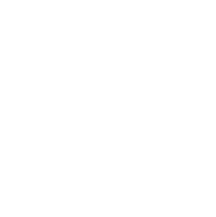
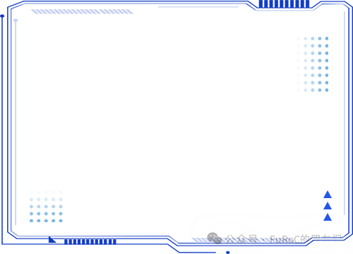
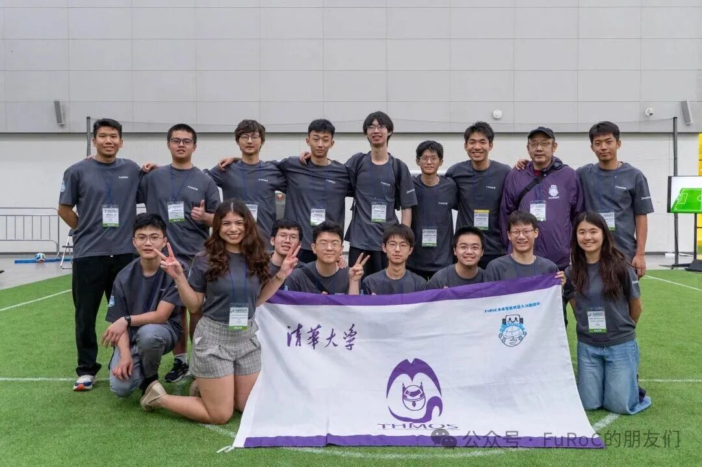
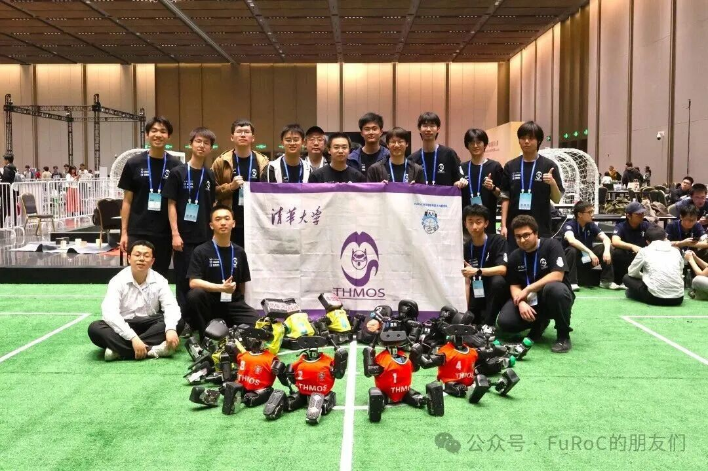
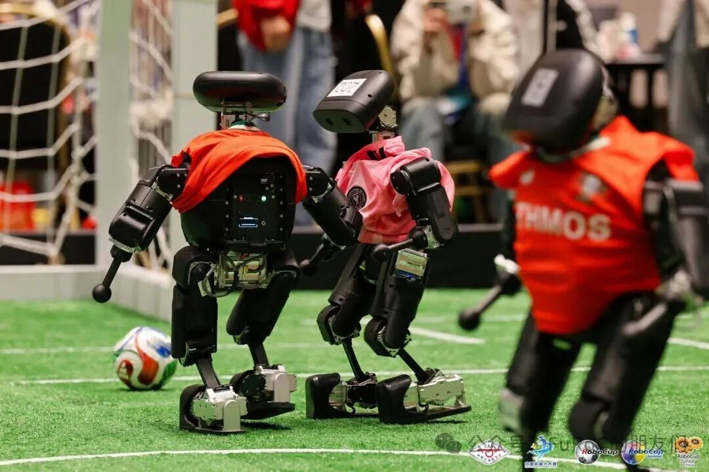

# 赛事队招新｜THMOS 清华机器人足球队 2026 秋季学期招新开始！

> 公众号: FuRoC的朋友们
> 发布时间: 2026-09-22 19:16:10
> 原文链接: https://mp.weixin.qq.com/s/IIHPSIs-u4bVH0ElpgKHcA

---

**THMOS**

**清华机器人足球队**

**招新啦！**

2026 年 7 月，韩国仁川，RoboCup 机器人世界杯。

THMOS 队的机器人 Oscar 在门前侧面连进两球，队友 Jackson 打出流畅配合——那场对阵 RFC-Tsudanuma 的比赛，队伍开赛十秒即攻入首球，**最终以 6:0 拿下胜利，闯入 Middle 组世界八强。**

从仁川的赛场到清华的调试间，从一版版迭代的代码到一次次跌倒重来的步态实验，这支由学生自己掌舵的机器人足球队，正在向 RoboCup 的终极愿景——让完全自主的人形机器人队伍击败人类世界冠军一步步靠近。

现在，THMOS 需要新的队友。

**你，要一起来吗？**

**01 一支由学生自己掌舵的机器人足球队**

**清华 THMOS 机器人足球队**成立于 2004 年，由机械系李曙光副教授、李啟文工程师担任指导教师，是以参加 RoboCup 机器人世界杯类人组（Humanoid League）赛事为牵引的学生科技竞技团队。

队伍以中小型仿人机器人足球为目标，研究覆盖机械设计、电路设计、步态控制、机器视觉、感知定位、智能决策等多个技术模块。

这里没有“学长学姐讲、你负责听”的单向灌输：队伍采用**学生主导、教师参与**的学生自治模式，通过队伍传承与技术积累持续迭代——每一行代码、每一次战术调整，都由队员自己完成。

2026年仁川世界杯THMOS合影

**02 从国内赛到国际赛，我们把奖杯搬****回了清华**

刚刚过去的 2024—2026 赛季，是 THMOS 收获满满的一年：

|  |  |
| --- | --- |
| \_ | 2026 仁川 RoboCup 世界杯：Small 组十二强、Middle 组八强 |
| \_ | 2026 亚太机器人世界杯天津国际邀请赛：亚军 |
| \_ | 2026 RoboCup 中国赛：Small 组季军、Middle 组第 7 名 |

再往前看，队伍的成绩单同样亮眼：

|  |  |
| --- | --- |
| \_ | **2025 巴西 RoboCup 世界杯**：Kid Size 亚军（创下队伍 21 年参赛史最高排名） |
| \_ | **2025 北京国内赛：**冠军 |
| \_ | **2024 福建国内赛**：冠军 |

2026年仁川世界杯THMOS赛后合影

**03 在这里，你要和机器人一起解决真问题**

足球机器人是一个把“软硬贯通”做到极致的平台。过去一年，我们完成了多项核心升级：

- **系统架构重构：**将核心系统从 Python + ROS2 重构为 C++ + IPC 架构，显著降低通信与运行时开销

- **强化学习步态：**用 RL 优化机器人控制策略，提升行走速度、动作响应与执行精度

- **感知与定位：**视觉目标检测、多源里程计融合（视觉、惯性、步态）、球场定位

2026年仁川世界杯THMOS机器人现场照片

**04 技术 × 管理，虚位以待**

**1**

**技术方向**

|  |  |
| --- | --- |
| **方向** | **工作内容** |
| 感知组 | 目标检测、融合里程计（视觉、惯性、步态）、球场定位算法 |
| 步态组 | 基于强化学习的机器人控制策略研发 |
| 本体组 | 机械、外形与电气集成设计 |
| 决策组 | 通信协议设计、路径规划、基于传统方法/RL 的机器人自主决策算法 |

**2**

**管理方向**

|  |  |
| --- | --- |
| **方向** | **工作内容** |
| 管理组 | 赛事对接与裁判协调、后勤物资保障、团队日常管理与文档整理 |
| 宣传组 | 公众号推文撰写与运营、海报与视觉设计、比赛影像记录、招新与活动宣传材料制作 |
| 外联组 | 赞助商对接与维护、校企合作与资源拓展、对外交流联络 |

**面向全校同学开放报名**，技术与管理双线招人。

**不设门槛的只有热情**：这里有系统的技术分享、完整的实战场景和一批愿意互相带教的队友。

**欢迎零基础、对机器人与具身智能感兴趣的你**——无论你想动手写代码、调机器人，还是负责队伍的组织、对接与宣传，THMOS 都有你的位置。

**05 扫码上车，下一个赛季见**

**扫码报名**

**写在最后**

从 2004 到 2026，从清华园到仁川，THMOS 已经走过了 22 年。

22 年里，一届届队员在这里学会看电路、调步态、写决策、打配合，也把队伍一次次推向更高的领奖台。

**下一个赛季的故事，等你来一起写。**

**扫码报名，加入 THMOS！**

文案 ｜ 余志强

排版 ｜ 李春燕

审核 ｜ 刘思彤

