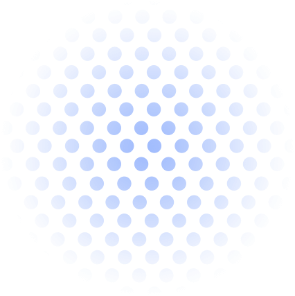
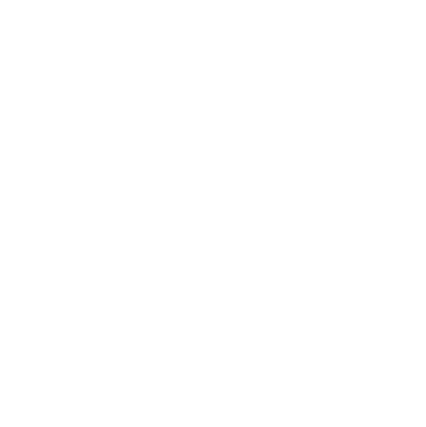
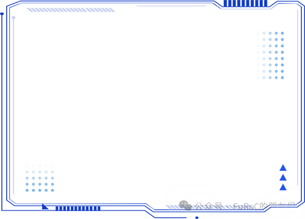

# 赛事队招新｜Tinker-家用服务机器人队 2026 秋季学期招新开始！

> 公众号: FuRoC的朋友们
> 发布时间: 2026-09-22 19:16:10
> 原文链接: https://mp.weixin.qq.com/s/gMuzpYdc1b5H6Tp2pMJxKw

---

**2026 秋季招新 只等你来！**

**Tinker**

**家用服务机器人队**

你是否对机器人充满兴趣？

是否想要接触机器人技术前沿？

是否想参与一项机器人国际赛事？

学技术、拿大奖……

未来机器人兴趣团队，招新啦！！！

**第二周 周三、周四 百团大战**

**H9 摊位，等你来看！**

**关于我们**

Tinker 队是由积极为 FuRoC 做出贡献的骨干成员组成的一支家用服务机器人比赛队，旨在通过参加 RoboCup 国际赛这样的世界范围比赛，在不断迭代中掌握世界顶尖水平的机器人技术，并为未来留下技术积累，为热爱机器人的同学们发挥兴趣特长提供良好的技术平台。

**1**

**人员组织**

未来机器人兴趣团队目前拥有 150 多名成员，其中 Tinker 队目前的骨干大致 15 人，涵盖了自动化、电子、计算机、软件、精密仪器、机械等十余个院系。

Tinker 队伍的组织管理模式是“老带新”：高年级的老队员往往承担着管理与开发骨干的工作，负责每周开展技术交流，分享机器人相关理论知识和技术开发经验，同时负责带领新队员开发学习；低年级的新队员则可以参与队伍的技术交流，并跟随老队员共同参与开发。

**2**

**队伍现状**

Tinker 家用服务机器人为集合机械臂运动规划与抓取、激光雷达 + VSLAM、深度相机识别、语音系统的大型机器人平台，主要面向家庭环境下物品传递、食物制作、垃圾分类等实际应用场景，是由各届队伍成员自主搭建的机器人平台，拥有自主设计的底盘方案；同时经过了多次迭代，已经基本具备完成基本家庭服务任务的各项能力。

我们建立了以兴趣为导向、以开发为基础的团队氛围。通过项目开发、技术分享、定期会议、参加国际比赛以及其他活动，关注国内外机器人相关领域的研究动态和产业发展，不断尝试先进技术。

**3**

**往届战绩**

FuRoC 团队参加 RoboCup 国际、国内比赛有着悠久历史，往届取得了优异成绩：

**·**2025 第二届中关村具身智能机器人应用大赛 · 具身智能商用服务场景应用赛 一等奖

**·**2026机器人世界杯家庭服务赛道组 国际第十一名；2025 机器人世界杯家庭服务赛道组 国际第八名

**·**2026中国机器人大赛暨RoboCup机器人世界杯中国赛国家一等奖、国家二等奖；2025 中国机器人大赛暨 RoboCup 机器人世界杯中国赛 国家三等奖

**·**2025 具身智能机器人运动会 拟人化设计奖

**·**2024 中国机器人大赛暨 RoboCup 机器人世界杯中国赛 国家三等奖

**·**2024 亚太机器人世界杯天津国际邀请赛家庭服务赛道 季军

**我们的队伍**

**1**

**本体组**

**我们在做什么？**

· 机器人本体搭建：围绕 Tinker 平台，近期计划基于现有全向底盘搭建含升降装置、横置双机械臂的新机器人

· 全向底盘设计：按现有需求，计划搭建全新三轮万向底盘，满足机器人的多场景需求

· 结构设计与标定：基于经验与痛点，设计高可靠度结构并完成相机标定任务

**当前技术栈**

· 机械设计：SolidWorks 3D 建模，用于机器人结构设计、支架设计、连接件适配与整机方案迭代

· 平台搭建：基于现有机器人底盘与机械臂平台，进行整机装配、结构调试与模块集成

· 数据系统支持：面向视觉感知任务，搭建数据采集与标注前端平台，支持后续 YOLO 等感知模型训练与评测

**加入本体组，你将收获……**

· 真实机器人硬件经验：从建模、打印、装配到调试，完整参与一台机器人从 0 到 1 的搭建过程

· 前沿平台实践机会：参与从单臂移动操作平台到升降柱双臂平台的持续演进，接触具身智能硬件落地的真实问题

· 跨组协作体验：与视觉、决策、语音等方向深度协作，真正支撑“感知 + 决策 + 执行”的机器人系统实现

**2**

**视觉组**

**我们在做什么？**

· 在开放场景中识别任务目标

· 记录并重识别人体特征

· 识别手势等人体动作

**当前技术栈**

· 开放场景目标识别：SAM3 + Qwen VL

· 人体特征识别：Qwen VL + 微调 ResNet

· 人体动作识别：MediaPipe + YOLO-seg

**加入视觉组，你将收获……**

· 前沿硬件支持：Orbbec、Realsense 等 RGBD 双目相机 + 显卡支持，真实体验具身视觉系统的搭建

· 完整技术闭环：参与开发、维护、调试一套完整的视觉识别 pipeline

· 前沿探索机会：接触并实践最新的视觉模型与算法

**3**

**语音组**

**我们在做什么？**

· 听懂复杂指令：让机器人不仅能听懂“去拿瓶可乐”，还能理解上下文和隐含意图，比如“我刚喝过的那个饮料，再帮我拿一瓶”

· 多轮对话交互：当指令模糊时，主动向用户提问澄清，“桌面有可乐和雪碧，您想要哪一个？”

**当前技术栈**

· 语音识别：OpenAI Whisper（本地部署/API），支持中英文混合识别

· 语义理解：接入大语言模型（智谱 ChatGLM、Moonshot Kimi），解析任务意图

· 语音合成：Coqui TTS，支持多音色、情感化语音生成

· 对话管理：构建基于 LLM 的多轮对话系统，维护对话状态

**加入语音组，你将收获……**

· 前沿硬件支持：Tinker 家务机器人实体、体验麦克风阵列、高性能计算设备，搭建真实的机器人语音交互系统

· 前沿探索机会：实践最新的语音大模型、端侧语音技术、多模态交互方案

· 跨组协作体验：与决策组深度合作，实现“语音 + 决策”的人机交互实现

**4**

**操作组**

**我们在做什么？**

· 机械臂的运动、抓取与规划

· 操作机械臂从场景中拿取物品

· 将目标物品放置在指定位置

**当前技术栈**

· 目标位姿：AnyGrasp 选择一个合适的位姿来抓取目标

· 运动规划：CuMotion 根据目标位姿生成运动轨迹并避免碰撞

· 执行运动：MoveIt 执行运动轨迹并操作夹爪开闭

· 可视化显示：RViz2 实时显示机械臂当前状态

· 数据采集：通过遥控机械臂采集数据

**加入操作组，你将收获……**

· 对机器人运动学基础的了解

· 软硬件结合调试的经验

· 对前沿操作技术（如 VLA）的理解

**5**

**决策组**

**我们在做什么？**

· 拆解任务，规划序列：当收到“Tinker，去卧室把里面的人引导到客厅”的指令时，能将模糊指令转化为机器人可执行的、有序的行动步骤

· 复杂状态下的动态决策：在执行任务（如抓取牛奶）途中，若遇到意外（如桌子被移动、目标被遮挡），能实时调整策略，规划新路径或子任务

· 长链任务的自主执行：探索让机器人具备“常识”，能够自主完成多步骤、长时序的复杂任务，比如“收拾餐桌”这类需要判断、规划和纠错的工作

· 行为与感知的桥梁：理解视觉等感知模块的输出（如“看到可乐”“认出张三”），并基于这些信息决定机器人“下一步该做什么”

**当前技术栈**

· 核心框架：基于行为树的决策方案，使用 pytree 库搭建清晰、模块化的机器人任务逻辑

· 底层通信：ROS2 架构，实现决策模块与感知、控制模块间的高效、稳定通信

· 前沿探索：让机器人具备更强的任务理解与长链任务执行能力，向自决策、自纠错的智能系统迈进

**加入决策组，你将收获……**

· 真实的机器人平台：你的代码将直接运行在实体机器人上，感受决策逻辑驱动身体行动的乐趣

· 核心智能的构建：参与设计与维护机器人的“大脑”，直面并解决开放环境下任务规划、执行与容错的真实挑战

· 前沿技术探索：有机会深入实践大语言模型（如 openclaw）与机器人决策的融合，探索如何让机器人更聪明地理解世界、规划任务

**6**

**导航组**

**我们在做什么？**

· 比赛场景地图重建

· 协同决策和视觉组完成移动场景任务

· 无地图探索与目标跟随

**当前技术栈**

· 传统激光雷达 SLAM（同时定位与建图）与导航：ROS2 Navigation2 + slam toolbox

· 视觉 SLAM 与导航：Rtabmap + ROS2 Navigation2

· 语义地图构建及语义辅助目标探索（基于 Dualmap，目前正在开发中）

**加入导航组，你将收获……**

· 先进软硬件支持：多个底盘可供算法调试，全向 or 差分构型；毫米级激光雷达与厘米级 RGBD 相机；导航组专用下位机以及成熟的仿真环境

· 跨领域的开发体验：导航组不局限于传统的导航算法与 SLAM 算法，与决策和视觉组有较多的协作开发机会，同时基础的导航开发也可以学习到关于底盘驱动和雷达信息处理的硬件知识，适合想要软硬兼修的同学

· 前沿技术学习与实践机会：语义导航的开发基于已有的 VLA 模型，与智能驾驶领域密切相关

**招新信息**

**· 招新时间：第二周 周三、周四**

**· 招新地点：百团大战 H9 摊位**

**学技术、拿大奖，未来机器人兴趣团队期待你的加入！**

**招新问卷：**

文案｜王科锦

排版｜韩赟祯

审核｜刘思彤

